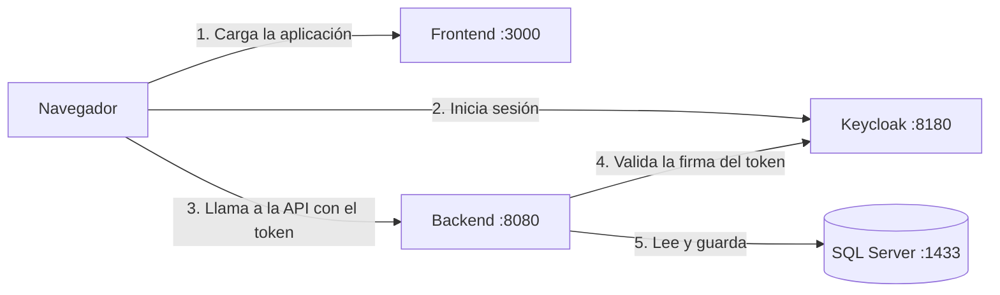

# Arquitectura del sistema

Este documento cuenta cómo está armado el Sistema de Gestión de Tarjetas de Crédito: qué piezas lo forman, cómo se comunican y por qué se tomaron algunas decisiones. Para el detalle de cada regla de negocio está [REGLAS_CREDITO.md](REGLAS_CREDITO.md), y para instalarlo y operarlo, los manuales en PDF de esta misma carpeta.

## Vista general

El sistema tiene cuatro piezas que corren cada una en su propio contenedor:

| Pieza | Tecnología | Qué hace |
|---|---|---|
| Frontend | Vue 3 + Vite, servido por nginx (puerto 3000) | La aplicación web que usa el personal del banco |
| Backend | Spring Boot 3.3 con Java 17 (puerto 8080) | La API REST con todas las reglas de negocio |
| Identidad | Keycloak 25 (puerto 8180) | Inicio de sesión, usuarios, perfiles y permisos |
| Base de datos | SQL Server 2022 (puerto 1433) | Guarda clientes, solicitudes, cuentas, tarjetas y movimientos |

El recorrido de una petición es sencillo. El usuario abre la aplicación y, si no tiene sesión, el frontend lo manda a Keycloak para que inicie sesión. Keycloak le devuelve un token JWT con sus permisos, y el frontend envía ese token en cada llamada a la API. El backend revisa la firma del token, comprueba que el usuario tenga el permiso que pide la operación, aplica las reglas y guarda en la base de datos.

## Cuenta y tarjeta: la idea central

La decisión que más pesa en el diseño es separar la **cuenta de crédito** de la **tarjeta**.

- La **cuenta** es donde vive el crédito: límite, saldo, ciclo de facturación, mora, intereses y movimientos.
- La **tarjeta** es solo el plástico que está anclado a esa cuenta.

Así funciona en un banco real. Si al cliente le roban la tarjeta, se le entrega otra con un número distinto, pero su deuda, su límite y su historial siguen siendo los mismos. Por eso una reposición o una renovación crean una tarjeta nueva en la misma cuenta, y la anterior queda marcada como *Reemplazada*.

El número de la cuenta es el mismo de la primera tarjeta que se emitió (16 dígitos con dígito verificador Luhn). Cada cliente puede tener como máximo una cuenta activa por tipo de tarjeta (Clásica, Oro, Platino o Black).

## Base de datos

La base `GestionTarjetasCredito` se crea con tres scripts T-SQL que se pueden ejecutar varias veces sin duplicar nada:

1. `01_crear_base_datos.sql`: crea la base y un usuario con los permisos justos para la aplicación.
2. `02_crear_esquema.sql`: crea las tablas, llaves, restricciones e índices.
3. `03_datos_semilla.sql`: carga datos de demostración, solo si la base está vacía. Las fechas son relativas al día en que se ejecuta, para que siempre haya casos de mora, pagos pendientes y tarjetas vencidas.

En Docker, un contenedor de un solo uso (`inicializador-base-datos`) espera a que SQL Server esté listo, corre los tres scripts en orden y termina.

### Tablas

| Tabla | Qué guarda |
|---|---|
| `cliente` | Datos personales y el código de cliente de 8 dígitos, que sale de la secuencia `seq_codigo_cliente` |
| `solicitud_tarjeta` | Cada solicitud con su ingreso, empleador, antigüedad laboral y decisión |
| `cuenta_credito` | La cuenta: tipo, límite, saldo, estado y datos de cancelación |
| `tarjeta_credito` | Cada plástico: número, vencimiento, bloqueo y reposición, con un enlace a la tarjeta que reemplazó |
| `consumo` y `pago` | Los movimientos de la cuenta, con su posible reverso |
| `cargo` | Intereses, recargos por mora y comisiones de reposición, con sus ajustes |

El diagrama completo está en [diagrama-entidad-relacion.md](diagrama-entidad-relacion.md).

Algunas reglas viven también en la base de datos, como segunda línea de defensa por si algo se escapa en el backend. Se hacen con índices únicos filtrados:

- Una sola cuenta **activa** por cliente y tipo de tarjeta.
- Una sola tarjeta vigente por cuenta.
- Un solo cargo de interés por cuenta y ciclo, para que el proceso automático nunca cobre dos veces el mismo mes.

### Borrado en cascada

SQL Server no permite dos caminos de cascada que lleguen a la misma tabla. Por eso las solicitudes, cuentas y movimientos se borran en cascada desde su dueño, mientras que las referencias cruzadas (por ejemplo, de un consumo a la tarjeta con que se hizo) quedan en `NO ACTION`. Cuando hace falta borrar algo que tiene esas referencias, el backend lo hace en el orden correcto dentro de una sola transacción.

En la práctica casi nada se borra: las cuentas se cancelan y los movimientos se reversan, para no perder el historial. Solo se puede eliminar un cliente que no tenga cuentas activas.

## Backend

El backend está organizado en las capas habituales de Spring:

| Paquete | Qué contiene |
|---|---|
| `controller` | Recibe las peticiones HTTP y no tiene lógica de negocio |
| `service` | Las reglas de negocio, una clase por tema (clientes, solicitudes, cuentas, tarjetas, movimientos, cargos, intereses) |
| `repository` | Acceso a datos con Spring Data JPA |
| `entity` | Las entidades JPA (con Lombok) y los enums del dominio |
| `dto` | Las peticiones (`*Peticion`) y respuestas (`*Respuesta`) como `record` |
| `mapper` | Convierte entidades en respuestas |
| `exception` | Las excepciones de negocio y el manejador global de errores |
| `config` | Seguridad, reloj, tareas programadas y Swagger |

Algunas decisiones que vale la pena conocer:

- **Hibernate no toca el esquema.** `ddl-auto` está en `validate`: las tablas las crean los scripts T-SQL y Hibernate solo comprueba que coincidan con las entidades.
- **El dinero se maneja con `BigDecimal`**, nunca con `double`.
- **El saldo no se corrompe con operaciones simultáneas.** Cada consumo, pago, reverso o cargo bloquea la fila de la cuenta (`PESSIMISTIC_WRITE`) mientras se calcula el nuevo saldo. Si dos cajeros registran algo al mismo tiempo sobre la misma cuenta, el segundo espera a que termine el primero.
- **La hora es la de Guatemala.** Hay un `Clock` con la zona `America/Guatemala` que usan todos los cálculos de fechas. Eso además permite fijar la fecha en las pruebas.
- **El estado de pago se calcula al consultar.** Si la cuenta está al día, tiene un pago pendiente o está en mora, se calcula a partir de los movimientos y de la fecha, sin guardarlo. Así nunca queda desactualizado.
- **Los intereses se generan solos.** `ProcesoInteresesService` corre al arrancar, todos los días a las 00:05 y antes de cualquier operación sobre una cuenta. Cobra el 5 % sobre lo que quedó sin pagar del corte y, gracias al índice único por ciclo, puede correr las veces que sea sin duplicar cargos.

### Errores

Todas las respuestas de error tienen la misma forma (`ErrorRespuesta`) y el mensaje en español, listo para mostrarse al usuario:

| Código | Cuándo |
|---|---|
| 400 | Datos inválidos o incompletos |
| 401 | No hay sesión o el token no es válido |
| 403 | El usuario no tiene el permiso que pide la operación |
| 404 | El registro no existe |
| 409 | Datos duplicados, como una identificación o un correo ya registrados |
| 422 | Se rompe una regla de negocio; por ejemplo, un consumo que supera el disponible |

### API

Todas las rutas empiezan con `/gestion-tarjetas`. La documentación interactiva está en Swagger UI, en `http://localhost:8080/swagger-ui.html`.

| Recurso | Operaciones |
|---|---|
| `/clientes` | Listar y buscar, ver, crear, editar y eliminar; ver las solicitudes y cuentas de un cliente |
| `/solicitudes` | Listar, ver, registrar, aprobar y rechazar |
| `/cuentas` | Listar, ver el detalle, sus tarjetas y movimientos; registrar consumos, pagos y cargos; exonerar la mora y cancelar |
| `/tarjetas` | Ver, bloquear, desbloquear, reponer y renovar |
| `/consumos`, `/pagos`, `/cargos` | Reversar un movimiento o ajustar un cargo |
| `/catalogos/tipos-tarjeta` | Tipos de tarjeta, motivos y parámetros que usa el frontend |

## Seguridad

La seguridad se apoya en Keycloak. El realm `tarjetas` define 18 **permisos**, uno por operación (`PAGOS_REGISTRAR`, `TARJETAS_BLOQUEAR`, `CUENTAS_CANCELAR`, etc.), y los agrupa en cuatro **perfiles**:

| Perfil | Para quién | Puede |
|---|---|---|
| Administrador | Supervisión (usuarios `admin` y `supervisor`) | Todo, incluido ver los números completos |
| Operador de atención | Atención al cliente | Clientes, registrar solicitudes y consumos, bloquear, reponer y renovar tarjetas |
| Cajero | Caja | Consultar y registrar pagos |
| Analista de crédito | Crédito | Consultar y decidir solicitudes |

Así se separan las funciones: quien registra una solicitud no la aprueba, y quien registra consumos no registra pagos.

En el backend, cada ruta pide un permiso concreto y cualquier ruta que no esté declarada se rechaza por defecto (`denyAll`). Los números completos de cuenta y tarjeta solo se envían a quien tiene el permiso `DATOS_SENSIBLES_VER`; los demás reciben siempre la versión enmascarada (`•••• •••• •••• 1234`). Esa decisión la toma el servidor, no la pantalla.

El frontend es un cliente público que inicia sesión con *Authorization Code + PKCE*, sin guardar secretos en el navegador.

### El emisor del token dentro de Docker

Hay un detalle que suele dar problemas. El navegador pide el token a `localhost:8180`, así que el token dice que lo emitió `http://localhost:8180/realms/tarjetas`. Pero dentro de Docker el backend llega a Keycloak por `keycloak:8080`.

Para que no choquen, el backend no usa el descubrimiento automático de Spring. Descarga las llaves públicas por la red interna (`KEYCLOAK_JWK_SET_URI`) y valida el emisor contra la dirección que ve el navegador (`KEYCLOAK_ISSUER_URI`). Fuera de Docker, las dos apuntan a `localhost:8180`.

## Frontend

El frontend es una aplicación de una sola página escrita con Vue 3 (Composition API con `<script setup>`), sin librerías de componentes: los estilos son propios y siguen el diseño hecho en Figma.

| Carpeta | Qué contiene |
|---|---|
| `vistas` | Las pantallas: resumen, clientes, solicitudes, cuentas y tarjetas |
| `componentes` | Piezas reutilizables: tarjeta visual, modales, tablas, campo de moneda, pestañas, esqueletos de carga |
| `composables` | Lógica compartida: catálogo, paginación, notificaciones, contador de solicitudes pendientes |
| `servicios` | Las llamadas a la API con Axios, una por recurso |
| `autenticacion` | La integración con Keycloak (`keycloak-js`) y la renovación del token |
| `router` | Las rutas, cada una con los permisos que necesita |
| `utilidades` | Formatos de moneda y fechas, constantes, permisos y manejo de errores |

La interfaz solo muestra lo que el usuario puede hacer: los menús y botones dependen de sus permisos, y si entra a una ruta sin permiso ve una página de "sin acceso". Aun así, la protección real está en el backend; la interfaz solo evita que el usuario intente algo que de todas formas sería rechazado.

## Docker Compose

`docker-compose.yml` levanta todo con un solo comando, en este orden:

1. `base-datos` y `keycloak` arrancan a la vez. Keycloak importa el realm con los permisos, perfiles y usuarios de demostración.
2. `inicializador-base-datos` espera a que SQL Server esté sano, corre los scripts y termina.
3. `backend` arranca cuando la base está inicializada y Keycloak está sano.
4. `frontend` arranca cuando el backend está sano.

Cada servicio tiene su *healthcheck*, y el orden se garantiza con `depends_on` por condición. Los datos de SQL Server quedan en el volumen `datos-sql-server`, así que sobreviven a un reinicio. Para empezar desde cero se usa `docker compose down -v`.

Las contraseñas y la configuración salen de `.env`, que se crea copiando `.env.example`. El archivo `.env` real no se sube al repositorio.

## Convenciones del código

- Nombres de dominio en español y descriptivos (`montoAprobado`, `creditoDisponible`, `cargarClientes`), sin abreviaturas.
- Sufijos de capa de Spring en inglés (`Controller`, `Service`, `Repository`), porque es lo que cualquier desarrollador Java espera encontrar.
- Inyección por constructor con campos `final`.
- Entidades con Lombok (`@Getter`, `@Setter` por campo y `@NoArgsConstructor`). No se usa `@Data` porque su `equals`, `hashCode` y `toString` recorrerían las relaciones perezosas.
- El código no lleva comentarios: se busca que los nombres expliquen lo que hace, y la documentación está en esta carpeta.
- SQL con palabras clave en mayúsculas, nombres en `snake_case` y restricciones con nombre propio.
