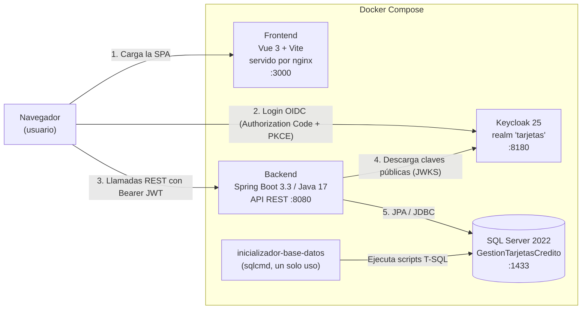
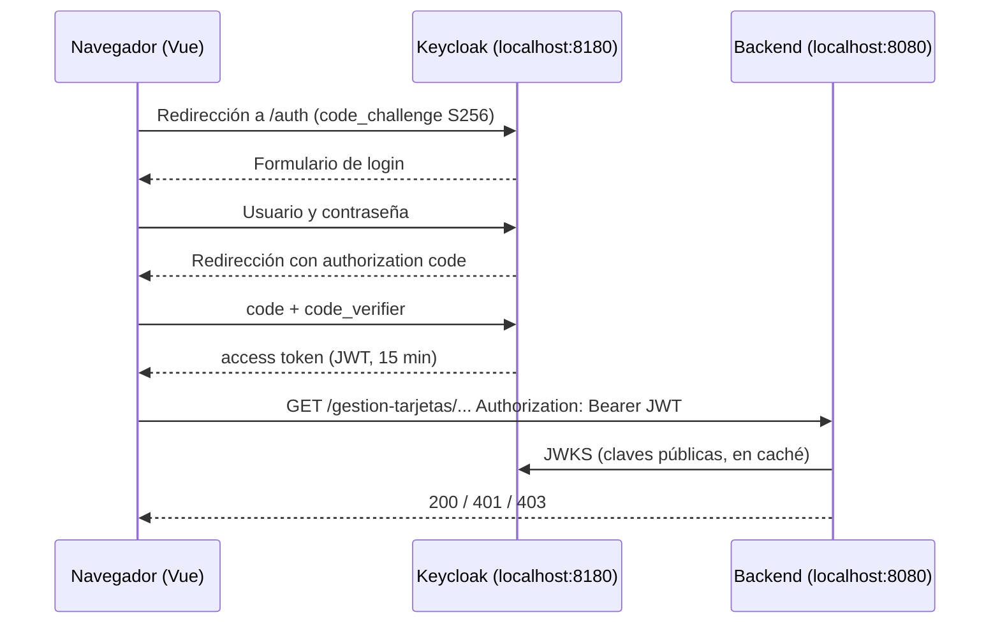
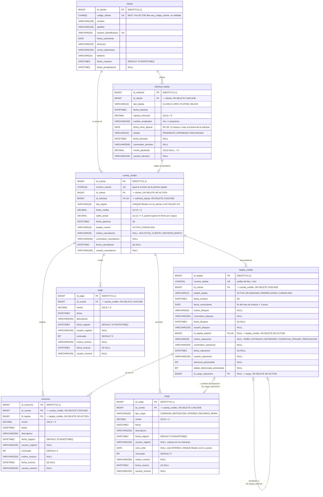

# Manual técnico

Sistema de Gestión de Tarjetas de Crédito (CHN). Este documento es para desarrolladores y evaluadores técnicos: explica cómo está construida la solución, cómo ejecutarla y configurarla, la API, la base de datos, la seguridad, las pruebas y las decisiones de diseño. Las reglas de negocio completas están en [REGLAS_CREDITO.md](REGLAS_CREDITO.md), que prevalece sobre cualquier otro documento; [ARQUITECTURA.md](ARQUITECTURA.md) es el contrato técnico original (su modelo de datos y su API fueron reemplazados por la Parte 2 de REGLAS_CREDITO.md). El uso de la aplicación se explica en el [manual de usuario](MANUAL_USUARIO.md) y el inicio rápido, en el [README](../README.md).

## Contenido

- [1. Visión general](#1-visión-general)
- [2. Arquitectura](#2-arquitectura)
- [3. Estructura del repositorio](#3-estructura-del-repositorio)
- [4. Requisitos previos](#4-requisitos-previos)
- [5. Ejecución con Docker Compose](#5-ejecución-con-docker-compose)
- [6. Ejecución local sin Docker](#6-ejecución-local-sin-docker)
- [7. Configuración y variables de entorno](#7-configuración-y-variables-de-entorno)
- [8. Keycloak](#8-keycloak)
- [9. Autenticación, permisos y datos sensibles](#9-autenticación-permisos-y-datos-sensibles)
- [10. API REST](#10-api-rest)
- [11. Backend: arquitectura en capas](#11-backend-arquitectura-en-capas)
- [12. Base de datos y modelo de datos](#12-base-de-datos-y-modelo-de-datos)
- [13. Reglas de negocio (resumen)](#13-reglas-de-negocio-resumen)
- [14. Reglas de crédito: implementación](#14-reglas-de-crédito-implementación)
- [15. Ciclo de facturación, pago mínimo, mora e intereses](#15-ciclo-de-facturación-pago-mínimo-mora-e-intereses)
- [16. Bloqueo de tarjetas](#16-bloqueo-de-tarjetas)
- [17. Reposición, renovación y cancelación](#17-reposición-renovación-y-cancelación)
- [18. Reverso de movimientos y ajustes de cargos](#18-reverso-de-movimientos-y-ajustes-de-cargos)
- [19. Catálogo de tipos de tarjeta](#19-catálogo-de-tipos-de-tarjeta)
- [20. Consultas en lote (evitar N+1)](#20-consultas-en-lote-evitar-n1)
- [21. Frontend](#21-frontend)
- [22. Datos de demostración y recorrido sugerido](#22-datos-de-demostración-y-recorrido-sugerido)
- [23. Pruebas](#23-pruebas)
- [24. Decisiones y supuestos](#24-decisiones-y-supuestos)
- [25. Notas de seguridad](#25-notas-de-seguridad)
- [26. Solución de problemas](#26-solución-de-problemas)
- [27. Documentación relacionada](#27-documentación-relacionada)

---

## 1. Visión general

Aplicación web para administrar el ciclo de vida de las tarjetas de crédito de un banco: registro de clientes, solicitudes de tarjeta con reglas de crédito (ingreso mínimo, estabilidad laboral, mora, una cuenta activa por tipo) y flujo de aprobación o rechazo, apertura automática de la **cuenta de crédito** con su primera tarjeta, consumos y pagos con control de saldo, ciclo de facturación con **pago mínimo del 10 %**, mora calculada contra ese mínimo e **interés automático del 5 % mensual**, cargos (comisión por reposición, intereses y recargos por mora) y sus ajustes (devolución de intereses, exoneración de mora y reversión de comisión), bloqueo, **reposición** (con requisitos y costo) y **renovación** de tarjetas, **cancelación** de cuentas y **reverso** administrativo de movimientos.

**Cuenta y tarjeta son cosas distintas.** El crédito (límite, saldo, ciclo de facturación, mora y movimientos) vive en la **cuenta de crédito**; la **tarjeta** es solo el plástico anclado a esa cuenta. Al aprobar una solicitud se abre una cuenta y se emite su primera tarjeta, y el **número de cuenta es el número de esa primera tarjeta** (16 dígitos). Si el plástico se roba, se extravía, se daña o vence, se **repone** o se **renueva**: la cuenta conserva su número, límite, saldo y movimientos, y se emite una tarjeta nueva con otro número; la anterior queda `REEMPLAZADA`. Una cuenta se puede **cancelar** (al día y con saldo Q 0.00): no se borra nada y el cliente sigue activo, "sin producto activo", con su historial. Cada cliente tiene como máximo una cuenta **activa** por tipo (Clásica, Oro, Platino, Black) y se identifica con un **código de cliente** de 8 dígitos (desde `10000001`) que asigna una secuencia de SQL Server.

**Acceso por permisos.** Cada operación de la API exige un **permiso** granular (18 en total, p. ej. `PAGOS_REGISTRAR`, `CUENTAS_CANCELAR` o `CARGOS_AJUSTAR`). Los permisos se agrupan en cuatro **perfiles** de Keycloak (ADMINISTRADOR, OPERADOR, CAJERO y ANALISTA_CREDITO), y la interfaz muestra a cada usuario solo lo que puede hacer. Cuenta y tarjeta se muestran enmascaradas (`**** **** **** 1234`); el número completo solo llega a quien tiene el permiso `DATOS_SENSIBLES_VER`, y eso lo decide el servidor.

| Componente | Tecnología | Responsabilidad |
|---|---|---|
| Frontend | Vue 3 + Vite, keycloak-js, axios; servido por nginx | Interfaz de usuario, login OIDC, llamadas a la API |
| Backend | Spring Boot 3.3.5, Java 17 | API REST, reglas de negocio, autorización por permiso |
| Identidad | Keycloak 25.0.6 (realm `tarjetas`) | Autenticación, emisión de JWT, 18 permisos y 4 perfiles compuestos |
| Base de datos | SQL Server 2022 | Persistencia e integridad referencial y de dominio |

Todos los servicios se orquestan con Docker Compose (`base-datos`, `inicializador-base-datos`, `keycloak`, `backend`, `frontend`), con *healthchecks* y `depends_on` por condición para garantizar el orden de arranque.

### 1.1 Tecnologías y versiones

| Capa | Tecnología | Versión |
|---|---|---|
| Base de datos | Microsoft SQL Server (Developer) | 2022 (`mcr.microsoft.com/mssql/server:2022-latest`) |
| Base de datos | Transact-SQL + `sqlcmd` (mssql-tools18) | — |
| Backend | Java (Eclipse Temurin) | 17 |
| Backend | Spring Boot (Web, Data JPA, Validation, OAuth2 Resource Server, Actuator) | 3.3.5 |
| Backend | Hibernate ORM / Spring Data JPA | gestionado por Spring Boot 3.3.5 |
| Backend | Microsoft JDBC Driver (`mssql-jdbc`) | gestionado por Spring Boot 3.3.5 |
| Backend | springdoc-openapi (Swagger UI) | 2.6.0 |
| Backend | Lombok (entidades) | gestionado por Spring Boot 3.3.5 |
| Backend | JUnit 5, Mockito, Spring Security Test | gestionados por Spring Boot 3.3.5 |
| Backend | Maven (con Maven Wrapper) | 3.9.9 (imagen de compilación) |
| Identidad | Keycloak | 25.0.6 |
| Frontend | Vue | ^3.4 |
| Frontend | Vue Router | ^4.4 |
| Frontend | Vite (+ `@vitejs/plugin-vue` ^5.1) | ^5.4 |
| Frontend | keycloak-js | 25.0.6 |
| Frontend | Axios | ^1.7 |
| Frontend | Node.js (compilación) / nginx (servidor) | 20 (alpine) / 1.27 (alpine) |
| Contenedores | Docker + Docker Compose | Compose v2 |

---

## 2. Arquitectura



- El **frontend** es una SPA estática: el navegador habla directamente con Keycloak (login) y con el backend (API).
- El **backend** es un *Resource Server* sin estado: valida la firma y el emisor del JWT, toma los permisos efectivos de `realm_access.roles` (Keycloak ya expande los perfiles compuestos), autoriza cada endpoint por permiso y aplica las reglas de negocio.
- La **base de datos** la crea un contenedor de un solo uso que ejecuta los scripts T-SQL en orden; la aplicación se conecta con un usuario de privilegio mínimo (`usuario_tarjetas`).

Arquitectura del backend en capas: `controller → service → repository → entity`, con DTO (`*Peticion` / `*Respuesta`), mappers manuales y un manejador global de excepciones. Ver la [sección 11](#11-backend-arquitectura-en-capas).

---

## 3. Estructura del repositorio

```
sistema-tarjetas-credito/
├── README.md
├── docker-compose.yml            # Stack completo: BD, inicializador, Keycloak, backend, frontend
├── .env.example                  # Variables de entorno (copiar a .env)
├── database/
│   ├── 01_crear_base_datos.sql   # BD + login/usuario de la aplicación
│   ├── 02_crear_esquema.sql      # Tablas, PK, FK, UNIQUE, CHECK, DEFAULT e índices
│   ├── 03_datos_semilla.sql      # Datos de demostración
│   └── inicializar-base-datos.sh # Ejecuta los 3 scripts en orden (contenedor inicializador)
├── keycloak/
│   └── realm-tarjetas.json       # Realm, 18 permisos + 4 perfiles compuestos, cliente frontend-tarjetas y 5 usuarios demo
├── backend/                      # API REST Spring Boot
│   ├── pom.xml, mvnw, Dockerfile
│   └── src/
│       ├── main/java/gt/com/chn/tarjetas/
│       │   ├── config/           # Seguridad por permiso (Permisos, ConfiguracionSeguridad, ConvertidorRolesKeycloak, UsuarioActual), OpenAPI, errores 401/403, reloj (Clock), tareas programadas (ConfiguracionTareas)
│       │   ├── controller/       # Cliente, Solicitud, Cuenta, Tarjeta, Reverso y CatalogoController
│       │   ├── dto/              # Records de petición y respuesta
│       │   ├── entity/           # Entidades JPA (Cliente, SolicitudTarjeta, CuentaCredito, TarjetaCredito, Consumo, Pago, Cargo), enums, CicloFacturacion y Tarifas
│       │   ├── exception/        # Excepciones de dominio y manejador global
│       │   ├── mapper/           # Conversión entidad <-> DTO
│       │   ├── repository/       # Repositorios Spring Data JPA
│       │   └── service/          # Reglas de negocio: cuentas (cancelación), tarjetas (bloqueo/reposición/renovación), movimientos y reversos, cargos y ajustes, estado de pago, proceso de intereses
│       ├── main/resources/application.yml
│       └── test/java/...         # Pruebas unitarias y de seguridad
├── frontend/                     # SPA Vue 3
│   ├── package.json, vite.config.js, Dockerfile, nginx.conf
│   └── src/
│       ├── autenticacion/        # Integración con keycloak-js
│       ├── componentes/          # Barra lateral, tarjeta visual (ChipTarjeta), NumeroProtegido, MenuAcciones, modales (movimiento, bloqueo, reposición, reverso, cargo, exoneración, cancelación), insignias
│       ├── composables/          # Catálogo, notificaciones, paginación, contador de pendientes
│       ├── vistas/               # Pantallas (resumen, clientes, solicitudes, cuentas y tarjetas, sin acceso)
│       ├── servicios/            # Cliente HTTP (axios) y servicios por recurso (cuentas, tarjetas, movimientos...)
│       ├── router/               # Rutas con meta.permisos y guard que redirige a /sin-acceso
│       ├── utilidades/           # permisos.js (constantes de permisos y perfiles), formatos, errores...
│       └── estilos/
└── docs/
    ├── ARQUITECTURA.md           # Contrato técnico del proyecto
    ├── REGLAS_CREDITO.md         # Reglas de crédito, ciclo, pago mínimo, intereses, mora, bloqueo, cuentas, reposiciones, renovación, cancelación, cargos, reversos, código de cliente, permisos y datos sensibles
    ├── MANUAL_TECNICO.md         # Este documento
    ├── MANUAL_USUARIO.md         # Manual para el personal del banco
    ├── imagenes/manual-usuario/  # Capturas del manual de usuario
    ├── diagrama-entidad-relacion.md
    ├── REQUISITOS.md             # Matriz de trazabilidad de requisitos
    ├── PLAN_DE_TRABAJO.md
    └── CHECKLIST_ENTREGA.md
```

---

## 4. Requisitos previos

**Para ejecutar con Docker (recomendado):**
- Docker Desktop 4.x (o Docker Engine + plugin Compose v2).
- Al menos 4 GB de RAM asignados a Docker (SQL Server requiere 2 GB).
- Puertos libres: `3000`, `8080`, `8180` y `1433`.

**Para ejecución local (modo desarrollo), además:**
- JDK 17.
- Node.js 20 y npm.
- (Opcional) `sqlcmd` si se desea ejecutar los scripts manualmente.

---

## 5. Ejecución con Docker Compose

```bash
git clone <url-del-repositorio>
cd sistema-tarjetas-credito

# 1. Variables de entorno (valores de demostración)
cp .env.example .env

# 2. Construir y levantar todo el stack
docker compose up -d --build

# 3. Ver el estado (esperar a que backend y frontend estén healthy / running)
docker compose ps
```

Orden de arranque (controlado por `depends_on` y *healthchecks*):

1. `base-datos` (SQL Server) arranca y queda *healthy*.
2. `inicializador-base-datos` crea la BD, el usuario de la aplicación, el esquema y los datos semilla, y termina con código 0.
3. `keycloak` importa el realm `tarjetas` y queda *healthy*.
4. `backend` arranca cuando la BD está inicializada y Keycloak está listo.
5. `frontend` arranca cuando el backend está *healthy*.

**Tiempo del primer arranque:** entre 3 y 6 minutos, según la conexión y la máquina (descarga de imágenes, compilación con Maven y npm). Los arranques siguientes tardan alrededor de 1 minuto.

| Servicio | URL / puerto |
|---|---|
| Aplicación web | http://localhost:3000 |
| API REST | http://localhost:8080/gestion-tarjetas |
| Swagger UI | http://localhost:8080/swagger-ui.html |
| OpenAPI (JSON) | http://localhost:8080/v3/api-docs |
| Health del backend | http://localhost:8080/actuator/health |
| Keycloak (consola) | http://localhost:8180 |
| SQL Server | `localhost,1433` |

Comandos útiles:

```bash
docker compose logs -f backend                    # logs del backend
docker compose logs inicializador-base-datos      # resultado de los scripts SQL
docker compose down                               # detener (conserva los datos)
docker compose down -v                            # detener y borrar el volumen de la BD
```

Los scripts son idempotentes: volver a levantar el stack sin `-v` no duplica los datos semilla. **Los permisos, perfiles y usuarios de Keycloak solo se importan en un realm nuevo:** `--import-realm` no sobrescribe un realm existente. Keycloak corre en `start-dev` sin volumen, así que `docker compose down` (con o sin `-v`) descarta su contenedor y el siguiente `up` importa el realm actualizado; un `up` sobre el contenedor anterior seguiría con los usuarios y permisos viejos (sin los 4 permisos de la Parte 4).

> **¿Ya tenía levantada una versión anterior? Ejecute `docker compose down -v` antes de volver a levantar.** El modelo de cuentas y tarjetas (nueva tabla `cuenta_credito`, `tarjeta_credito` rehecha como plástico, consumos y pagos por cuenta, columnas de reverso, empleador y fecha de inicio laboral en la solicitud), el código de cliente (columna `codigo_cliente` y secuencia `seq_codigo_cliente`) y las Partes 4 y 5 (tabla `cargo` con `ciclo_corte`, estado y datos de cancelación en la cuenta, requisitos de reposición en la tarjeta, CHECK de saldo sin tope superior) son un **cambio de esquema incompatible** con los volúmenes anteriores: los scripts son idempotentes para una base de datos **nueva**, pero no migran el esquema viejo, y el backend (`ddl-auto: validate`) no arrancaría contra él. Con `docker compose down -v` se borra el volumen y el siguiente `docker compose up -d --build` crea el esquema y la semilla nuevos. Quien clone el repositorio desde cero no necesita hacer nada.

> **Apple Silicon (M1/M2/M3/M4):** SQL Server no publica imagen ARM, por eso `docker-compose.yml` usa `platform: linux/amd64` para `base-datos` y el inicializador. En Docker Desktop active *Settings → General → "Use Rosetta for x86_64/amd64 emulation on Apple Silicon"*. El primer arranque de SQL Server puede tardar un poco más por la emulación.

---

## 6. Ejecución local sin Docker

En este modo el backend y el frontend corren en la máquina local; SQL Server y Keycloak se levantan con Docker solo como infraestructura.

### 6.1 Infraestructura (SQL Server + scripts + Keycloak)

```bash
cp .env.example .env
docker compose up -d base-datos inicializador-base-datos keycloak
```

El contenedor `inicializador-base-datos` ejecuta automáticamente los scripts. Si prefiere ejecutarlos a mano (por ejemplo, contra un SQL Server propio), hágalo **en este orden** con `sqlcmd`:

```bash
cd database
sqlcmd -S localhost,1433 -U sa -P 'Tarjetas_Chn2026' -C -b -I \
       -i 01_crear_base_datos.sql -v CLAVE_USUARIO_APLICACION='Aplicacion_Tarjetas2026'
sqlcmd -S localhost,1433 -U sa -P 'Tarjetas_Chn2026' -C -b -I -d GestionTarjetasCredito -i 02_crear_esquema.sql
sqlcmd -S localhost,1433 -U sa -P 'Tarjetas_Chn2026' -C -b -I -d GestionTarjetasCredito -i 03_datos_semilla.sql
```

- `-v CLAVE_USUARIO_APLICACION` es obligatorio en el script 01 (contraseña del login `usuario_tarjetas`).
- `-I` activa `QUOTED_IDENTIFIER`, necesario para los índices y CHECK.

### 6.2 Backend

```bash
cd backend
./mvnw spring-boot:run          # en Windows: mvnw.cmd spring-boot:run
```

Los valores por defecto de `application.yml` ya apuntan a la infraestructura local, así que no hace falta definir variables. Si su entorno es distinto, puede sobrescribirlas:

| Variable | Valor por defecto |
|---|---|
| `URL_BASE_DATOS` | `jdbc:sqlserver://localhost:1433;databaseName=GestionTarjetasCredito;encrypt=true;trustServerCertificate=true;sendStringParametersAsUnicode=false` |
| `USUARIO_BASE_DATOS` | `usuario_tarjetas` |
| `CLAVE_BASE_DATOS` | `Aplicacion_Tarjetas2026` |
| `KEYCLOAK_ISSUER_URI` | `http://localhost:8180/realms/tarjetas` |
| `KEYCLOAK_JWK_SET_URI` | `http://localhost:8180/realms/tarjetas/protocol/openid-connect/certs` |
| `CORS_ORIGENES_PERMITIDOS` | `http://localhost:5173,http://localhost:3000` |

Ejemplo: `CLAVE_BASE_DATOS=OtraClave ./mvnw spring-boot:run`.

La API queda en http://localhost:8080/gestion-tarjetas y Swagger en http://localhost:8080/swagger-ui.html.

### 6.3 Frontend

```bash
cd frontend
npm install && npm run dev
```

La aplicación queda en **http://localhost:5173**. Las variables `VITE_*` (URL de la API y de Keycloak) están en `frontend/.env.development`; `frontend/.env.example` sirve de referencia.

---

## 7. Configuración y variables de entorno

### 7.1 Archivo `.env` (raíz del repositorio)

`docker compose` lee `.env` (copia de `.env.example`). Son valores de demostración; `.env` está excluido de Git.

| Variable | Valor de ejemplo | Uso |
|---|---|---|
| `MSSQL_SA_PASSWORD` | `Tarjetas_Chn2026` | Contraseña de `sa` en SQL Server (contenedor `base-datos` e inicializador) |
| `CLAVE_USUARIO_APLICACION` | `Aplicacion_Tarjetas2026` | Contraseña del login `usuario_tarjetas`; el inicializador la usa al crear el login y el backend al conectarse (`CLAVE_BASE_DATOS`) |
| `KEYCLOAK_ADMIN` | `admin` | Usuario de la consola de administración de Keycloak (realm `master`) |
| `KEYCLOAK_ADMIN_PASSWORD` | `admin` | Contraseña de la consola de Keycloak |

### 7.2 Backend (`backend/src/main/resources/application.yml`)

Cada valor se puede sobrescribir con una variable de entorno. En Docker Compose se definen en el servicio `backend`; en ejecución local se usan los valores por defecto.

| Variable | Valor por defecto (local) | Valor en Docker Compose |
|---|---|---|
| `URL_BASE_DATOS` | `jdbc:sqlserver://localhost:1433;databaseName=GestionTarjetasCredito;encrypt=true;trustServerCertificate=true;sendStringParametersAsUnicode=false` | Igual, con el host `base-datos` |
| `USUARIO_BASE_DATOS` | `usuario_tarjetas` | `usuario_tarjetas` |
| `CLAVE_BASE_DATOS` | `Aplicacion_Tarjetas2026` | `${CLAVE_USUARIO_APLICACION}` |
| `KEYCLOAK_ISSUER_URI` | `http://localhost:8180/realms/tarjetas` | `http://localhost:8180/realms/tarjetas` |
| `KEYCLOAK_JWK_SET_URI` | `http://localhost:8180/realms/tarjetas/protocol/openid-connect/certs` | `http://keycloak:8080/realms/tarjetas/protocol/openid-connect/certs` |
| `CORS_ORIGENES_PERMITIDOS` | `http://localhost:5173,http://localhost:3000` | `http://localhost:3000,http://localhost:5173` |
| `TZ` | (zona del sistema) | `America/Guatemala` |

El issuer y el JWKS se configuran por separado a propósito (ver [sección 9.3](#93-issuer-público-frente-a-jwks-interno)).

### 7.3 Frontend (variables `VITE_*`)

Se inyectan en tiempo de compilación. En ejecución local se leen de `frontend/.env.development` (`frontend/.env.example` sirve de referencia); en Docker se pasan como `build args` del servicio `frontend`.

| Variable | Valor |
|---|---|
| `VITE_URL_API` | `http://localhost:8080/gestion-tarjetas` |
| `VITE_KEYCLOAK_URL` | `http://localhost:8180` |
| `VITE_KEYCLOAK_REALM` | `tarjetas` |
| `VITE_KEYCLOAK_CLIENTE_ID` | `frontend-tarjetas` |

Si cambia una variable `VITE_*` en Docker, hay que reconstruir la imagen: `docker compose up -d --build frontend`.

---

## 8. Keycloak

### 8.1 Realm y cliente

Keycloak 25.0.6 corre en modo `start-dev --import-realm` e importa `keycloak/realm-tarjetas.json` al crear el contenedor.

| Elemento | Configuración |
|---|---|
| Realm | `tarjetas` (`sslRequired: none`, access token de 15 minutos) |
| Cliente | `frontend-tarjetas`: público (sin secreto), *Standard flow* con PKCE `S256`, *redirect URIs* `http://localhost:3000/*` y `http://localhost:5173/*`, *web origins* `http://localhost:3000` y `http://localhost:5173`; *Direct access grants* habilitado solo para pruebas con curl y Swagger |
| Roles de realm | 18 permisos (`CLIENTES_CONSULTAR` … `DATOS_SENSIBLES_VER`) y 4 perfiles compuestos (`ADMINISTRADOR`, `OPERADOR`, `CAJERO`, `ANALISTA_CREDITO`); ver [sección 9.4](#94-permisos-perfiles-compuestos-y-roles-efectivos-en-el-token) |
| Usuarios | 5 usuarios de demostración, cada uno con **solo su perfil** asignado |

### 8.2 Usuarios de demostración

Solo **dos** usuarios tienen todos los permisos (`admin` y `supervisor`). Los otros tres muestran cómo cambia la aplicación según el perfil.

| Usuario | Contraseña | Perfil | Nombre | Qué puede hacer |
|---|---|---|---|---|
| `admin` | `admin123` | ADMINISTRADOR | Administrador Sistema | **Todo:** clientes (incluido eliminar), registrar y decidir solicitudes, consumos y pagos, bloquear, desbloquear, reponer y renovar tarjetas, cancelar cuentas, registrar recargos por mora, ajustar cargos (devolver intereses, exonerar mora, reversar comisiones), reversar movimientos y ver números completos. |
| `supervisor` | `supervisor123` | ADMINISTRADOR | Supervisora de Crédito | Igual que `admin` (segundo usuario con todos los permisos). |
| `operador` | `operador123` | OPERADOR | Operador Atención | Atención al cliente: consultar y gestionar clientes (sin eliminar), registrar solicitudes (sin decidirlas), consultar cuentas, registrar **consumos** (no pagos), **bloquear**, **reponer** y **renovar** tarjetas. No desbloquea, no reversa, no cancela cuentas, no registra ni ajusta cargos y ve los números solo enmascarados. |
| `cajero` | `cajero123` | CAJERO | Cajero Agencia | Consultar clientes y cuentas y registrar **pagos** (con las opciones de monto en mora, pago mínimo y contado). No ve el menú Solicitudes ni registra consumos, bloqueos, reposiciones, renovaciones, cargos ni cancelaciones. |
| `analista` | `analista123` | ANALISTA_CREDITO | Analista de Crédito | Consultar clientes, solicitudes y cuentas y **aprobar o rechazar** solicitudes. No crea ni edita clientes, no registra solicitudes ni movimientos y no opera tarjetas. |

### 8.3 Otras credenciales

| Servicio | Usuario | Contraseña | Uso |
|---|---|---|---|
| Consola de Keycloak (http://localhost:8180/admin, realm `master`) | `admin` | `admin` | Administración de Keycloak (`KEYCLOAK_ADMIN` / `KEYCLOAK_ADMIN_PASSWORD` en `.env`). En el realm `tarjetas` → *Realm roles* se ven los 18 permisos y los 4 perfiles compuestos. |
| SQL Server (`localhost,1433`) | `sa` | `Tarjetas_Chn2026` | Administración (`MSSQL_SA_PASSWORD`) |
| SQL Server, usuario de la aplicación | `usuario_tarjetas` | `Aplicacion_Tarjetas2026` | Lectura/escritura de datos y `UPDATE` sobre la secuencia del código de cliente (`CLAVE_USUARIO_APLICACION`) |

### 8.4 Crear usuarios y asignar perfiles

1. Abra http://localhost:8180/admin e ingrese con `admin` / `admin` (realm `master`).
2. Cambie al realm **tarjetas** con el selector de la esquina superior izquierda.
3. *Users* → **Create new user**: escriba el *Username* (y opcionalmente nombre, apellido y correo; la barra superior de la aplicación muestra nombre y apellido) y pulse **Create**.
4. Pestaña **Credentials** → **Set password**: escriba la contraseña y desactive *Temporary* si no quiere obligar al usuario a cambiarla en el primer ingreso.
5. Pestaña **Role mapping** → **Assign role** → filtre por *realm roles* y asigne **un perfil** (`ADMINISTRADOR`, `OPERADOR`, `CAJERO` o `ANALISTA_CREDITO`). No hace falta asignar los permisos uno por uno: el perfil es un rol compuesto y Keycloak los entrega expandidos en el token.
6. El usuario ya puede ingresar en http://localhost:3000. Si tenía una sesión abierta, debe cerrar sesión y volver a ingresar para recibir un token con los permisos nuevos.

Para cambiar lo que puede hacer un perfil: *Realm roles* → el perfil → pestaña **Associated roles** → agregar o quitar permisos. No requiere cambios de código.

> **Los cambios hechos en la consola se pierden al recrear el contenedor.** Keycloak corre en modo desarrollo sin volumen: `docker compose down` (con o sin `-v`) descarta su base de datos interna y el siguiente `up` vuelve a importar `keycloak/realm-tarjetas.json`. Para que un usuario o un cambio de perfil sea permanente, agréguelo también a ese archivo (sección `users`, con `credentials` y `realmRoles`, siguiendo el formato de los usuarios existentes) o exporte el realm desde la consola (*Realm settings* → *Action* → *Partial export*) y actualice el archivo.

---

## 9. Autenticación, permisos y datos sensibles



### 9.1 Frontend: Authorization Code + PKCE
- `src/autenticacion/servicioAutenticacion.js` inicializa `keycloak-js` con `onLoad: 'login-required'` y `pkceMethod: 'S256'` antes de montar la aplicación (`main.js` usa *top-level await*). Ninguna pantalla se muestra sin sesión.
- El cliente `frontend-tarjetas` es **público** (sin secreto, como corresponde a una SPA); PKCE protege el intercambio del código.
- `src/servicios/clienteHttp.js` (axios) añade `Authorization: Bearer` en cada petición tras refrescar el token si le quedan menos de 30 s (`updateToken(30)`); ante un 401 redirige al login.
- Los permisos se leen de `tokenParsed.realm_access.roles` con `tienePermiso(permiso)` / `tieneAlgunPermiso(permisos)` (`servicioAutenticacion.js`), usando las constantes de `utilidades/permisos.js`. La UI muestra cada botón, acción, opción de la barra lateral y sección del Resumen según su permiso, y el guard del router protege las rutas (sección 21.4). Esto es solo usabilidad: la autorización real está en el backend.
- `obtenerPerfil()` busca en los roles el primer perfil conocido (`ETIQUETAS_PERFIL`) y la barra superior muestra su etiqueta: Administrador, Operador de atención, Cajero o Analista de crédito.

### 9.2 Backend: Resource Server JWT con autorización por permiso
- `ConfiguracionSeguridad`: sesiones `STATELESS`, CSRF deshabilitado (no hay cookies de sesión), CORS restringido a `http://localhost:3000` y `http://localhost:5173`.
- `ConvertidorRolesKeycloak` transforma cada entrada de `realm_access.roles` en una autoridad `ROLE_<nombre>` (`ROLE_PAGOS_REGISTRAR`, `ROLE_ADMINISTRADOR`…) y usa `preferred_username` como nombre del usuario (se guarda en `usuario_decision`, `usuario_registro`, `usuario_bloqueo`, `usuario_reposicion`, `usuario_cancelacion` y `usuario_reverso`; los intereses automáticos usan `sistema`). No necesita expandir perfiles: Keycloak ya entrega los roles efectivos (sección 9.4).
- Reglas por URL centralizadas en un solo lugar (no hay `@PreAuthorize` dispersos). Cada endpoint exige un **permiso**, nunca un perfil, con `hasRole(Permisos.X)`:
  - Públicas: Swagger UI, `/v3/api-docs/**`, `/actuator/health`, `/error` (para que el despacho interno de errores de Spring Boot no convierta un 400/404 en 401) y `OPTIONS`.
  - Clientes: `GET` → `CLIENTES_CONSULTAR`; `POST`/`PUT` → `CLIENTES_GESTIONAR`; `DELETE` → `CLIENTES_ELIMINAR`.
  - Solicitudes: `GET /gestion-tarjetas/solicitudes/**` y `GET /gestion-tarjetas/clientes/*/solicitudes` → `SOLICITUDES_CONSULTAR`; `POST` → `SOLICITUDES_REGISTRAR`; `aprobar`/`rechazar` → `SOLICITUDES_DECIDIR`.
  - Cuentas y tarjetas (lectura): `GET /gestion-tarjetas/cuentas`, `/gestion-tarjetas/cuentas/*`, `/gestion-tarjetas/cuentas/*/tarjetas`, `/gestion-tarjetas/cuentas/*/movimientos`, `GET /gestion-tarjetas/clientes/*/cuentas` y `GET /gestion-tarjetas/tarjetas/*` → `CUENTAS_CONSULTAR`. Catálogo → `CUENTAS_CONSULTAR` **o** `SOLICITUDES_CONSULTAR` (`hasAnyRole`).
  - Operaciones: consumos → `CONSUMOS_REGISTRAR`; pagos → `PAGOS_REGISTRAR`; reversos de consumos y pagos → `MOVIMIENTOS_REVERSAR`; bloquear → `TARJETAS_BLOQUEAR`; desbloquear → `TARJETAS_DESBLOQUEAR`; reposiciones → `TARJETAS_REPONER`; `POST /gestion-tarjetas/tarjetas/*/renovaciones` → `TARJETAS_RENOVAR`; `PUT /gestion-tarjetas/cuentas/*/cancelar` → `CUENTAS_CANCELAR`; `POST /gestion-tarjetas/cuentas/*/cargos` → `CARGOS_REGISTRAR`; `PUT /gestion-tarjetas/cargos/*/reversar` y `POST /gestion-tarjetas/cuentas/*/exoneracion-mora` → `CARGOS_AJUSTAR`.
  - **Todo lo demás se deniega** (`anyRequest().denyAll()`): una ruta nueva sin regla explícita queda cerrada por defecto en lugar de abierta a cualquier usuario autenticado. Por eso las rutas eliminadas (`GET /gestion-tarjetas/tarjetas`, `/gestion-tarjetas/clientes/{id}/tarjetas`, `/gestion-tarjetas/tarjetas/{id}/consumos|pagos`) responden 403 con token (`SeguridadControllerTest.rutasReemplazadasNoExisten`), y un token sin permisos recibe 403 en cualquier endpoint (`tokenSinPermisos`).
- Los nombres de los permisos son constantes de la clase `Permisos` (sin strings sueltos); `utilidades/permisos.js` las replica en el frontend con los mismos valores.
- `ManejadorErroresSeguridad` responde 401 y 403 con el mismo JSON de error que el resto de la API ("No tiene permisos para realizar esta operación").

### 9.3 Issuer público frente a JWKS interno
El token lo obtiene el navegador en `http://localhost:8180`, así que su claim `iss` es `http://localhost:8180/realms/tarjetas`. Dentro de Docker, el backend no puede alcanzar `localhost:8180` (sería su propio contenedor). Solución:

- Keycloak se configura con `KC_HOSTNAME=http://localhost:8180` y `KC_HOSTNAME_BACKCHANNEL_DYNAMIC=true`, de modo que el issuer es siempre `localhost:8180`, aunque se le hable por la red interna.
- El backend **no usa discovery** (`issuer-uri`). Define su propio `JwtDecoder` con dos valores separados:
  - `KEYCLOAK_JWK_SET_URI`: de dónde descargar las claves (en Docker, `http://keycloak:8080/realms/tarjetas/protocol/openid-connect/certs`).
  - `KEYCLOAK_ISSUER_URI`: qué issuer exigir en el token (`http://localhost:8180/realms/tarjetas`).
- En ejecución local ambos valores apuntan a `localhost:8180` (valores por defecto de `application.yml`). El mismo token funciona en ambos escenarios.
- Se validan firma, expiración e issuer; la audiencia no se valida (el token lo emite el mismo realm para un único cliente).

### 9.4 Permisos, perfiles compuestos y roles efectivos en el token
- **Keycloak** (`keycloak/realm-tarjetas.json`) define 18 roles de realm que son **permisos** (`CLIENTES_CONSULTAR`, `CLIENTES_GESTIONAR`, `CLIENTES_ELIMINAR`, `SOLICITUDES_CONSULTAR`, `SOLICITUDES_REGISTRAR`, `SOLICITUDES_DECIDIR`, `CUENTAS_CONSULTAR`, `CONSUMOS_REGISTRAR`, `PAGOS_REGISTRAR`, `MOVIMIENTOS_REVERSAR`, `TARJETAS_BLOQUEAR`, `TARJETAS_DESBLOQUEAR`, `TARJETAS_REPONER`, `TARJETAS_RENOVAR`, `CUENTAS_CANCELAR`, `CARGOS_REGISTRAR`, `CARGOS_AJUSTAR`, `DATOS_SENSIBLES_VER`) y 4 roles **compuestos** que son **perfiles** (`composite: true` con `composites.realm`):

- Los usuarios demo tienen asignado **solo su perfil** (`admin` y `supervisor` → ADMINISTRADOR, `operador` → OPERADOR, `cajero` → CAJERO, `analista` → ANALISTA_CREDITO). Al emitir el access token, Keycloak expande los compuestos y `realm_access.roles` trae los **roles efectivos**: el perfil y todos sus permisos. Por eso ni el backend ni el frontend necesitan conocer qué permisos tiene cada perfil; solo preguntan por el permiso.
- **Ventaja:** cambiar lo que puede hacer un perfil (o crear uno nuevo) es una tarea de configuración en Keycloak, sin tocar código. El perfil solo se usa en la UI para la etiqueta de la barra superior.
- Separación de funciones: quien registra solicitudes (OPERADOR) no las decide (ANALISTA_CREDITO); el cajero cobra pero no carga consumos, y el operador carga consumos pero no cobra; solo el ADMINISTRADOR reversa, desbloquea, elimina, cancela cuentas, registra y ajusta cargos y ve datos sensibles. Renovar una tarjeta vencida es atención al cliente sin costo ni riesgo, por eso también lo tiene el OPERADOR.

La autorización es **por permiso**, no por perfil ([REGLAS_CREDITO.md](REGLAS_CREDITO.md), secciones 18 y 26). Cada permiso es un rol de realm en Keycloak; los perfiles son **roles compuestos** que los agrupan. Keycloak entrega en el token (`realm_access.roles`) los roles **efectivos**, es decir, el perfil y todos sus permisos ya expandidos, y el backend verifica el permiso que exige cada endpoint.

#### Permisos

| Permiso | Qué permite |
|---|---|
| `CLIENTES_CONSULTAR` | Ver clientes y su detalle |
| `CLIENTES_GESTIONAR` | Crear y editar clientes |
| `CLIENTES_ELIMINAR` | Eliminar clientes |
| `SOLICITUDES_CONSULTAR` | Ver solicitudes |
| `SOLICITUDES_REGISTRAR` | Crear solicitudes |
| `SOLICITUDES_DECIDIR` | Aprobar y rechazar solicitudes |
| `CUENTAS_CONSULTAR` | Ver cuentas, tarjetas, movimientos y el catálogo |
| `CONSUMOS_REGISTRAR` | Registrar consumos |
| `PAGOS_REGISTRAR` | Registrar pagos |
| `MOVIMIENTOS_REVERSAR` | Reversar consumos y pagos |
| `TARJETAS_BLOQUEAR` | Bloquear tarjetas |
| `TARJETAS_DESBLOQUEAR` | Desbloquear tarjetas (solo motivo Solicitud del cliente) |
| `TARJETAS_REPONER` | Reponer tarjetas |
| `TARJETAS_RENOVAR` | Renovar tarjetas vencidas |
| `CUENTAS_CANCELAR` | Cancelar cuentas |
| `CARGOS_REGISTRAR` | Registrar recargos por mora (los intereses son automáticos) |
| `CARGOS_AJUSTAR` | Devolución de intereses, exoneración de mora y reversión de comisiones |
| `DATOS_SENSIBLES_VER` | Ver el número completo de cuenta y de tarjeta |

#### Perfiles → permisos

| Permiso | ADMINISTRADOR | OPERADOR | CAJERO | ANALISTA_CREDITO |
|---|:---:|:---:|:---:|:---:|
| `CLIENTES_CONSULTAR` | ✓ | ✓ | ✓ | ✓ |
| `CLIENTES_GESTIONAR` | ✓ | ✓ | | |
| `CLIENTES_ELIMINAR` | ✓ | | | |
| `SOLICITUDES_CONSULTAR` | ✓ | ✓ | | ✓ |
| `SOLICITUDES_REGISTRAR` | ✓ | ✓ | | |
| `SOLICITUDES_DECIDIR` | ✓ | | | ✓ |
| `CUENTAS_CONSULTAR` | ✓ | ✓ | ✓ | ✓ |
| `CONSUMOS_REGISTRAR` | ✓ | ✓ | | |
| `PAGOS_REGISTRAR` | ✓ | | ✓ | |
| `MOVIMIENTOS_REVERSAR` | ✓ | | | |
| `TARJETAS_BLOQUEAR` | ✓ | ✓ | | |
| `TARJETAS_DESBLOQUEAR` | ✓ | | | |
| `TARJETAS_REPONER` | ✓ | ✓ | | |
| `TARJETAS_RENOVAR` | ✓ | ✓ | | |
| `CUENTAS_CANCELAR` | ✓ | | | |
| `CARGOS_REGISTRAR` | ✓ | | | |
| `CARGOS_AJUSTAR` | ✓ | | | |
| `DATOS_SENSIBLES_VER` | ✓ | | | |
| **Total** | **18** | **9** | **3** | **4** |

Usuarios de cada perfil: [sección 8.2](#82-usuarios-de-demostración). Etiqueta en la barra superior: Administrador, Operador de atención, Cajero o Analista de crédito.

**Dónde se aplica:**
- **Backend:** las reglas por URL están centralizadas en `ConfiguracionSeguridad`, con `hasRole(Permisos.X)` y las constantes de la clase `Permisos` (no hay nombres de permiso sueltos). Toda ruta que no está mapeada se **deniega** (`anyRequest().denyAll()`): un token válido recibe 403 en una ruta no prevista. Sin token, 401.
- **Frontend:** `tienePermiso(permiso)` lee `realm_access.roles`, y las constantes están en `utilidades/permisos.js`. Cada botón, acción, opción de la barra lateral y sección del Resumen se muestra según su permiso. Cada ruta declara `meta.permisos` y, si el usuario no tiene ninguno, el guard del router lo lleva a `/sin-acceso`. Ocultar en la UI es solo usabilidad: la autorización real está en el backend.

### 9.5 Datos sensibles decididos en el servidor
- `UsuarioActual.puedeVerDatosSensibles()` revisa si la autenticación de la petición en curso tiene la autoridad `ROLE_DATOS_SENSIBLES_VER`.
- Los controladores de clientes, solicitudes, cuentas y tarjetas pasan ese indicador (`incluirDatosSensibles`) a los servicios y estos a `CuentaMapper`, `TarjetaMapper` y `SolicitudMapper`. Solo con `true` se llenan `numeroCuentaCompleto` y `numeroTarjetaCompleto` (en `CuentaRespuesta`, su `tarjetaVigente`, `TarjetaRespuesta` y `SolicitudRespuesta` aprobada); si no, van en `null`. Los campos enmascarados se envían siempre.
- **Nunca** se envía el número completo para que el frontend lo oculte: sin el permiso, el dato no sale del servidor (`SeguridadControllerTest.datosSensiblesSegunPermiso`, `CuentaServiceTest` / `TarjetaServiceTest.numerosCompletosSegunPermiso`, `SolicitudServiceTest.aprobarConDatosSensibles`).
- `MovimientoRespuesta` y los mensajes de error usan siempre el número enmascarado.
- En la UI, `NumeroProtegido` muestra el enmascarado y, **solo si la respuesta trae el completo**, un botón de ojo "Mostrar número" / "Ocultar número" (`aria-pressed`). El estado es local al componente, así que el número vuelve a ocultarse al salir de la página.

---

## 10. API REST

### 10.1 Endpoints

Todas las rutas tienen el prefijo `/gestion-tarjetas` y requieren un token Bearer (JWT de Keycloak). Sin token: **401**; sin el permiso que exige la ruta: **403**. La columna *Permiso* está verificada contra `ConfiguracionSeguridad`. La API está organizada con la **cuenta** como recurso principal; la tarjeta es un subrecurso para bloqueo, desbloqueo, reposición y renovación.

| Método | Ruta | Descripción | Respuestas | Permiso |
|---|---|---|---|---|
| GET | `/gestion-tarjetas/clientes?busqueda=` | Lista clientes (filtro opcional por nombre, apellido, identificación o **código de cliente**); incluye `codigoCliente`, `tieneCuentasEnMora` y `cantidadProductosActivos` | 200 | `CLIENTES_CONSULTAR` |
| GET | `/gestion-tarjetas/clientes/{idCliente}` | Obtiene un cliente | 200, 404 | `CLIENTES_CONSULTAR` |
| POST | `/gestion-tarjetas/clientes` | Crea un cliente; el servidor le asigna el código de la secuencia | 201, 400, 409, 422 | `CLIENTES_GESTIONAR` |
| PUT | `/gestion-tarjetas/clientes/{idCliente}` | Actualiza un cliente (el código no cambia) | 200, 400, 404, 409, 422 | `CLIENTES_GESTIONAR` |
| DELETE | `/gestion-tarjetas/clientes/{idCliente}` | Elimina el cliente con sus solicitudes, cuentas canceladas, tarjetas, movimientos y cargos. 422 si tiene cuentas activas (CL-01) | 204, 404, 422 | `CLIENTES_ELIMINAR` |
| GET | `/gestion-tarjetas/clientes/{idCliente}/solicitudes` | Solicitudes del cliente | 200, 404 | `SOLICITUDES_CONSULTAR` |
| GET | `/gestion-tarjetas/clientes/{idCliente}/cuentas` | Todas las cuentas del cliente, **también las canceladas**, con tarjeta vigente (o última), estado de pago y datos de cancelación | 200, 404 | `CUENTAS_CONSULTAR` |
| GET | `/gestion-tarjetas/solicitudes?estado=` | Bandeja de solicitudes (`PENDIENTE`, `APROBADA`, `RECHAZADA` u omitido = todas) | 200, 400 | `SOLICITUDES_CONSULTAR` |
| GET | `/gestion-tarjetas/solicitudes/{idSolicitud}` | Obtiene una solicitud (incluye empleador, meses de antigüedad y, si está aprobada, cuenta y primera tarjeta) | 200, 404 | `SOLICITUDES_CONSULTAR` |
| POST | `/gestion-tarjetas/solicitudes` | Registra una solicitud PENDIENTE con `{idCliente, tipoTarjeta, ingresoMensual, nombreEmpleador, fechaInicioLaboral}`. 422: RC-06, RC-01, RC-02, RC-07 o pendiente duplicada | 201, 400, 404, 422 | `SOLICITUDES_REGISTRAR` |
| PUT | `/gestion-tarjetas/solicitudes/{idSolicitud}/aprobar` | Aprueba con `{montoAprobado, comentarioDecision?}`, abre la cuenta y emite su primera tarjeta. 422: no pendiente, RC-06, RC-02, RC-03 o RC-07 | 200, 400, 404, 422 | `SOLICITUDES_DECIDIR` |
| PUT | `/gestion-tarjetas/solicitudes/{idSolicitud}/rechazar` | Rechaza con `{comentarioDecision}` (obligatorio) | 200, 400, 404, 422 | `SOLICITUDES_DECIDIR` |
| GET | `/gestion-tarjetas/cuentas?estado=` | Cuentas con titular (y su código), tarjeta vigente, estado de pago y cantidad de reposiciones; `estado` = `ACTIVA` o `CANCELADA` (omitido = todas; otro valor = 400) | 200, 400 | `CUENTAS_CONSULTAR` |
| GET | `/gestion-tarjetas/cuentas/{idCuenta}` | Detalle de la cuenta (límite, saldo, disponible, ciclo de facturación con pago mínimo y de contado, mora, tarjeta vigente, estado y cancelación) | 200, 404 | `CUENTAS_CONSULTAR` |
| GET | `/gestion-tarjetas/cuentas/{idCuenta}/tarjetas` | Historial de tarjetas de la cuenta, de la más reciente a la más antigua | 200, 404 | `CUENTAS_CONSULTAR` |
| GET | `/gestion-tarjetas/cuentas/{idCuenta}/movimientos` | Consumos, pagos y cargos unificados (`tipoMovimiento` CONSUMO, PAGO o CARGO, con `tipoCargo` y `descripcionTipoCargo`), por fecha descendente, incluidos los reversados | 200, 404 | `CUENTAS_CONSULTAR` |
| POST | `/gestion-tarjetas/cuentas/{idCuenta}/consumos` | Registra un consumo con la tarjeta vigente. 422: cuenta cancelada (CA-05), tarjeta vigente bloqueada (RB-03), tarjeta vencida (RNV-04), cuenta en mora (RC-05) o excede el disponible | 201, 400, 404, 422 | `CONSUMOS_REGISTRAR` |
| POST | `/gestion-tarjetas/cuentas/{idCuenta}/pagos` | Registra un pago (también con tarjeta bloqueada o vencida o cuenta en mora). 422: cuenta cancelada, sin saldo o mayor que el saldo | 201, 400, 404, 422 | `PAGOS_REGISTRAR` |
| POST | `/gestion-tarjetas/cuentas/{idCuenta}/cargos` | Registra un cargo manual `{tipoCargo, monto, descripcion, fecha?}`; solo `RECARGO_MORA` (422 con `INTERES` o `COMISION_REPOSICION`). Puede sobregirar el límite. 422 también si la cuenta está cancelada | 201, 400, 404, 422 | `CARGOS_REGISTRAR` |
| POST | `/gestion-tarjetas/cuentas/{idCuenta}/exoneracion-mora` | Exonera **todos** los recargos por mora pendientes con `{motivo}`; responde `{cantidadCargosExonerados, montoExonerado, cuenta}`. 422: sin recargos pendientes, saldo negativo o cuenta cancelada | 200, 400, 404, 422 | `CARGOS_AJUSTAR` |
| PUT | `/gestion-tarjetas/cuentas/{idCuenta}/cancelar` | Cancela la cuenta con `{motivoCancelacion, comentario?}` (`SOLICITUD_CLIENTE` o `DECISION_BANCO`); responde la `CuentaRespuesta` cancelada. 422: ya cancelada (CA-01), no está al día (CA-02) o saldo distinto de 0 (CA-03) | 200, 400, 404, 422 | `CUENTAS_CANCELAR` |
| GET | `/gestion-tarjetas/tarjetas/{idTarjeta}` | Una tarjeta con su `idCuenta` | 200, 404 | `CUENTAS_CONSULTAR` |
| PUT | `/gestion-tarjetas/tarjetas/{idTarjeta}/bloquear` | Bloquea con `{motivoBloqueo, comentario?}`. 422: ya bloqueada o reemplazada | 200, 400, 404, 422 | `TARJETAS_BLOQUEAR` |
| PUT | `/gestion-tarjetas/tarjetas/{idTarjeta}/desbloquear` | Desbloquea (sin cuerpo). 422: no bloqueada, reemplazada o motivo distinto de Solicitud del cliente (RB-04) | 200, 404, 422 | `TARJETAS_DESBLOQUEAR` |
| POST | `/gestion-tarjetas/tarjetas/{idTarjeta}/reposiciones` | Repone la tarjeta vigente con `{motivoReposicion, comentario?, denunciaPresentada, tarjetaDeterioradaPresentada}`; responde con la **tarjeta nueva**; por extravío cobra Q 45.00. 422: ya reemplazada, cuenta cancelada, falta la denuncia (robo) o la tarjeta deteriorada (deterioro), motivo `RENOVACION` | 201, 400, 404, 422 | `TARJETAS_REPONER` |
| POST | `/gestion-tarjetas/tarjetas/{idTarjeta}/renovaciones` | Renueva la tarjeta vigente vencida, sin cuerpo y sin costo; responde con la **tarjeta nueva**. 422: no vencida (RNV-01), bloqueada (RNV-02), reemplazada o cuenta cancelada | 201, 404, 422 | `TARJETAS_RENOVAR` |
| PUT | `/gestion-tarjetas/consumos/{idConsumo}/reversar` | Reversa un consumo con `{motivo}` (5 a 250). 422: ya reversado o el saldo quedaría negativo | 200, 400, 404, 422 | `MOVIMIENTOS_REVERSAR` |
| PUT | `/gestion-tarjetas/pagos/{idPago}/reversar` | Reversa un pago con `{motivo}`. 422: ya reversado o el saldo superaría el límite | 200, 400, 404, 422 | `MOVIMIENTOS_REVERSAR` |
| PUT | `/gestion-tarjetas/cargos/{idCargo}/reversar` | Reversa **un** cargo con `{motivo}`: devolución de intereses, exoneración de un recargo por mora o reversión de comisión. 422: ya reversado, el saldo quedaría negativo o cuenta cancelada | 200, 400, 404, 422 | `CARGOS_AJUSTAR` |
| GET | `/gestion-tarjetas/catalogos/tipos-tarjeta` | Tipos con ingreso mínimo, porcentaje máximo (150), meses mínimos de estabilidad laboral (12), días de corte (5) y pago (25), `comisionReposicionExtravio` (45.00), `porcentajePagoMinimo` (10), `tasaInteresMensual` (5), motivos de bloqueo (`permiteDesbloqueo` solo es `true` en `SOLICITUD_CLIENTE`), de reposición (sin `RENOVACION`) y de cancelación, y `tiposCargoManual` (solo `RECARGO_MORA`) | 200 | `CUENTAS_CONSULTAR` **o** `SOLICITUDES_CONSULTAR` |

Códigos: 400 validación, 401 sin token, 403 sin permiso, 404 no existe, 409 duplicado, **422 regla de negocio**.

Rutas eliminadas respecto de la versión anterior: `GET /gestion-tarjetas/tarjetas`, `GET /gestion-tarjetas/clientes/{id}/tarjetas`, `GET|POST /gestion-tarjetas/tarjetas/{id}/consumos` y `GET|POST /gestion-tarjetas/tarjetas/{id}/pagos`. Como ninguna tiene un permiso asignado, `denyAll` las rechaza con **403** si hay token (401 sin token).

Respuestas principales (detalle en [REGLAS_CREDITO.md](REGLAS_CREDITO.md), sección 13):
- `CuentaRespuesta`: `numeroCuentaEnmascarado` (y `numeroCuentaCompleto` solo con `DATOS_SENSIBLES_VER`), titular y `codigoCliente`, tipo, `limiteCredito`, `saldoActual`, `creditoDisponible` (`max(0, límite − saldo)`), `fechaApertura`, estado de pago (`estadoPago`, `fechaUltimoCorte`, `fechaLimitePago`, `fechaProximoCorte`, `saldoAlCorte`, `pagoMinimo`, `pagoMinimoPendiente`, `pagoContado`, `pagoContadoPendiente`, `montoEnMora`, `diasMora`), `tarjetaVigente`, `cantidadReposiciones`, `estadoCuenta`, datos de cancelación (`motivoCancelacion`, `comentarioCancelacion`, `fechaCancelacion`, `usuarioCancelacion`) y `tieneRecargosMoraPendientes`. El antiguo `pagoPendiente` ya no existe: lo reemplaza `pagoContadoPendiente`.
- `TarjetaRespuesta`: `idCuenta`, `codigoCliente`, `numeroCuentaEnmascarado`, `numeroTarjetaEnmascarado` (y sus versiones `…Completo` solo con `DATOS_SENSIBLES_VER`), fechas de emisión y vencimiento, `estadoTarjeta` (`ACTIVA`, `BLOQUEADA`, `REEMPLAZADA`, `CANCELADA`), datos del bloqueo, `idTarjetaAnterior`, datos de la reposición (`denunciaPresentada`, `tarjetaDeterioradaPresentada`, `idCargoReposicion`), `puedeDesbloquearse`, `vencida` y `puedeRenovarse`.
- `MovimientoRespuesta`: `tipoMovimiento` (CONSUMO, PAGO o CARGO), monto, fecha, descripción, usuario (`sistema` en los intereses), en consumos la tarjeta usada (`idTarjeta`, `numeroTarjetaEnmascarado`), en cargos `tipoCargo` y `descripcionTipoCargo`, y el reverso (`reversado`, `motivoReverso`, `fechaReverso`, `usuarioReverso`).
- `ClienteRespuesta`: datos del cliente, `codigoCliente`, `tieneCuentasEnMora` y `cantidadProductosActivos`.
- `SolicitudRespuesta`: `codigoCliente`; además de la decisión, `nombreEmpleador`, `fechaInicioLaboral`, `mesesAntiguedadLaboral` y, si fue aprobada, `idCuenta`, `numeroCuentaEnmascarado`, `idTarjeta` y `numeroTarjetaEnmascarado` (primera tarjeta), con `numeroCuentaCompleto` y `numeroTarjetaCompleto` solo con `DATOS_SENSIBLES_VER`.
- Sin `DATOS_SENSIBLES_VER`, los campos `…Completo` van en `null`. `MovimientoRespuesta` y los mensajes de error solo usan números enmascarados.

### 10.2 Formato de errores y códigos HTTP

Todas las respuestas de error usan `ErrorRespuesta`:

```json
{
  "fechaHora": "2026-10-09T10:15:00",
  "estado": 422,
  "error": "Unprocessable Entity",
  "mensaje": "El consumo de Q 2500.00 excede el crédito disponible de Q 2000.00",
  "ruta": "/gestion-tarjetas/cuentas/3/consumos",
  "errores": {}
}
```

`errores` siempre está presente (mapa campo → mensaje en los 400 de validación; vacío en el resto).

| Situación | Origen | HTTP |
|---|---|---|
| Validación de DTO (`@Valid`), cuerpo ilegible, parámetro inválido o faltante (p. ej. `estado=XYZ`) | `MethodArgumentNotValidException`, `ConstraintViolationException`, `HttpMessageNotReadableException`, `MethodArgumentTypeMismatchException`, `MissingServletRequestParameterException` | 400 |
| Sin token o token inválido | `ManejadorErroresSeguridad` | 401 |
| Sin el permiso que exige la ruta, o ruta `/gestion-tarjetas` no mapeada (`denyAll`) con token válido | `ManejadorErroresSeguridad` / `AccessDeniedException` | 403 |
| Recurso inexistente (id que no existe) en una ruta permitida | `RecursoNoEncontradoException`, `NoResourceFoundException` | 404 |
| Método HTTP no permitido / tipo de contenido no soportado | Spring MVC | 405 / 415 |
| Identificación duplicada; violación de integridad en la BD | `RecursoDuplicadoException`, `DataIntegrityViolationException` | 409 |
| Regla de negocio (menor de edad, solicitud no pendiente, pendiente duplicada, estabilidad laboral insuficiente, ingreso bajo el mínimo, cliente en mora, cuenta del mismo tipo, monto > 150 %, cuenta en mora, tarjeta bloqueada o vencida, bloqueo/desbloqueo/reposición no permitidos, requisito de reposición faltante, renovación de una tarjeta no vencida o bloqueada, tarjeta reemplazada, cuenta cancelada, cancelación sin estar al día o con saldo, cargo `INTERES`/`COMISION_REPOSICION` manual, exoneración sin recargos, movimiento o cargo ya reversado, reverso que dejaría el saldo fuera de rango, límite o saldo excedido) | `ReglaNegocioException` | 422 |
| Error no controlado | `Exception` (se registra en el log con la traza) | 500, mensaje genérico |

Se usa **422** para distinguir "la petición está bien formada pero viola una regla del negocio" de un error de formato (400). Nunca se devuelve una traza al cliente; el frontend muestra `mensaje` en `MensajeAlerta` y cada entrada de `errores` bajo su campo (`utilidades/errores.js`).

### 10.3 Probar la API con Swagger o curl

1. Obtener un token (el cliente `frontend-tarjetas` tiene habilitado el *password grant* solo para facilitar estas pruebas). Cambie `username`/`password` por `cajero`/`cajero123`, `analista`/`analista123`, etc. para ver la diferencia de permisos (403) y de datos sensibles (`…Completo` en `null`):

   ```bash
   TOKEN=$(curl -s -X POST http://localhost:8180/realms/tarjetas/protocol/openid-connect/token \
     -d grant_type=password -d client_id=frontend-tarjetas \
     -d username=admin -d password=admin123 | jq -r .access_token)
   echo "$TOKEN"
   ```

   Sin `jq`, copie el valor de `access_token` de la respuesta JSON. El token dura 15 minutos.

2. **Swagger:** abrir http://localhost:8080/swagger-ui.html, pulsar **Authorize**, pegar el token (sin el prefijo `Bearer`) y ejecutar las operaciones.

3. **curl:**

   ```bash
   curl -s http://localhost:8080/gestion-tarjetas/cuentas -H "Authorization: Bearer $TOKEN"

   curl -s http://localhost:8080/gestion-tarjetas/catalogos/tipos-tarjeta -H "Authorization: Bearer $TOKEN"

   curl -s -X POST http://localhost:8080/gestion-tarjetas/solicitudes \
     -H "Authorization: Bearer $TOKEN" -H "Content-Type: application/json" \
     -d '{"idCliente": 1, "tipoTarjeta": "PLATINO", "ingresoMensual": 16000,
          "nombreEmpleador": "Banco Industrial", "fechaInicioLaboral": "2022-01-15"}'

   curl -s -X PUT http://localhost:8080/gestion-tarjetas/solicitudes/{idSolicitud}/aprobar \
     -H "Authorization: Bearer $TOKEN" -H "Content-Type: application/json" \
     -d '{"montoAprobado": 24000, "comentarioDecision": "Aprobada"}'

   curl -s -X POST http://localhost:8080/gestion-tarjetas/cuentas/{idCuenta}/consumos \
     -H "Authorization: Bearer $TOKEN" -H "Content-Type: application/json" \
     -d '{"monto": 250.00, "descripcion": "Supermercado"}'

   curl -s -X POST http://localhost:8080/gestion-tarjetas/tarjetas/{idTarjeta}/reposiciones \
     -H "Authorization: Bearer $TOKEN" -H "Content-Type: application/json" \
     -d '{"motivoReposicion": "EXTRAVIO", "comentario": "Reportada por el cliente"}'

   curl -s -X PUT http://localhost:8080/gestion-tarjetas/consumos/{idConsumo}/reversar \
     -H "Authorization: Bearer $TOKEN" -H "Content-Type: application/json" \
     -d '{"motivo": "Cargo duplicado por el comercio"}'

   # Reposición por robo: exige la denuncia (sin ella responde 422)
   curl -s -X POST http://localhost:8080/gestion-tarjetas/tarjetas/{idTarjeta}/reposiciones \
     -H "Authorization: Bearer $TOKEN" -H "Content-Type: application/json" \
     -d '{"motivoReposicion": "ROBO", "denunciaPresentada": true}'

   # Renovación de una tarjeta vencida (sin cuerpo, sin costo)
   curl -s -X POST http://localhost:8080/gestion-tarjetas/tarjetas/{idTarjeta}/renovaciones -H "Authorization: Bearer $TOKEN"

   # Recargo por mora manual (INTERES responde 422: es automático)
   curl -s -X POST http://localhost:8080/gestion-tarjetas/cuentas/{idCuenta}/cargos \
     -H "Authorization: Bearer $TOKEN" -H "Content-Type: application/json" \
     -d '{"tipoCargo": "RECARGO_MORA", "monto": 150.00, "descripcion": "Recargo por mora del ciclo"}'

   # Devolución de intereses / exoneración de un recargo / reversión de comisión
   curl -s -X PUT http://localhost:8080/gestion-tarjetas/cargos/{idCargo}/reversar \
     -H "Authorization: Bearer $TOKEN" -H "Content-Type: application/json" \
     -d '{"motivo": "Devolución autorizada por gerencia"}'

   # Exoneración de todos los recargos por mora de la cuenta
   curl -s -X POST http://localhost:8080/gestion-tarjetas/cuentas/{idCuenta}/exoneracion-mora \
     -H "Authorization: Bearer $TOKEN" -H "Content-Type: application/json" \
     -d '{"motivo": "Cliente con buen historial"}'

   # Cancelación (al día y saldo Q 0.00)
   curl -s -X PUT http://localhost:8080/gestion-tarjetas/cuentas/{idCuenta}/cancelar \
     -H "Authorization: Bearer $TOKEN" -H "Content-Type: application/json" \
     -d '{"motivoCancelacion": "SOLICITUD_CLIENTE", "comentario": "Ya no utiliza la tarjeta"}'

   curl -s "http://localhost:8080/gestion-tarjetas/cuentas?estado=CANCELADA" -H "Authorization: Bearer $TOKEN"
   ```

   Los ids se generan con `IDENTITY`; consulte `GET /gestion-tarjetas/cuentas` (incluye `tarjetaVigente.id`) y `GET /gestion-tarjetas/cuentas/{idCuenta}/movimientos` (incluye los cargos) para obtenerlos.

---

## 11. Backend: arquitectura en capas

Paquete raíz `gt.com.chn.tarjetas`:

```
controller  →  service  →  repository  →  entity
    ↑             ↑
   dto  ←——   mapper
exception (ManejadorGlobalExcepciones)      config (seguridad, OpenAPI, reloj, tareas programadas)
```

| Paquete | Contenido | Notas |
|---|---|---|
| `controller` | `ClienteController` (`/gestion-tarjetas/clientes/**`, incluidas las subrutas de solicitudes y cuentas del cliente), `SolicitudController` (`/gestion-tarjetas/solicitudes/**`), `CuentaController` (`/gestion-tarjetas/cuentas/**`: listado con filtro `?estado=`, detalle, historial de tarjetas, movimientos, consumos, pagos, cargos, exoneración de mora y cancelación), `TarjetaController` (`/gestion-tarjetas/tarjetas/{id}`: detalle, bloqueo, desbloqueo, reposición y renovación), `ReversoController` (`/gestion-tarjetas/consumos/{id}/reversar`, `/gestion-tarjetas/pagos/{id}/reversar` y `/gestion-tarjetas/cargos/{id}/reversar`), `CatalogoController` (`/gestion-tarjetas/catalogos/tipos-tarjeta`) | Solo reciben DTO validados con `@Valid`, delegan en servicios y arman la respuesta HTTP (201 + `Location` en POST, 204 en DELETE). Obtienen el usuario autenticado con `Authentication.getName()` (`preferred_username`) y, en las respuestas con números de cuenta o tarjeta, consultan `UsuarioActual.puedeVerDatosSensibles()` para pasar `incluirDatosSensibles` al servicio (sección 9.5). |
| `service` | `ClienteService`, `SolicitudService`, `CuentaService` (apertura, consultas y **cancelación**), `TarjetaService` (bloqueo, **reposición con requisitos y comisión**, **renovación**), `MovimientoCuentaService`, `CargoService` (cargos, reverso de cargos y exoneración de mora), `ProcesoInteresesService` (interés automático), `EstadoPagoService`, `CalculadoraEstadoPago`, `ReglasCuenta` (CA-05, RV-01 y formatos compartidos), `GeneradorNumeroTarjeta`, `FormatoMonto` | Contienen todas las reglas de negocio y los límites de transacción (`@Transactional`; lecturas con `readOnly = true`). Todas las fechas "actuales" (solicitud, decisión, apertura, emisión, vencimiento, movimientos, cargos, bloqueo, reposición, renovación, cancelación, reverso, estado de pago, intereses y mayoría de edad) se obtienen de un `java.time.Clock` inyectado. |
| `repository` | Interfaces Spring Data JPA (`ClienteRepository`, `SolicitudTarjetaRepository`, `CuentaCreditoRepository`, `TarjetaCreditoRepository`, `ConsumoRepository`, `PagoRepository`, `CargoRepository`) | Consultas derivadas, JPQL con `join fetch` para evitar N+1, consultas con `@Lock(PESSIMISTIC_WRITE)`, el borrado masivo `CuentaCreditoRepository.eliminarPorIdCliente` y la consulta nativa `ClienteRepository.siguienteCodigoCliente` (`SELECT NEXT VALUE FOR dbo.seq_codigo_cliente`). |
| `entity` | `Cliente`, `SolicitudTarjeta`, `CuentaCredito`, `TarjetaCredito`, `Consumo`, `Pago`, `Cargo`; enums `TipoTarjeta` (descripción, ingreso mínimo y prefijo), `EstadoSolicitud`, `EstadoCuenta` (`ACTIVA`, `CANCELADA`), `EstadoTarjeta` (`ACTIVA`, `BLOQUEADA`, `REEMPLAZADA`, `CANCELADA`), `MotivoBloqueo` (con `permiteDesbloqueo`), `MotivoReposicion` (con el motivo de bloqueo previo y `esSolicitable`; `RENOVACION` no lo es), `MotivoCancelacion`, `TipoCargo` (con `permiteRegistroManual` y su mensaje de rechazo) y `EstadoPago`; `CicloFacturacion` (días de corte y pago); `Tarifas` (comisión, porcentaje de pago mínimo y tasa de interés); record `EstadoPagoCuenta` | Relaciones `LAZY`; fechas de auditoría con `@PrePersist` / `@PreUpdate`. Sin cascadas JPA: la cascada la resuelve la BD. El comportamiento vive en las entidades: `TarjetaCredito` (`bloquear`, `desbloquear`, `reemplazar`, `cancelar`, `estaBloqueada`, `estaReemplazada`, `estaVencida`, `puedeDesbloquearse`, `puedeRenovarse`, `calcularFechaVencimiento`), `CuentaCredito` (`obtenerCreditoDisponible`, `cancelar`, `estaCancelada`), `Consumo`/`Pago`/`Cargo` (`reversar`, `estaReversado`) y `SolicitudTarjeta.calcularMesesAntiguedad`. |
| `dto` | `record` de Java 17: `*Peticion` (entrada con Bean Validation: `ClientePeticion`, `SolicitudPeticion`, `AprobacionPeticion`, `RechazoPeticion`, `MovimientoPeticion`, `CargoPeticion`, `BloqueoTarjetaPeticion`, `ReposicionTarjetaPeticion`, `CancelacionCuentaPeticion`, `ReversoPeticion`) y `*Respuesta` (`ClienteRespuesta`, `SolicitudRespuesta`, `CuentaRespuesta`, `TarjetaRespuesta`, `MovimientoRespuesta`, `ExoneracionMoraRespuesta`, `CatalogoTiposTarjetaRespuesta`, `ErrorRespuesta`) | Ningún controlador expone entidades. `ClienteRespuesta`, `CuentaRespuesta`, `TarjetaRespuesta` y `SolicitudRespuesta` incluyen `codigoCliente`. Los campos `numeroCuentaCompleto` / `numeroTarjetaCompleto` solo se llenan con `DATOS_SENSIBLES_VER`; si no, van en `null`. |
| `mapper` | Conversión manual entidad ↔ DTO (`ClienteMapper`, `SolicitudMapper`, `CuentaMapper`, `TarjetaMapper`, `MovimientoMapper`) | `TarjetaMapper.enmascararNumero` produce `**** **** **** 1234` y se usa para cuentas, tarjetas, movimientos, solicitudes y mensajes de error. `CuentaMapper`, `TarjetaMapper` y `SolicitudMapper` reciben el indicador `incluirDatosSensibles` y solo con él copian los números completos. `CuentaMapper` combina la cuenta con su `EstadoPagoCuenta`, su tarjeta vigente y su cantidad de reposiciones. |
| `exception` | `RecursoNoEncontradoException`, `RecursoDuplicadoException`, `ReglaNegocioException`, `ManejadorGlobalExcepciones` | Traducción centralizada a códigos HTTP. |
| `config` | `ConfiguracionSeguridad`, `Permisos`, `ConvertidorRolesKeycloak`, `UsuarioActual`, `ManejadorErroresSeguridad`, `ConfiguracionOpenApi`, `ConfiguracionReloj`, `ConfiguracionTareas` | Seguridad por permiso (sección 9), CORS, Swagger, el bean `Clock` (zona `America/Guatemala`) y `@EnableScheduling` para el proceso diario de intereses (sección 15.5). |

Convenciones: nombres en español, inyección por constructor, entidades con Lombok (`@Getter` en la clase, `@Setter` solo en los campos modificables desde fuera, `@NoArgsConstructor` para JPA; sin `@Data`), sin MapStruct, sin comentarios en el código, `open-in-view: false` (no hay consultas perezosas fuera de la transacción) y configuración externa por variables de entorno con valores por defecto para ejecución local.

---

## 12. Base de datos y modelo de datos

- Scripts T-SQL en [`database/`](../database/), idempotentes sobre una base de datos **nueva** (se pueden ejecutar varias veces sin duplicar nada):
  - [`01_crear_base_datos.sql`](../database/01_crear_base_datos.sql): BD `GestionTarjetasCredito` (collation `Modern_Spanish_CI_AS`) y login/usuario `usuario_tarjetas` con `db_datareader` + `db_datawriter`.
  - [`02_crear_esquema.sql`](../database/02_crear_esquema.sql): secuencia `dbo.seq_codigo_cliente` (`START WITH 10000001 INCREMENT BY 1`) con `GRANT UPDATE` a `usuario_tarjetas` (lo exige `NEXT VALUE FOR` y `db_datawriter` no lo incluye); tablas `cliente` (con `codigo_cliente CHAR(8)` único y solo dígitos), `solicitud_tarjeta`, `cuenta_credito` (con `estado_cuenta` y datos de cancelación; CHECK `saldo_actual >= 0` sin tope superior), `cargo` (con `ciclo_corte` para los intereses), `tarjeta_credito` (con requisitos de reposición e `id_cargo_reposicion`), `consumo` y `pago`, con claves, restricciones CHECK/UNIQUE/DEFAULT e índices, incluidos los índices únicos filtrados `ux_tarjeta_credito_vigente_por_cuenta` (una tarjeta vigente por cuenta), `ux_cuenta_credito_cliente_tipo_activa` (una cuenta **activa** por tipo y cliente) y `ux_cargo_interes_por_ciclo` (un interés por ciclo).
  - [`03_datos_semilla.sql`](../database/03_datos_semilla.sql): datos de demostración con fechas relativas a la fecha actual (solo si la tabla de clientes está vacía). Reinicia la secuencia en `10000001` y asigna los códigos con `NEXT VALUE FOR`, así que la secuencia continúa después del último cliente semilla. No inserta intereses: los genera el backend al arrancar.
- **Cambio incompatible:** el esquema de cuentas, el código de cliente y las tablas y columnas de las Partes 4 y 5 no se migran sobre un volumen anterior; ejecute `docker compose down -v` (ver [sección 5](#5-ejecución-con-docker-compose)).
- Diagrama entidad-relación completo, cardinalidades y estrategia de cascadas: [diagrama-entidad-relacion.md](diagrama-entidad-relacion.md).



Siete tablas y una secuencia (`seq_codigo_cliente`, sección 12.11) en el esquema `dbo` de la BD `GestionTarjetasCredito` (collation `Modern_Spanish_CI_AS`): `cliente`, `solicitud_tarjeta`, `cuenta_credito`, `tarjeta_credito`, `consumo`, `pago` y `cargo`. Diagrama completo y cardinalidades: [diagrama-entidad-relacion.md](diagrama-entidad-relacion.md).

```
cliente 1───* solicitud_tarjeta 1───0..1 cuenta_credito 1───* tarjeta_credito
                                             │                    │ (id_tarjeta_anterior → tarjeta_credito)
                                             ├──* consumo ────────┘ (cada consumo guarda con qué tarjeta se hizo)
                                             ├──* pago
                                             └──* cargo  (COMISION_REPOSICION | INTERES | RECARGO_MORA;
                                                          tarjeta_credito.id_cargo_reposicion → cargo)
```

### 12.1 Por qué separar cuenta y tarjeta
En el modelo anterior la tarjeta guardaba límite, saldo y movimientos. Eso impedía modelar la **reposición** de un plástico robado o dañado sin perder el historial: una tarjeta nueva habría empezado con saldo 0 y sin ciclo, o habría obligado a copiar movimientos. Así funcionan los emisores reales:

- **`cuenta_credito`** es el producto de crédito: límite, saldo, ciclo de facturación, mora, movimientos y cargos. Nace al aprobar una solicitud (1 a 0..1 con `solicitud_tarjeta`), no cambia cuando cambia el plástico y tiene un estado (`ACTIVA` o `CANCELADA`, sección 17.3).
- **`tarjeta_credito`** es solo el **plástico** anclado a la cuenta: número, emisión, vencimiento, estado (`ACTIVA`, `BLOQUEADA`, `REEMPLAZADA`, `CANCELADA`), bloqueo y datos de reposición (incluidos los requisitos presentados y la comisión cobrada). Una cuenta acumula su historial de plásticos.
- **`consumo`**, **`pago`** y **`cargo`** pertenecen a la cuenta. El consumo guarda además la tarjeta vigente con la que se hizo, para auditoría.
- **Una cuenta activa por tipo y cliente** (RC-07, índice único filtrado `ux_cuenta_credito_cliente_tipo_activa`): una categoría nueva es siempre una cuenta y una tarjeta nuevas; perder la tarjeta es una reposición, no una cuenta nueva; y tras cancelar una cuenta el cliente puede abrir otra del mismo tipo (con número nuevo).

El estado de pago, la mora y el bloqueo de consumos se evalúan sobre la cuenta; el bloqueo operativo (robo, fraude) es de la tarjeta vigente.

### 12.2 Número de cuenta = número de la primera tarjeta
No hay un generador aparte para cuentas. Al aprobar, `SolicitudService.aprobar` genera **un** número de tarjeta único (`TarjetaService.generarNumeroUnico`) y lo usa dos veces: como `cuenta_credito.numero_cuenta` (`CuentaService.abrirCuenta`) y como número de la primera tarjeta (`TarjetaService.emitirTarjeta`). Las reposiciones generan números de tarjeta nuevos; la cuenta conserva el original.

- La unicidad del número nuevo se comprueba solo contra `tarjeta_credito.numero_tarjeta`: como toda cuenta tiene su primera tarjeta con su mismo número, eso basta. `uq_cuenta_credito_numero_cuenta` y `uq_tarjeta_credito_numero_tarjeta` son la defensa final.
- Tras una reposición, el número de la tarjeta vigente y el de la cuenta son distintos; la UI muestra ambos ("Cuenta •••• 9015 · Tarjeta vigente •••• 9875").
- La API expone siempre `numeroCuentaEnmascarado` y `numeroTarjetaEnmascarado`, también en los mensajes de error (RC-07). Los números completos solo viajan a quien tiene `DATOS_SENSIBLES_VER` (sección 9.5).

### 12.3 Generación del número
`GeneradorNumeroTarjeta` (con `SecureRandom`):
1. Prefijo de 4 dígitos según el tipo: Clásica `4100`, Oro `4200`, Platino `4300`, Black `4400` (definido en el enum `TipoTarjeta`).
2. 11 dígitos aleatorios.
3. Dígito verificador calculado con el algoritmo de **Luhn**.

`TarjetaService.generarNumeroUnico` comprueba que el número no exista y reintenta hasta 10 veces. La cuenta y la tarjeta se crean dentro de la transacción de aprobación: si algo falla, la solicitud no queda aprobada.

### 12.4 Una tarjeta vigente por cuenta: índice único filtrado
Cada cuenta tiene **exactamente una** tarjeta no `REEMPLAZADA` (ACTIVA o BLOQUEADA; CANCELADA si la cuenta se canceló). Lo garantiza la BD con:

```sql
CREATE UNIQUE INDEX ux_tarjeta_credito_vigente_por_cuenta ON dbo.tarjeta_credito (id_cuenta)
    WHERE estado_tarjeta <> 'REEMPLAZADA';
```

Un `UNIQUE` normal sobre `id_cuenta` impediría el historial; el índice filtrado solo restringe las filas vigentes. Un segundo índice filtrado, `ux_tarjeta_credito_anterior (id_tarjeta_anterior) WHERE id_tarjeta_anterior IS NOT NULL`, impide reemplazar dos veces la misma tarjeta.

Consecuencia en el código: Hibernate ejecuta los `INSERT` antes que los `UPDATE` al hacer *flush*, por lo que la reposición y la renovación (`TarjetaService.reemplazarPorNueva`) hacen `tarjetaCreditoRepository.flush()` después de marcar la anterior como `REEMPLAZADA` y antes de insertar la nueva; si no, el índice rechazaría la segunda tarjeta vigente (`TarjetaServiceTest.reponerGuardaLaAnteriorAntesDeLaNueva`).

### 12.5 Integridad en la base de datos
La BD es la última línea de defensa, aunque el backend valide antes:
- `UNIQUE`: identificación y código del cliente (`uq_cliente_codigo_cliente`, con `ck_cliente_codigo_cliente`: solo dígitos), número de cuenta, número de tarjeta y `id_solicitud` de la cuenta (una solicitud origina como máximo una cuenta). Índices únicos **filtrados**: `ux_cuenta_credito_cliente_tipo_activa` (`(id_cliente, tipo_tarjeta) WHERE estado_cuenta = 'ACTIVA'`, RC-07), `ux_tarjeta_credito_vigente_por_cuenta`, `ux_tarjeta_credito_anterior` y `ux_cargo_interes_por_ciclo` (`(id_cuenta, ciclo_corte) WHERE tipo_cargo = 'INTERES'`, sección 15.5).
- `CHECK` de dominio: tipos (`CLASICA`, `ORO`, `PLATINO`, `BLACK`), estados y motivos permitidos (incluidos `CANCELADA`, `RENOVACION`, los motivos de cancelación y los tres tipos de cargo), montos mayores que 0, números de 16 dígitos numéricos, **`saldo_actual >= 0`** (sin tope superior: los cargos pueden sobregirar el límite, sección 12.12), `ciclo_corte` solo en los intereses (`ck_cargo_ciclo_corte`), empleador con al menos 2 caracteres.
- `CHECK` de coherencia: `ck_solicitud_tarjeta_coherencia_decision` (PENDIENTE sin decisión; APROBADA con fecha y monto; RECHAZADA con fecha y comentario, sin monto); `ck_tarjeta_credito_coherencia_bloqueo` (ACTIVA sin motivo de bloqueo; BLOQUEADA con motivo y fecha; REEMPLAZADA y CANCELADA conservan el bloqueo previo como historial); `ck_tarjeta_credito_coherencia_reposicion` (solo la REEMPLAZADA tiene motivo y fecha de reposición); `ck_cuenta_credito_coherencia_cancelacion` (ACTIVA sin datos de cancelación; CANCELADA con motivo y fecha); `ck_consumo_coherencia_reverso`, `ck_pago_coherencia_reverso` y `ck_cargo_coherencia_reverso` (si `reversado = 1`, motivo y fecha no nulos; si es 0, nulos).
- `DEFAULT` para estado `PENDIENTE`, saldo 0, `estado_cuenta = 'ACTIVA'`, `estado_tarjeta = 'ACTIVA'`, `reversado = 0` y fechas de creación.
- Índices en las FK y en `(estado, fecha_solicitud)` para la bandeja de solicitudes.

### 12.6 Claves foráneas, cascadas y eliminación de un cliente
SQL Server rechaza *multiple cascade paths* y no admite `CASCADE` en una FK a la misma tabla. La estrategia deja **un solo camino de cascada** desde `cliente`:

| FK | Acción | Motivo |
|---|---|---|
| `solicitud_tarjeta.id_cliente` → cliente | CASCADE | Al borrar el cliente se van sus solicitudes |
| `cuenta_credito.id_solicitud` → solicitud | CASCADE | La solicitud aprobada origina la cuenta |
| `cuenta_credito.id_cliente` → cliente | **NO ACTION** | Sería un segundo camino cliente → cuenta |
| `tarjeta_credito.id_cuenta`, `consumo.id_cuenta`, `pago.id_cuenta`, `cargo.id_cuenta` → cuenta | CASCADE | Los plásticos, movimientos y cargos pertenecen a la cuenta |
| `consumo.id_tarjeta` → tarjeta | **NO ACTION** | Sería un segundo camino cuenta → consumo (vía tarjeta) |
| `tarjeta_credito.id_tarjeta_anterior` → tarjeta | **NO ACTION** | FK a la misma tabla |
| `tarjeta_credito.id_cargo_reposicion` → cargo | **NO ACTION** | Sería un segundo camino cuenta → cargo; ambos se eliminan juntos con la cuenta |

`ClienteService.eliminar` trabaja en una sola transacción y en orden explícito: primero `CuentaCreditoRepository.eliminarPorIdCliente` (un `DELETE` masivo con `@Modifying`, también de las cuentas canceladas; la BD borra en cascada tarjetas, consumos, pagos y cargos) y después el cliente (la BD borra en cascada sus solicitudes). Las FK `NO ACTION` no impiden el borrado porque SQL Server las evalúa al final de la sentencia, cuando la cascada ya eliminó todas las filas implicadas; se verificó contra la BD real eliminando clientes con varias cuentas, reposiciones y movimientos reversados. Se eligió la cascada en la BD (y no `CascadeType.REMOVE` en JPA) porque es atómica, no carga en memoria las filas hijas y mantiene la integridad aunque se borre desde fuera de la aplicación.

### 12.7 `ddl-auto: validate`
El esquema lo definen exclusivamente los scripts T-SQL (con nombres explícitos para restricciones e índices). Hibernate solo **valida** al arrancar que las entidades coinciden con las tablas; si no coinciden, la aplicación no arranca. Los números de cuenta y de tarjeta son `CHAR(16)` y se mapean con `@JdbcTypeCode(CHAR)`. El usuario `usuario_tarjetas` solo tiene `db_datareader` y `db_datawriter` (más `UPDATE` sobre la secuencia del código de cliente, sección 12.11), por lo que no podría alterar el esquema.

### 12.8 Scripts idempotentes y cambio de esquema incompatible
Cada objeto se crea dentro de `IF OBJECT_ID(...) IS NULL` / `IF NOT EXISTS`, y los datos semilla solo se insertan si `dbo.cliente` está vacía (en una transacción con `XACT_ABORT`, con ids obtenidos por `SCOPE_IDENTITY()`). El contenedor `inicializador-base-datos` los ejecuta en cada `up` sin duplicar nada.

El modelo de cuentas es un **cambio incompatible** con el esquema anterior (tarjeta con límite y saldo), y las Partes 4 y 5 agregan otro (tabla `cargo` con `ciclo_corte`, estado y cancelación en la cuenta, requisitos de reposición en la tarjeta y el CHECK de saldo sin tope). Los scripts son idempotentes para una BD **nueva** y ya no incluyen migraciones del esquema viejo: quien tenga un volumen anterior debe ejecutar `docker compose down -v` (sección 5). El evaluador clona desde cero y no se ve afectado.

### 12.9 Datos semilla con fechas relativas
`03_datos_semilla.sql` calcula en T-SQL la hora de Guatemala (`SYSUTCDATETIME() − 6 h`), el corte actual y el último corte vencido con la misma lógica que `CicloFacturacion`, y ubica cada movimiento en días relativos a ellos. Así los estados de la demostración no dependen del día de carga. **La semilla no inserta intereses:** los genera `ProcesoInteresesService` al arrancar el backend (sección 15.5), y los saldos de la semilla son los de **antes** del proceso.

| Cliente / cuenta | Escenario | Después del proceso de intereses |
|---|---|---|
| Ana Oro | Al día; pagó el contado completo antes del 25; reposición por robo con `denuncia_presentada = 1`; consumo duplicado reversado | Sin interés; saldo Q 1,550.00 |
| Ana Clásica | Tarjeta **vencida** (venció al cierre del mes pasado); de un saldo al corte de Q 2,000.00 pagó solo el mínimo (Q 200.00) | Interés de Q 90.00 (5 % de Q 1,800.00) para probar la **devolución**; saldo Q 1,701.00 del día 6 al 25 (también pagó el mínimo de Q 189.00 del ciclo actual) o Q 1,890.00 del 26 al 5 |
| Carlos Platino | Pagó menos del mínimo dos ciclos seguidos; 2 `RECARGO_MORA` de Q 150.00 | 2 intereses (Q 575.00 y Q 786.29); saldo Q 16,662.04; **en mora** por Q 672.58 |
| Luis Clásica | Saldo 0; tarjeta bloqueada por `SOLICITUD_CLIENTE`; solicitud Oro rechazada | Al día, cancelable |
| Sofía Black | Tarjeta bloqueada por `SOSPECHA_FRAUDE`; consumo de Q 6,300.00 posterior al corte vencido | Pago pendiente (mínimo Q 630.00) del día 6 al 25; al día el resto |
| Jorge Clásica | Cuenta **CANCELADA** por solicitud del cliente hace 3 meses, saldo 0, tarjeta CANCELADA, historial de consumos y pagos | Sin producto activo; puede solicitar otra Clásica |

- **Códigos de cliente:** la semilla reinicia la secuencia en `10000001` y asigna los códigos con `NEXT VALUE FOR` en orden de inserción (Ana `10000001` … Andrea `10000006`, Jorge `10000007`); el siguiente cliente creado por la API recibe `10000008`.
- **Solicitudes pendientes:** María (aprobable, 35 meses de antigüedad laboral) y Andrea (5 meses: la API no permitiría crearla por RC-06, se inserta directamente para que el administrador vea el aviso y la rechace).
- El saldo de cada cuenta es consumos + cargos − pagos sin contar los reversados; los límites cumplen RC-03 y los ingresos RC-01.

### 12.10 Concurrencia: bloqueo pesimista
- `CuentaCreditoRepository.buscarPorIdConBloqueo`, `TarjetaCreditoRepository.buscarPorIdConBloqueo` y `SolicitudTarjetaRepository.buscarPorIdConBloqueo` usan `@Lock(PESSIMISTIC_WRITE)` (en SQL Server, `SELECT ... WITH (UPDLOCK, HOLDLOCK, ROWLOCK)`).
- **Toda escritura sobre una cuenta** (consumo, pago, cargo, reverso de consumo, pago o cargo, exoneración, cancelación, reposición, renovación, bloqueo y desbloqueo) bloquea primero la **cuenta** y valida CA-05; las que afectan el saldo o dependen del estado de pago (todas salvo bloqueo y desbloqueo) generan además los intereses vencidos pendientes en la misma transacción. Después se lee y modifica lo demás. Dos operaciones simultáneas sobre la misma cuenta se serializan y no pueden superar el límite, dejar el saldo negativo ni generar dos veces el mismo interés (RV-04).
- **Orden de bloqueo único:** las operaciones de tarjeta (`TarjetaService.obtenerConBloqueoDeCuenta`) obtienen el `id_cuenta` con una consulta ligera, bloquean la cuenta y **luego** la tarjeta, el mismo orden que la cancelación (cuenta y después tarjeta vigente). Un orden común evita bloqueos mutuos (*deadlocks*).
- Los reversos de movimientos y cargos obtienen el `id_cuenta` con `buscarIdCuentaPorId`, bloquean la cuenta y solo después leen el movimiento, para ver un reverso concurrente ya confirmado.
- **Aprobar y rechazar** bloquean la solicitud: dos administradores no pueden decidir la misma solicitud a la vez (el segundo recibe 422).
- El proceso diario y el de arranque abren una transacción por cuenta (`TransactionTemplate`) y bloquean esa cuenta; un error en una cuenta se registra y no detiene al resto ni impide el arranque.
- Se prefirió el bloqueo pesimista al optimista (`@Version`) porque el saldo es un dato financiero muy disputado y el bloqueo es corto (una fila); se evita que el usuario reciba conflictos que debería reintentar. Los `CHECK` y los índices únicos de la BD son la defensa final.

### 12.11 Código de cliente con secuencia de SQL Server
Cada cliente tiene un `codigo_cliente CHAR(8) NOT NULL` único y solo de dígitos ([REGLAS_CREDITO.md](REGLAS_CREDITO.md), sección 16):

```sql
CREATE SEQUENCE dbo.seq_codigo_cliente AS BIGINT START WITH 10000001 INCREMENT BY 1;
-- NEXT VALUE FOR exige UPDATE sobre la secuencia; db_datawriter no lo incluye
GRANT UPDATE ON OBJECT::dbo.seq_codigo_cliente TO usuario_tarjetas;
```

- `ClienteService.crear` obtiene el valor con `ClienteRepository.siguienteCodigoCliente()` (consulta nativa `SELECT NEXT VALUE FOR dbo.seq_codigo_cliente`) **antes** de insertar y lo guarda como texto de 8 dígitos. Se eligió una secuencia y no `MAX(codigo) + 1` porque la secuencia es atómica: dos altas simultáneas nunca reciben el mismo código, y `uq_cliente_codigo_cliente` es la defensa final. Un valor consumido por una transacción revertida deja un hueco, lo cual es aceptable para un código de identificación.
- El código **no se edita**: `ClientePeticion` no lo incluye y `ClienteService.actualizar` lo conserva (`ClienteServiceTest.crearUsaElSiguienteValorDeLaSecuencia` / `actualizarConservaElCodigo`). En el formulario de edición se muestra como campo de solo lectura.
- `ClienteRespuesta`, `CuentaRespuesta`, `TarjetaRespuesta` y `SolicitudRespuesta` exponen `codigoCliente`. `GET /gestion-tarjetas/clientes?busqueda=` también busca por código (`ClienteRepository.buscarPorTexto`); los listados de cuentas y solicitudes lo filtran en el cliente, como el resto de sus búsquedas.
- `GRANT UPDATE` es necesario porque el usuario de la aplicación solo tiene `db_datareader` y `db_datawriter`: sin él, `NEXT VALUE FOR` fallaría por permisos. No le da permisos de DDL.

### 12.12 Cargos y sobregiro
Tabla `dbo.cargo` (entidad `Cargo`): `id_cuenta` (CASCADE), `tipo_cargo`, `monto > 0`, `fecha`, `descripcion`, `fecha_registro`, `usuario_registro`, `ciclo_corte` (solo intereses) y las mismas columnas de reverso que consumo y pago.

| `TipoCargo` | Origen | Quién lo crea |
|---|---|---|
| `COMISION_REPOSICION` | Reposición por extravío (Q 45.00, `Tarifas.COMISION_REPOSICION_EXTRAVIO`) | `CargoService.registrarComisionReposicion`, dentro de la transacción de `TarjetaService.reponer` |
| `INTERES` | Vencimiento de cada ciclo (5 %, `Tarifas.TASA_INTERES_MENSUAL`) | `ProcesoInteresesService` (usuario `sistema`, sección 15.5) |
| `RECARGO_MORA` | Manual (simula el cierre de mes) | `CargoService.registrar` (`POST /gestion-tarjetas/cuentas/{id}/cargos`, permiso `CARGOS_REGISTRAR`) |

- **Saldo:** un cargo suma al saldo como un consumo y cuenta en el saldo al corte, el pago mínimo, la mora y la base de interés (salvo reversado). `CalculadoraEstadoPago` trata consumos y cargos como débitos.
- **Sobregiro:** a diferencia de los consumos, un cargo **puede dejar el saldo por encima del límite**. Por eso se eliminó el CHECK `saldo_actual <= limite_credito` y queda solo `saldo_actual >= 0`; el límite de los consumos se valida en `MovimientoCuentaService` (una cuenta sobregirada no admite consumos: `MovimientoCuentaServiceTest.consumoConCuentaSobregirada`). `CuentaCredito.obtenerCreditoDisponible` devuelve `max(0, límite − saldo)` y la UI muestra el monto del sobregiro.
- **Registro manual:** `TipoCargo.permiteRegistroManual()` solo es `true` para `RECARGO_MORA`; los demás responden 422 con su mensaje (`"Los intereses se generan automáticamente al vencer cada ciclo"`, `"La comisión por reposición se genera automáticamente…"`). El catálogo publica `tiposCargoManual` desde el mismo enum, así que el modal *Registrar cargo* solo ofrece recargo por mora.
- **Movimientos:** `GET /gestion-tarjetas/cuentas/{id}/movimientos` incluye los cargos con `tipoMovimiento = "CARGO"`, `tipoCargo` y `descripcionTipoCargo`.

---

## 13. Reglas de negocio (resumen)

La especificación completa está en [REGLAS_CREDITO.md](REGLAS_CREDITO.md) (Partes 1 a 6). Toda violación de una regla responde **422** con un mensaje en español. Las secciones 14 a 18 explican cómo se implementa cada grupo de reglas.

### 13.1 Requisitos para obtener una tarjeta

Para que una solicitud se registre **y** se apruebe, el cliente debe cumplir todo lo siguiente (cada incumplimiento responde **422** con un mensaje en español):

1. **Estar registrado y ser mayor de edad** (18 años o más).
2. **Estabilidad laboral de al menos 12 meses** entre la fecha de inicio laboral declarada y la fecha de la solicitud (RC-06). El empleador (2 a 150 caracteres) y la fecha de inicio laboral (no futura) son obligatorios.
3. **Ingreso mensual mínimo** según el tipo (RC-01): Clásica Q 3,000 · Oro Q 8,000 · Platino Q 15,000 · Black Q 30,000.
4. **No tener ninguna cuenta activa en mora** (RC-02; se vuelve a validar al aprobar, RC-04).
5. **No tener ya una cuenta activa del mismo tipo** (RC-07). Si perdió o dañó la tarjeta, lo que corresponde es una **reposición**, no una solicitud nueva. Una cuenta **cancelada** no cuenta: el cliente puede volver a solicitar ese tipo.
6. **No tener otra solicitud pendiente del mismo tipo.**
7. Al aprobar, el **monto aprobado** debe ser mayor que 0 y **no superar el 150 %** del ingreso mensual declarado (RC-03).

Al aprobar se vuelven a validar estabilidad laboral, mora, monto y cuenta del mismo tipo; si todo se cumple se abren la cuenta y su primera tarjeta en la misma transacción.

| # | Regla |
|---|---|
| RC-01 | El ingreso mensual declarado debe alcanzar el mínimo del tipo: Clásica Q 3,000, Oro Q 8,000, Platino Q 15,000, Black Q 30,000. |
| RC-02 | Un cliente con alguna **cuenta activa en mora** no puede registrar solicitudes. |
| RC-03 | El monto aprobado no puede superar el **150 %** del ingreso mensual declarado. La pantalla de revisión propone ese máximo. |
| RC-04 | Al aprobar se vuelve a validar RC-02 (el cliente pudo caer en mora mientras la solicitud estaba pendiente). |
| RC-05 | Una cuenta en mora **no acepta consumos**. Los pagos siempre se aceptan; al completar el pago mínimo vencido sale de la mora. |
| RC-06 | **Estabilidad laboral:** al menos **12 meses** entre la fecha de inicio laboral y la fecha de la solicitud. Se valida al crear y otra vez al aprobar (calculada a la fecha de la solicitud). |
| RC-07 | Un cliente **no puede tener dos cuentas activas del mismo tipo**. Si perdió o dañó la tarjeta, corresponde una reposición; si canceló la cuenta, puede volver a solicitar el tipo. Se valida al crear y al aprobar; la BD lo respalda con el índice único filtrado `ux_cuenta_credito_cliente_tipo_activa` (`WHERE estado_cuenta = 'ACTIVA'`). |

### 13.2 Ciclo, pago mínimo, intereses y mora

Fuente: [REGLAS_CREDITO.md](REGLAS_CREDITO.md), secciones 4, 28, 29 y 30. Todo se calcula sobre la **cuenta**, con la hora de Guatemala y sin contar los movimientos reversados.

| Concepto | Cálculo |
|---|---|
| Corte (`C`) y fecha límite (`P`) | Día **5** y día **25** del mismo mes, ambos hasta las 23:59:59 |
| Saldo al corte | Consumos + cargos − pagos con fecha hasta el corte; nunca negativo |
| **Pago mínimo** | **10 %** del saldo al corte, redondeado **hacia arriba** al centavo (0 si el saldo al corte es 0) |
| Pago de contado | El saldo al corte completo |
| Pagado en el ciclo | Pagos posteriores al corte |
| Pago mínimo / de contado pendiente | `max(0, mínimo − pagado)` / `max(0, contado − pagado)` |
| **En mora** | Ya pasó el día 25 del último ciclo vencido y lo pagado desde su corte es **menor que su pago mínimo**. `montoEnMora` = lo que falta del mínimo; `diasMora` = días desde el 25 |
| **Pago pendiente** | Sin mora, falta pago mínimo del ciclo actual y aún no pasa el día 25 |
| **Al día** | Cualquier otro caso, **aunque quede saldo de contado** (esa parte genera interés) |
| **Interés** | Al vencer el ciclo: **5 %** de `saldoAlCorte − pagos hechos entre el corte y el día 25`, redondeado HALF_UP; se registra como cargo `INTERES` fechado el día **26 a las 00:00**, así que entra en el saldo al corte del ciclo siguiente |

**Ejemplo numérico.** Corte del 5 de octubre con saldo al corte de **Q 2,000.00**. Pago mínimo = 10 % = **Q 200.00**; pago de contado = **Q 2,000.00**; fecha límite el 25 de octubre.

| Qué paga el cliente | Estado del 6 al 25 de octubre | Estado desde el 26 de octubre | Interés generado el 26 de octubre |
|---|---|---|---|
| Nada todavía | Pago pendiente (mínimo pendiente Q 200.00) | — | — |
| Q 2,000.00 el 20 de octubre (contado) | Al día | Al día | **Ninguno** |
| Q 200.00 el 20 de octubre (mínimo) | Al día | Al día | 5 % de Q 1,800.00 = **Q 90.00** |
| Q 150.00 el 20 de octubre | Pago pendiente | **En mora por Q 50.00** (no puede consumir) | 5 % de Q 1,850.00 = **Q 92.50** |
| Q 2,000.00 el 27 de octubre (tarde) | Pago pendiente | En mora por Q 200.00 hasta el 27; al pagar, Al día | 5 % de Q 2,000.00 = **Q 100.00** (el pago tardío no reduce la base) |

Pagar el mínimo evita la mora, pero no el interés; solo el contado completo antes del día 25 evita el interés. En la semilla, Carlos tiene un saldo al corte de Q 16,725.75: su pago mínimo es Q 1,672.58 (redondeo hacia arriba de 1,672.575) y, como solo pagó Q 1,000.00, quedó en mora por Q 672.58 y el sistema le cobró 5 % de Q 15,725.75 = Q 786.29 (HALF_UP de 786.2875).

### 13.3 Reposición, renovación, cancelación, bloqueo y reversos

**Reposición de tarjetas** (`POST /gestion-tarjetas/tarjetas/{id}/reposiciones`; motivos Robo, Extravío, Deterioro y Sospecha de fraude; requisitos y costo en [sección 17](#17-reposición-renovación-y-cancelación))

| # | Regla |
|---|---|
| RR-01 | Solo se repone la tarjeta **vigente**. Una tarjeta REEMPLAZADA no se puede reponer, bloquear, desbloquear ni usar: "La tarjeta ya fue reemplazada por la tarjeta terminada en {últimos 4}". |
| RR-02 | Si el motivo es Robo, Extravío o Sospecha de fraude y la tarjeta está ACTIVA, en la misma transacción primero se bloquea con ese motivo y luego se reemplaza. |
| RR-03 | La tarjeta anterior pasa a REEMPLAZADA con motivo, fecha y usuario de la reposición, y conserva su bloqueo como historial. |
| RR-04 | La tarjeta nueva queda ACTIVA en la **misma cuenta** (mismo número de cuenta, límite, saldo, ciclo, mora y movimientos), con número nuevo y `idTarjetaAnterior` apuntando a la reemplazada. |
| RR-05 | La mora **no impide** una reposición. |
| Requisitos | Robo exige `denunciaPresentada`; Deterioro exige `tarjetaDeterioradaPresentada`; Extravío cobra la comisión de Q 45.00 (cargo automático). |

**Renovación de tarjetas** (`POST /gestion-tarjetas/tarjetas/{id}/renovaciones`, sin costo)

| # | Regla |
|---|---|
| RNV-01 | Solo se renueva la tarjeta vigente y **vencida**: "La tarjeta vence el {dd/MM/yyyy}; solo puede renovarse cuando haya vencido". |
| RNV-02 | La tarjeta debe estar ACTIVA: "La tarjeta está bloqueada por {motivo}; resuelva el bloqueo antes de renovarla". |
| RNV-03 | Nueva tarjeta en la misma cuenta, número nuevo, vencimiento a 5 años e `idTarjetaAnterior`; la vieja pasa a REEMPLAZADA con motivo `RENOVACION`. |
| RNV-04 | Una tarjeta vencida **no acepta consumos** (sí pagos): "La tarjeta venció el {dd/MM/yyyy}. Debe renovarse antes de registrar consumos". |

**Cancelación de cuentas** (`PUT /gestion-tarjetas/cuentas/{id}/cancelar`)

| # | Regla |
|---|---|
| CA-01 | La cuenta debe estar ACTIVA: "La cuenta ya fue cancelada el {dd/MM/yyyy}". |
| CA-02 | Debe estar **al día** (`AL_DIA`, sin mora ni pago mínimo pendiente): "Para cancelar, la cuenta debe estar al día en sus pagos". |
| CA-03 | El saldo debe ser **Q 0.00**: "Para cancelar, la cuenta debe tener saldo Q 0.00. Saldo actual: Q {saldo}". |
| CA-04 | La cuenta y su tarjeta vigente pasan a CANCELADA con motivo, fecha y usuario. **Nada se borra.** |
| CA-05 | Una cuenta cancelada no acepta consumos, pagos, cargos, reposiciones, renovaciones, bloqueos ni ajustes: "La cuenta está cancelada". |

**Bloqueo de tarjetas**

| # | Regla |
|---|---|
| RB-01 | Solo se bloquea una tarjeta ACTIVA. El motivo es obligatorio (Robo, Extravío, Sospecha de fraude, Solicitud del cliente); el comentario es opcional (máx. 250). |
| RB-02 | Solo se desbloquea una tarjeta BLOQUEADA. |
| RB-03 | Si la tarjeta vigente está bloqueada, la cuenta no acepta consumos (se valida antes que la mora). |
| RB-04 | Las tarjetas bloqueadas por Robo, Extravío o **Sospecha de fraude** **no se pueden desbloquear**: "Una tarjeta bloqueada por {motivo} no puede desbloquearse. Solicite una reposición". La única salida es la reposición. Solo **Solicitud del cliente** permite desbloquear (en el catálogo, `permiteDesbloqueo` solo es `true` para ese motivo). |
| RB-05 | Los pagos se aceptan aunque la tarjeta vigente esté bloqueada. |

**Reverso de movimientos** (permiso `MOVIMIENTOS_REVERSAR`, solo perfil ADMINISTRADOR; motivo obligatorio de 5 a 250 caracteres; los cargos se reversan con `CARGOS_AJUSTAR`, ver [sección 13.4](#134-cargos-y-ajustes), y aplican RV-01, RV-02 y RV-05)

| # | Regla |
|---|---|
| RV-01 | No se puede reversar un movimiento ya reversado: "El movimiento ya fue reversado el {fecha}". |
| RV-02 | Reversar un **consumo** resta su monto del saldo; no se permite si el saldo quedaría negativo (hubo pagos posteriores que lo cubrieron: hay que reversar primero ese pago). |
| RV-03 | Reversar un **pago** suma su monto al saldo; no se permite si el saldo superaría el límite de crédito. |
| RV-04 | El reverso se ejecuta con bloqueo pesimista de la **cuenta**, igual que los consumos y pagos. |
| RV-05 | El movimiento **no se borra**: queda marcado como reversado con motivo, fecha y usuario, y deja de contar en el saldo, el saldo al corte, el pago mínimo, la mora, los intereses y los totales. |

### 13.4 Cargos y ajustes

| Tipo de cargo | Origen | Ajuste (permiso `CARGOS_AJUSTAR`) | Estado tras el ajuste |
|---|---|---|---|
| `COMISION_REPOSICION` (Comisión por reposición) | Automático al reponer por extravío (Q 45.00) | **Reversión de comisión** (botón *Reversar*) | Reversado |
| `INTERES` (Intereses) | Automático al vencer cada ciclo (5 %) | **Devolución de intereses** (botón *Devolver*) | Devuelto (no se regenera) |
| `RECARGO_MORA` (Recargo por mora) | Manual con *Registrar cargo* (permiso `CARGOS_REGISTRAR`; simula el cierre de mes) | **Exoneración de mora** (botón *Exonerar*, uno a uno) o *Exonerar mora* en el menú (todos) | Exonerado |

- Los cargos **suman al saldo** como los consumos, cuentan en el saldo al corte, el pago mínimo y la mora, y **pueden sobregirar el límite**: la BD solo exige `saldo_actual >= 0` y `creditoDisponible = max(0, límite − saldo)`. El límite se sigue validando en los consumos.
- `POST /gestion-tarjetas/cuentas/{id}/cargos` solo acepta `RECARGO_MORA`: `INTERES` responde 422 "Los intereses se generan automáticamente al vencer cada ciclo" y `COMISION_REPOSICION`, 422 "La comisión por reposición se genera automáticamente…".
- Un ajuste reversa el cargo con motivo (5 a 250 caracteres), fecha y usuario; resta su monto del saldo (nunca por debajo de 0) y el cargo deja de contar. No se puede ajustar dos veces (RV-01) ni sobre una cuenta cancelada (CA-05).
- `POST /gestion-tarjetas/cuentas/{id}/exoneracion-mora` reversa **todos** los recargos por mora pendientes y responde `{cantidadCargosExonerados, montoExonerado, cuenta}`; sin recargos, 422 "La cuenta no tiene recargos por mora pendientes de exonerar". **La exoneración no paga la deuda:** si falta el pago mínimo vencido, la cuenta sigue en mora.

### 13.5 Clientes

- El número de identificación es único (409 si se repite, al crear o al editar).
- **Código de cliente:** `CHAR(8)` único, solo dígitos. El servicio toma el siguiente valor de la secuencia `dbo.seq_codigo_cliente` (`SELECT NEXT VALUE FOR`, desde `10000001`) antes de insertar. No viene en la petición y **no se edita**: al actualizar se conserva. Se muestra en clientes, cuentas, solicitudes y revisión, y las búsquedas de clientes, cuentas y solicitudes lo aceptan.
- *Supuesto:* el cliente debe ser **mayor de edad** (18 años o más); de lo contrario, 422. La fecha de nacimiento debe ser pasada.
- **CL-01:** un cliente con cuentas **activas** no se puede eliminar (422 `No se puede eliminar el cliente: tiene n cuenta(s) activa(s). Cancele primero sus cuentas`); primero deben cancelarse todas.
- Al eliminar un cliente (ya sin cuentas activas) se eliminan sus solicitudes, cuentas canceladas, tarjetas (incluidas las reemplazadas), consumos, pagos y cargos en una sola transacción. Cancelar una cuenta, en cambio, no borra nada.

---

## 14. Reglas de crédito: implementación

Las reglas viven en `SolicitudService` y se validan en este orden:

| Momento | Regla | Implementación |
|---|---|---|
| `crear` | Cliente existente (404) | `clienteRepository.findById` |
| `crear` | RC-06: al menos 12 meses de antigüedad laboral a la fecha de hoy (= fecha de la solicitud) | `validarEstabilidadLaboral` con `SolicitudTarjeta.calcularMesesAntiguedad` (`ChronoUnit.MONTHS`, meses completos) |
| `crear` | RC-01: ingreso ≥ mínimo del tipo | `validarIngresoMinimo`, con el mínimo de `TipoTarjeta.getIngresoMinimo()` |
| `crear` | RC-02: el cliente no tiene cuentas **activas** en mora | `validarClienteSinMora` → `EstadoPagoService.tieneCuentasEnMora` (solo cuentas `ACTIVA`) |
| `crear` | RC-07: el cliente no tiene ya una cuenta **activa** del mismo tipo (una cancelada no cuenta: `SolicitudServiceTest.crearSolicitudDelTipoDeUnaCuentaCancelada`) | `validarSinCuentaDelMismoTipo` → consulta por cliente, tipo y `EstadoCuenta.ACTIVA`; el mensaje incluye el número de cuenta enmascarado |
| `crear` | Sin otra solicitud PENDIENTE del mismo tipo | `existsByClienteIdAndTipoTarjetaAndEstado` |
| `aprobar` | Solicitud PENDIENTE (con bloqueo pesimista) | `obtenerPendienteConBloqueo` |
| `aprobar` | RC-06 de nuevo, **a la fecha de la solicitud** | Por eso la solicitud de Andrea (semilla) no se puede aprobar, solo rechazar |
| `aprobar` | RC-04: se repite RC-02 | `validarClienteSinMora` |
| `aprobar` | RC-03: monto ≤ 150 % del ingreso | `validarMontoAprobado`: `ingreso × 150 / 100`, redondeado hacia abajo a 2 decimales |
| `aprobar` | RC-07 de nuevo | `validarSinCuentaDelMismoTipo` (respaldo en BD: `ux_cuenta_credito_cliente_tipo_activa`) |

El empleador (2 a 150 caracteres) y la fecha de inicio laboral (obligatoria, `@PastOrPresent`: 400 si es futura) se validan en `SolicitudPeticion`. Los factores viven en constantes únicas: `SolicitudService.PORCENTAJE_MAXIMO_LIMITE_SOBRE_INGRESO = 150` y `SolicitudService.MESES_MINIMOS_ESTABILIDAD_LABORAL = 12`; los mínimos, solo en el enum. El frontend no los duplica: los obtiene del catálogo (sección 19). `SolicitudRespuesta.mesesAntiguedadLaboral` se calcula a la fecha de la solicitud. Los montos de los mensajes se formatean con `FormatoMonto` (2 decimales, sin notación científica).

---

## 15. Ciclo de facturación, pago mínimo, mora e intereses

### 15.1 `CicloFacturacion` y `Tarifas`
`CicloFacturacion` es una clase utilitaria (paquete `entity`) que concentra los días del ciclo y el cálculo de fechas. Todas las fechas vencen al final del día (23:59:59, inclusive).

| Método | Resultado |
|---|---|
| `DIA_CORTE = 5`, `DIA_LIMITE_PAGO = 25` | Constantes del ciclo |
| `ultimoCorte(ahora)` | El día 5 del mes actual si ya terminó; si no, el día 5 del mes anterior |
| `ultimoCorteVencido(ahora)` | El último corte cuyo día 25 ya terminó (el corte actual o el anterior) |
| `fechaLimitePago(corte)` | Día 25 del mes del corte |
| `proximoCorte(corte)` | Mismo día del mes siguiente |
| `finDeDia(fecha)` | 23:59:59 de esa fecha |

`Tarifas` concentra los parámetros económicos: `COMISION_REPOSICION_EXTRAVIO = 45.00`, `PORCENTAJE_PAGO_MINIMO = 10` y `TASA_INTERES_MENSUAL = 5`. El catálogo los publica (`comisionReposicionExtravio`, `porcentajePagoMinimo`, `tasaInteresMensual`) para que el frontend no los duplique.

### 15.2 Algoritmo del estado de pago (`CalculadoraEstadoPago.calcular`)
El estado de pago **no se guarda en la BD**: se calcula en cada consulta a partir de los consumos, cargos y pagos **no reversados** de la cuenta y de `ahora`. La calculadora descarta primero los movimientos con `estaReversado()`.

1. `saldoAlCorte(C)` = `max(0, Σ consumos + Σ cargos − Σ pagos)` con fecha ≤ fin del día `C`. **Nunca es negativo** (`CalculadoraEstadoPagoTest.saldoAlCorteNuncaNegativo`). Si el corte es anterior a la apertura de la cuenta, vale 0.
2. `pagoMinimo(saldo)` = `saldo × 10 / 100` redondeado con `RoundingMode.CEILING` a 2 decimales (`pagoMinimoConRedondeo`: 16,725.75 → 1,672.58). Si el saldo al corte es 0, el mínimo es 0.
3. **Ciclo actual** (`C2 = ultimoCorte(ahora)`): `pagadoEnElCiclo` = pagos en `(C2, ahora]`; `pagoMinimoPendiente = max(0, pagoMinimo − pagado)`; `pagoContado = saldoAlCorte(C2)`; `pagoContadoPendiente = max(0, pagoContado − pagado)`.
4. **Último ciclo vencido** (`C = ultimoCorteVencido(ahora)`): `faltante = max(0, pagoMinimo(saldoAlCorte(C)) − pagos en (C, ahora])`.
5. Si `faltante > 0` → `EN_MORA`, con `montoEnMora = faltante` y `diasMora` = días entre la fecha límite de `C` y hoy. Al completar el mínimo vencido, la mora se quita (`completarElMinimoSacaDeLaMora`).
6. Si no, y `pagoMinimoPendiente > 0` y `ahora` no pasó la fecha límite de `C2` → `PAGO_PENDIENTE`.
7. En otro caso → `AL_DIA`, **aunque quede saldo de contado** (esa parte genera interés; `pagarElMinimoDejaAlDia`, `pasadoElPlazoConMinimoPagado`).

El resultado es el record `EstadoPagoCuenta`, que `CuentaMapper` vuelca en `CuentaRespuesta` (`saldoAlCorte`, `pagoMinimo`, `pagoMinimoPendiente`, `pagoContado`, `pagoContadoPendiente`, `montoEnMora`, `diasMora` y las fechas). **El campo `pagoPendiente` de versiones anteriores se eliminó**: lo reemplaza `pagoContadoPendiente`, y la mora ya no se mide contra el saldo al corte completo sino contra el pago mínimo.

Ejemplo con hoy = 10 de octubre: corte actual 5 de octubre, último corte vencido 5 de septiembre (límite 25 de septiembre). Si al 5 de septiembre el saldo al corte era Q 2,000.00, el mínimo era Q 200.00: con Q 200.00 pagados la cuenta está al día (pero se cobró un interés de Q 90.00 el 26 de septiembre); con Q 150.00, está en mora por Q 50.00 con 15 días.

### 15.3 Reloj inyectable
`ConfiguracionReloj` publica un bean `Clock.system(ZoneId.of("America/Guatemala"))`. Todos los servicios obtienen la fecha actual con `LocalDateTime.now(reloj)` / `LocalDate.now(reloj)`. En las pruebas se usa `Clock.fixed(...)` o se pasa `ahora` directamente a la calculadora, lo que permite probar las fronteras de los días 5 y 25, el cambio de año, los pagos tardíos, la apertura posterior a un corte, el vencimiento de la tarjeta y la antigüedad laboral exacta de 11 y 12 meses. El estado de pago se calcula al consultar: al llegar el día 26 la cuenta pasa a mora en la siguiente consulta. Lo único que se **persiste** al vencer un ciclo es el interés (sección 15.5).

### 15.4 Consecuencias de la mora
- RC-05: `MovimientoCuentaService.registrarConsumo` rechaza el consumo con 422 si la cuenta está en mora (después de validar la cuenta cancelada, el bloqueo de la tarjeta vigente, RB-03, y su vencimiento, RNV-04).
- Los pagos no se validan contra la mora ni contra el mínimo: se aceptan pagos parciales (se acumulan en el ciclo). Al completar el mínimo vencido, la siguiente consulta devuelve `AL_DIA` o `PAGO_PENDIENTE`.
- `ClienteRespuesta.tieneCuentasEnMora` (solo cuentas activas) permite al frontend avisar antes de crear una solicitud; el backend lo valida igual (RC-02/RC-04).
- La mora **no** impide la reposición (RR-05), la renovación ni el reverso; **sí** impide la cancelación (CA-02).
- La exoneración de los recargos por mora **no** paga la deuda: si falta el mínimo vencido, la cuenta sigue en mora (sección 18.2).

### 15.5 Proceso automático de intereses (`ProcesoInteresesService`)
**Cálculo** (`crearInteres`), para cada ciclo vencido con corte `C` y fecha límite `P`:
- `base = saldoAlCorte(C) − pagos con fecha en (C, P]`. Los pagos hechos **después** del día 25 no reducen la base (`pagoTardioNoReduceLaBase`).
- Si `base > 0`, `interés = base × 5 / 100` redondeado con `HALF_UP` a 2 decimales (`redondeoHalfUp`). Si la base o el interés son 0, no se crea nada: pagar el contado completo antes del 25 evita el interés (`contadoCompletoSinInteres`); pagar solo el mínimo, no (`soloElMinimoGeneraInteres`).
- Se crea un `Cargo` `INTERES` fechado `P + 1 día` a las 00:00:00 (el día 26), con `ciclo_corte = C`, usuario `sistema` (`ProcesoInteresesService.USUARIO_SISTEMA`) y descripción `Intereses del ciclo con corte dd/MM/yyyy (5 % sobre Q {base})`. Se suma a `saldo_actual` aunque sobregire el límite (`interesPuedeSobregirar`).

**Recorrido de ciclos** (`generarInteresesPendientes(cuenta)`): toma todos los cortes vencidos desde la apertura de la cuenta (los anteriores a la apertura no cuentan) y los procesa **del más antiguo al más reciente**; cada interés generado se agrega a la lista de cargos vigentes, de modo que entra en el saldo al corte del ciclo siguiente (`ciclosEncadenados`). Las cuentas `CANCELADA` no generan intereses (`cuentaCanceladaSinInteres`); como la cancelación exige estar al día y genera antes los intereses pendientes, no queda ningún ciclo sin cobrar.

**Disparadores:**

| Disparador | Implementación | Alcance |
|---|---|---|
| Arranque del backend | `@EventListener(ApplicationReadyEvent.class)` en `generarParaCuentasActivas` | Todas las cuentas `ACTIVA` (`CuentaCreditoRepository.listarIdsActivas`), una transacción por cuenta con la cuenta bloqueada |
| Diario a las 00:05 | `@Scheduled(cron = "0 5 0 * * *", zone = "America/Guatemala")` sobre el mismo método; `@EnableScheduling` en `ConfiguracionTareas` | Igual que al arrancar |
| Antes de cada escritura | Llamada a `generarInteresesPendientes(cuenta)` desde `MovimientoCuentaService`, `CargoService`, `CuentaService.cancelar` y `TarjetaService.reponer`/`renovar`, después de bloquear la cuenta | Solo esa cuenta, dentro de la transacción del llamador (`generaInteresesAntesDeEscribir`, `registrarGeneraInteresesConLaCuentaBloqueada`) |

Así el saldo y la mora que valida cualquier operación ya incluyen los intereses vencidos, aunque el backend haya estado apagado el día 26. En el proceso masivo, una excepción en una cuenta se registra en el log y no detiene a las demás ni el arranque (`procesoParaTodasLasCuentasActivas`).

**Idempotencia:** antes de generar, el servicio arma el conjunto de `ciclo_corte` que ya tienen un `INTERES` (**incluidos los reversados**) y salta esos ciclos (`noRegeneraElInteresDeUnCicloYaCobrado`). La BD lo garantiza con el índice único filtrado:

```sql
CREATE UNIQUE INDEX ux_cargo_interes_por_ciclo ON dbo.cargo (id_cuenta, ciclo_corte)
    WHERE tipo_cargo = 'INTERES';
```

Como el interés devuelto sigue existiendo (marcado como reversado), una **devolución de intereses no provoca que se vuelva a generar** (`interesDevueltoNoSeRegenera`). La ejecución concurrente del proceso diario y de una operación sobre la misma cuenta se serializa por el bloqueo de la cuenta; si aun así dos inserciones coincidieran, el índice rechazaría la segunda.

---

## 16. Bloqueo de tarjetas

- El estado operativo **sí se guarda** en `tarjeta_credito`: `estado_tarjeta`, `motivo_bloqueo`, `comentario_bloqueo`, `fecha_bloqueo` y `usuario_bloqueo`, mapeados con los enums `EstadoTarjeta` y `MotivoBloqueo`.
- `MotivoBloqueo` define si el motivo admite desbloqueo. **RB-04 (Parte 3):** `ROBO`, `EXTRAVIO` y `SOSPECHA_FRAUDE` no (la única salida es la reposición); solo `SOLICITUD_CLIENTE` sí. El catálogo publica `permiteDesbloqueo` desde el mismo enum, así que solo es `true` para `SOLICITUD_CLIENTE`.
- `TarjetaService.bloquear` (RB-01: solo si está ACTIVA) guarda motivo, comentario normalizado, fecha truncada a segundos (`DATETIME2(0)`) y el usuario. `TarjetaService.desbloquear` valida RB-02 y RB-04 (422 "Una tarjeta bloqueada por {motivo} no puede desbloquearse. Solicite una reposición") y limpia los cinco campos (`TarjetaServiceTest.desbloquearPorMotivoSinDesbloqueo` / `desbloquearPorSolicitudDelCliente`). Ambos rechazan una tarjeta `REEMPLAZADA` con el mensaje de RR-01 y una cuenta cancelada con CA-05.
- `MovimientoCuentaService.validarSinBloqueoNiMora` aplica, en orden, RB-03 (tarjeta vigente bloqueada), RNV-04 (tarjeta vencida) y RC-05 (mora); `registrarPago` no consulta el bloqueo ni el vencimiento (RB-05).
- Permisos: `PUT /gestion-tarjetas/tarjetas/*/bloquear` exige `TARJETAS_BLOQUEAR` (ADMINISTRADOR y OPERADOR) y `PUT /gestion-tarjetas/tarjetas/*/desbloquear`, `TARJETAS_DESBLOQUEAR` (solo ADMINISTRADOR).
- `TarjetaRespuesta.puedeDesbloquearse` (`TarjetaCredito.puedeDesbloquearse`: bloqueada y motivo con `permiteDesbloqueo`) solo es verdadero para una tarjeta bloqueada por Solicitud del cliente. La UI muestra *Desbloquear tarjeta* solo en ese caso (y si el usuario tiene el permiso); en los demás bloqueos muestra "Esta tarjeta no puede desbloquearse. La única opción es generar una reposición" con un acceso directo a la reposición.
- Semilla: Sofía (sospecha de fraude) muestra el bloqueo definitivo y Luis (solicitud del cliente), el desbloqueable.

---

## 17. Reposición, renovación y cancelación

### 17.1 Reposición de tarjetas (requisitos y comisión)
`POST /gestion-tarjetas/tarjetas/{idTarjeta}/reposiciones` → `TarjetaService.reponer` (permiso `TARJETAS_REPONER`: perfiles ADMINISTRADOR y OPERADOR), con `ReposicionTarjetaPeticion { motivoReposicion, comentario?, denunciaPresentada, tarjetaDeterioradaPresentada }`, en una transacción:

1. Rechaza el motivo `RENOVACION` (`MotivoReposicion.esSolicitable() = false`): solo lo usa la renovación (`reponerConMotivoRenovacion`).
2. Bloquea la cuenta y luego la tarjeta (`obtenerConBloqueoDeCuenta`, sección 12.10) y valida **RR-01**: si ya está `REEMPLAZADA`, responde 422 indicando los últimos 4 dígitos de la sucesora (`findByTarjetaAnteriorId`). Valida CA-05.
3. **Requisitos** (`validarRequisitosReposicion`): `ROBO` exige `denunciaPresentada` ("Para reponer por robo el cliente debe presentar la denuncia del robo") y `DETERIORO` exige `tarjetaDeterioradaPresentada` ("… la tarjeta deteriorada"); para los demás motivos esos indicadores se ignoran.
4. Genera los intereses vencidos pendientes (sección 15.5).
5. **RR-02:** `MotivoReposicion.getMotivoBloqueoPrevio()` indica si el motivo exige bloquear antes (ROBO → ROBO, EXTRAVIO → EXTRAVIO, SOSPECHA_FRAUDE → SOSPECHA_FRAUDE; DETERIORO no). Si lo exige y la tarjeta está activa, se bloquea con ese motivo, fecha y usuario; si ya estaba bloqueada, conserva su bloqueo original.
6. **RR-03:** `TarjetaCredito.reemplazar` la pasa a `REEMPLAZADA` con motivo, comentario, fecha, usuario y la evidencia del requisito (`denuncia_presentada = 1` en robo, `tarjeta_deteriorada_presentada = 1` en deterioro, `NULL` en los demás); conserva el bloqueo como historial. Se hace `flush()` (sección 12.4).
7. **RR-04:** `emitirTarjeta` crea la nueva tarjeta `ACTIVA` en la **misma cuenta**, con número nuevo único del prefijo del tipo, nuevas fechas de emisión y vencimiento e `id_tarjeta_anterior` apuntando a la reemplazada.
8. **Costo:** si el motivo es `EXTRAVIO`, `CargoService.registrarComisionReposicion` crea en la **misma transacción** un cargo `COMISION_REPOSICION` de Q 45.00 ("Comisión por reposición de tarjeta por extravío"), lo suma al saldo (puede sobregirar) y su id queda en `id_cargo_reposicion` de la tarjeta reemplazada (`reponerPorExtravioCobraComision`). Robo, deterioro y fraude no tienen costo (`reponerPorFraudeSinComision`).
9. **RR-05:** no se consulta el estado de pago; la mora no impide reponer.

Responde **201** con la `TarjetaRespuesta` de la tarjeta nueva y `Location: /gestion-tarjetas/tarjetas/{idNueva}`. El saldo (salvo la comisión), el límite, el ciclo, la mora y los movimientos no cambian porque viven en la cuenta. `TarjetaRespuesta` expone `denunciaPresentada`, `tarjetaDeterioradaPresentada` e `idCargoReposicion`.

### 17.2 Renovación por vencimiento
`POST /gestion-tarjetas/tarjetas/{idTarjeta}/renovaciones` (sin cuerpo) → `TarjetaService.renovar`, permiso `TARJETAS_RENOVAR` (ADMINISTRADOR y OPERADOR). **No tiene costo.**

1. Bloquea cuenta y tarjeta, valida RR-01 (no reemplazada) y CA-05, y genera los intereses pendientes.
2. **RNV-01:** la tarjeta debe estar **vencida**: `LocalDate.now(reloj)` posterior a `fecha_vencimiento` (el mismo día del vencimiento todavía es válida: `MovimientoCuentaServiceTest.consumoElDiaDelVencimiento`). Si no, 422 "La tarjeta vence el {dd/MM/yyyy}; solo puede renovarse cuando haya vencido".
3. **RNV-02:** debe estar `ACTIVA`; si está bloqueada, 422 "La tarjeta está bloqueada por {motivo}; resuelva el bloqueo antes de renovarla" (se desbloquea o se repone).
4. **RNV-03:** la anterior pasa a `REEMPLAZADA` con `motivo_reposicion = RENOVACION` ("Renovación por vencimiento") y se emite la nueva en la misma cuenta, con número nuevo, vencimiento a 5 años e `id_tarjeta_anterior`.
5. **RNV-04:** mientras no se renueve, la tarjeta vencida no acepta consumos (sí pagos), validado en `validarSinBloqueoNiMora`.

`TarjetaRespuesta` agrega `vencida` (`TarjetaCredito.estaVencida(hoy)`) y `puedeRenovarse` (`TarjetaCredito.puedeRenovarse`: vigente, `ACTIVA` y vencida); `TarjetaMapper` los calcula con la fecha del reloj. Pruebas: `TarjetaServiceTest.vencidaYPuedeRenovarse`, `renovarTarjetaVencida`, `renovarTarjetaNoVencida`, `renovarTarjetaBloqueada`, `renovarTarjetaReemplazada`.

### 17.3 Cancelación de la cuenta y estados
`PUT /gestion-tarjetas/cuentas/{idCuenta}/cancelar` con `CancelacionCuentaPeticion { motivoCancelacion (SOLICITUD_CLIENTE | DECISION_BANCO), comentario? }` → `CuentaService.cancelar`, permiso `CUENTAS_CANCELAR` (solo ADMINISTRADOR). Responde 200 con la `CuentaRespuesta`.

1. Bloquea la cuenta. **CA-01:** si ya está cancelada, 422 "La cuenta ya fue cancelada el {dd/MM/yyyy}".
2. Genera los intereses vencidos pendientes, para evaluar el estado real.
3. **CA-02:** el estado de pago debe ser `AL_DIA` (ni mora ni pago mínimo pendiente). **CA-03:** el saldo debe ser exactamente Q 0.00 ("Saldo actual: Q {saldo}"); una cuenta al día puede tener saldo del ciclo en curso.
4. **CA-04:** `CuentaCredito.cancelar` guarda `estado_cuenta = 'CANCELADA'`, motivo, comentario, fecha y usuario, y `TarjetaCredito.cancelar` pasa la tarjeta vigente a `CANCELADA` **aunque estuviera bloqueada** (conserva su bloqueo como historial). **Nada se borra.**

| Estado | Cuenta | Tarjeta |
|---|---|---|
| `ACTIVA` | Opera con normalidad | Opera con normalidad |
| `BLOQUEADA` | — | No acepta consumos; sí pagos |
| `REEMPLAZADA` | — | Historial tras una reposición o renovación |
| `CANCELADA` | Conserva tarjetas, movimientos y cargos; no admite operaciones | La última tarjeta de una cuenta cancelada |

- **CA-05:** `ReglasCuenta.exigirActiva` se invoca en todas las escrituras (consumos, pagos, cargos, reversos, ajustes, exoneración, bloqueo, desbloqueo, reposición y renovación) y responde 422 "La cuenta está cancelada" (`MovimientoCuentaServiceTest.cuentaCanceladaNoAdmiteMovimientos`, `TarjetaServiceTest.cuentaCanceladaNoAdmiteOperacionesDeTarjeta`, `CargoServiceTest.cuentaCancelada`).
- **El cliente sigue activo.** `ClienteRespuesta.cantidadProductosActivos` se calcula con una sola consulta agrupada (`CuentaCreditoRepository.contarActivasPorClientes`); la UI muestra "Sin producto activo" cuando vale 0.
- Solo cuentan las cuentas `ACTIVA` en RC-02 (`listarActivasPorClientes`) y en RC-07 (y en su índice filtrado), de modo que el cliente puede solicitar de nuevo el mismo tipo y recibe un número de cuenta nuevo.
- `GET /gestion-tarjetas/cuentas?estado=ACTIVA|CANCELADA` filtra en la consulta (`listarConCliente(estado)`; sin parámetro, todas; valor inválido, 400). `GET /gestion-tarjetas/clientes/{id}/cuentas` devuelve todas, también las canceladas, para el historial de productos.

---

## 18. Reverso de movimientos y ajustes de cargos

### 18.1 Reverso de consumos y pagos
`PUT /gestion-tarjetas/consumos/{id}/reversar` y `PUT /gestion-tarjetas/pagos/{id}/reversar` (`ReversoController` → `MovimientoCuentaService.reversarConsumo` / `reversarPago`), permiso `MOVIMIENTOS_REVERSAR` (**solo el perfil ADMINISTRADOR**), con `ReversoPeticion { motivo }` (5 a 250 caracteres):

1. Obtiene el `id_cuenta` del movimiento con una consulta ligera (`buscarIdCuentaPorId`; 404 si no existe).
2. **RV-04:** bloquea la **cuenta** con bloqueo pesimista, valida CA-05, genera los intereses pendientes y solo **después** lee el movimiento, para ver un reverso concurrente ya confirmado (`MovimientoCuentaServiceTest.reversoBloqueaLaCuentaPrimero`).
3. **RV-01:** si ya está reversado, 422 con la fecha del reverso.
4. **RV-02:** reversar un consumo resta su monto del saldo; si quedaría negativo (hubo pagos posteriores que lo cubrieron), 422 pidiendo reversar primero el pago. **RV-03:** reversar un pago suma su monto; si superaría el límite, 422.
5. **RV-05:** `Consumo.reversar` / `Pago.reversar` marcan `reversado = 1` con motivo, fecha (truncada a segundos) y usuario; el saldo de la cuenta se ajusta. **No se borra nada.**

Exclusión en los cálculos: el saldo se ajusta en el momento del reverso, y la calculadora de estado de pago (saldo al corte, pago mínimo, mora) y el proceso de intereses ignoran los movimientos reversados; el frontend también los excluye de los totales. `GET /gestion-tarjetas/cuentas/{id}/movimientos` sigue devolviéndolos (con `reversado`, `motivoReverso`, `fechaReverso`, `usuarioReverso`) para auditoría. Se permite reversar con la tarjeta bloqueada o reemplazada, o la cuenta en mora: es una corrección administrativa.

### 18.2 Ajustes sobre cargos: devolución de intereses, exoneración de mora y reversión de comisión
Permiso `CARGOS_AJUSTAR` (solo ADMINISTRADOR), en `CargoService`:

| Endpoint | Método | Efecto |
|---|---|---|
| `PUT /gestion-tarjetas/cargos/{idCargo}/reversar` con `{ motivo }` | `reversar` | Reversa **un** cargo. La UI lo nombra según su tipo: `INTERES` → **Devolución de intereses** (botón *Devolver*, estado "Devuelto"); `RECARGO_MORA` → **Exoneración de mora** (*Exonerar*, "Exonerado"); `COMISION_REPOSICION` → **Reversión de comisión** (*Reversar*, "Reversado"). Responde `MovimientoRespuesta`. |
| `POST /gestion-tarjetas/cuentas/{idCuenta}/exoneracion-mora` con `{ motivo }` | `exonerarMora` | Reversa **todos** los `RECARGO_MORA` no reversados de la cuenta (`findByCuentaIdAndTipoCargoAndReversadoFalse`) y responde `ExoneracionMoraRespuesta { cantidadCargosExonerados, montoExonerado, cuenta }`. Sin recargos: 422 "La cuenta no tiene recargos por mora pendientes de exonerar". |

- Igual que los reversos: bloqueo pesimista de la cuenta antes de leer el cargo, CA-05, intereses pendientes generados antes, **RV-01** (no se ajusta dos veces) y **RV-05** (el cargo queda marcado con motivo, fecha y usuario y deja de contar). El saldo baja el monto del cargo y **nunca queda negativo**: si quedaría negativo, 422 pidiendo reversar primero el pago que lo cubrió (`reversarCargoDejaSaldoNegativo`, `exonerarMoraDejaSaldoNegativo`).
- **La exoneración no paga la deuda.** Quita los recargos; si el saldo al corte vencido sigue sin cubrir el mínimo, la cuenta sigue en mora (con un monto menor si el recargo exonerado formaba parte de ese saldo al corte).
- **Un interés devuelto no se regenera** gracias a la idempotencia por `ciclo_corte` (sección 15.5).
- `CuentaRespuesta.tieneRecargosMoraPendientes` (calculado en lote con `CargoRepository.idsCuentasConCargoVigente`, `CuentaServiceTest.recargosMoraPendientesEnLote`) decide si la UI ofrece *Exonerar mora*.

---

## 19. Catálogo de tipos de tarjeta

`GET /gestion-tarjetas/catalogos/tipos-tarjeta` (`CatalogoController`, permiso `CUENTAS_CONSULTAR` **o** `SOLICITUDES_CONSULTAR`, porque lo usan tanto las pantallas de cuentas como las de solicitudes) devuelve `CatalogoTiposTarjetaRespuesta`, construido a partir de las constantes del backend:

- `porcentajeMaximoLimiteSobreIngreso` (150), `mesesMinimosEstabilidadLaboral` (12), `diaCorte` (5) y `diaLimitePago` (25).
- `tiposTarjeta`: código, descripción e ingreso mínimo de cada valor de `TipoTarjeta`.
- `motivosBloqueo`: código, descripción y `permiteDesbloqueo` de cada valor de `MotivoBloqueo` (solo `SOLICITUD_CLIENTE` es `true`).
- `comisionReposicionExtravio` (45.00), `porcentajePagoMinimo` (10) y `tasaInteresMensual` (5), desde `Tarifas`.
- `motivosReposicion`: código y descripción de cada valor de `MotivoReposicion` **solicitable** (sin `RENOVACION`).
- `motivosCancelacion`: `SOLICITUD_CLIENTE` y `DECISION_BANCO`.
- `tiposCargoManual`: los `TipoCargo` con `permiteRegistroManual` (solo `RECARGO_MORA`).

Así un cambio de regla se hace en un solo lugar y el frontend (composable `usarCatalogoTiposTarjeta`) lo refleja sin duplicar valores.

---

## 20. Consultas en lote (evitar N+1)

- `EstadoPagoService.calcular(Collection<CuentaCredito>)` carga **todos** los consumos, cargos y pagos de las cuentas pedidas con tres consultas (`ConsumoRepository`, `CargoRepository` y `PagoRepository.findByCuentaIdIn`), los agrupa por cuenta en memoria y llama a la calculadora con un único `ahora`.
- `CuentaService.aRespuestas` añade una sola consulta de tarjetas (`TarjetaCreditoRepository.listarPorCuentas`), de la que salen la tarjeta vigente y la cantidad de reposiciones de cada cuenta, y una de recargos por mora pendientes (`CargoRepository.idsCuentasConCargoVigente`). `GET /gestion-tarjetas/cuentas` usa `listarConCliente(estado)` (`join fetch c.cliente`): en total 6 consultas, sin importar cuántas cuentas haya.
- `GET /gestion-tarjetas/clientes` calcula `tieneCuentasEnMora` con `EstadoPagoService.idsClientesConMora`: una consulta de las cuentas **activas** de todos los clientes listados (`listarActivasPorClientes`, con `join fetch`) más las de movimientos y cargos; y `cantidadProductosActivos` con una consulta agrupada (`contarActivasPorClientes`).
- Las solicitudes se listan con `join fetch s.cliente left join fetch s.cuenta`, y las primeras tarjetas de sus cuentas se cargan con una consulta (`listarPrimerasPorCuentas`).
- Los movimientos de una cuenta cargan la tarjeta de cada consumo con `join fetch` (`ConsumoRepository.listarPorCuenta`).

El cálculo en memoria es adecuado para el volumen de la demostración. Con millones de movimientos se reemplazaría por agregados en SQL (`SUM ... WHERE reversado = 0 GROUP BY id_cuenta` hasta cada fecha de corte), y el proceso de intereses procesaría solo los ciclos recién vencidos.

---

## 21. Frontend

La interfaz sigue el diseño de Figma del proyecto: barra lateral fija con la marca CHN y las secciones (Resumen, Clientes, Solicitudes con contador de pendientes, **Cuentas y tarjetas**), barra superior con el usuario, su perfil y el cierre de sesión, y área de trabajo con encabezado de página y migas de pan. En pantallas de menos de 900 px la barra lateral se convierte en un menú desplegable.

```
frontend/src/
├── main.js                     # Inicializa Keycloak y luego monta la app
├── App.vue                     # Layout: BarraLateral + BarraSuperior + notificaciones + <RouterView>
├── autenticacion/servicioAutenticacion.js
├── router/index.js             # Rutas con meta.permisos, guard hacia /sin-acceso y redirecciones desde /tarjetas
├── servicios/                  # clienteHttp (axios + token) y servicios por recurso: clientes, solicitudes,
│                               # cuentas (cargos, exoneración, cancelación), tarjetas (bloqueo, desbloqueo, reposición,
│                               # renovación), movimientos (reversos de consumos, pagos y cargos), catálogos
├── composables/                # Estado compartido y lógica reutilizable
├── vistas/                     # Pantallas
├── componentes/                # Piezas reutilizables
├── utilidades/                 # permisos (constantes de permisos y perfiles), constantes, formatos (moneda Q, fechas,
│                               # número enmascarado y completo en grupos de 4), errores, ordenamiento
└── estilos/principal.css       # Variables de diseño, colores por tipo de tarjeta
```

### 21.1 Vistas

| Ruta | Vista | Función |
|---|---|---|
| `/` → `/resumen` | `ResumenVista` | Indicadores (clientes, pendientes, cuentas activas por tipo, deuda de la cartera), solicitudes pendientes más recientes, uso de la cartera con cuentas en mora y actividad reciente. Cada sección se oculta si falta su permiso de consulta |
| `/clientes` | `ListaClientesVista` | Tabla paginada con código de cliente, buscador (nombre, código o identificación), etiquetas "En mora" (`tieneCuentasEnMora`) y "Sin producto activo" (`cantidadProductosActivos = 0`), *Agregar*/*Editar* (`CLIENTES_GESTIONAR`) y *Eliminar* (`CLIENTES_ELIMINAR`) |
| `/clientes/nuevo`, `/clientes/:idCliente/editar` | `FormularioClienteVista` | Alta y edición con validación en cliente (incluida mayoría de edad) y errores del servidor por campo; en edición, el código de cliente como campo de solo lectura |
| `/clientes/:idCliente` | `DetalleClienteVista` | Datos del cliente con su código, sus solicitudes (si tiene `SOLICITUDES_CONSULTAR`) y dos paneles de cuentas: **Productos activos** (número de cuenta enmascarado, tipo, tarjeta vigente, estado de pago y bloqueo) e **Historial de productos** (cuentas canceladas con motivo y fecha), con enlace al detalle de cada cuenta; acceso a "Nueva solicitud" |
| `/solicitudes` | `ListaSolicitudesVista` | Lista paginada con código de cliente, buscador (titular, código de cliente o de solicitud) y pestañas por estado con contador y enlace a la revisión |
| `/solicitudes/nueva` | `NuevaSolicitudVista` | Cliente, ingreso, tipo, **empleador** y **fecha de inicio laboral**; calcula la antigüedad en vivo y avisa si es menor de 12 meses; deshabilita los tipos cuyo mínimo no alcanza el ingreso y los que el cliente **ya tiene como cuenta activa** (RC-07, consulta `GET /gestion-tarjetas/clientes/{id}/cuentas`); el panel del cliente muestra sus productos activos y su **historial de productos** (cancelados, con apertura, cancelación y motivo); bloquea el envío si el cliente tiene mora (`?idCliente=` preselecciona) |
| `/solicitudes/:idSolicitud/revision` | `RevisionSolicitudVista` | Datos de la solicitud (incluidos empleador y meses de antigüedad) y del cliente (con su código); *Aprobar*/*Rechazar* solo con `SOLICITUDES_DECIDIR`; avisa y deshabilita *Aprobar* si falta estabilidad laboral, si ya existe una cuenta del tipo o si el cliente está en mora; monto propuesto = máximo del 150 %; rechazo con motivo; tras aprobar muestra la cuenta abierta y su primera tarjeta |
| `/cuentas` | `ListaCuentasVista` | Pestañas **Activas** (por defecto), **Canceladas** (con contador) y Todas; indicadores de cartera (cuentas, límite, deuda y disponible totales de las activas), buscador (titular, código de cliente o últimos 4 dígitos de cuenta o tarjeta vigente) y filtros por tipo y estado (Al día, Pago pendiente, En mora, Tarjeta bloqueada) |
| `/cuentas/:idCuenta` | `DetalleCuentaVista` | Tarjeta visual de la tarjeta vigente (sin número de cuenta); cuenta y tarjeta vigente con `NumeroProtegido`; titular y código de cliente; límite, saldo, disponible, barra de uso y **sobregiro**; panel **Ciclo de facturación** con fechas, saldo al corte, pagado del corte, **pago mínimo** y **pago de contado** (con lo pendiente de cada uno) y **tasa de interés**; avisos de cuenta cancelada (gris, con motivo, fecha y usuario), tarjeta **vencida** (con *Renovar tarjeta*), bloqueo (con *Generar reposición* si es definitivo) y mora. **Encabezado:** botones *Registrar consumo* (deshabilitado con su motivo si la tarjeta está bloqueada o vencida o la cuenta en mora) y *Registrar pago*, y el menú **Más acciones** (`MenuAcciones`) con *Reponer tarjeta*, *Renovar tarjeta* (si `puedeRenovarse`), *Bloquear*/*Desbloquear tarjeta* (este solo si `puedeDesbloquearse`), *Registrar cargo*, *Exonerar mora* (si `tieneRecargosMoraPendientes`) y *Cancelar cuenta* (en rojo), cada una según su permiso; una cuenta cancelada no muestra acciones. Tabla **Tarjetas de la cuenta** (vigente, reemplazadas y cancelada con motivo de bloqueo y de reposición); **Historial de movimientos** con consumos, pagos y **cargos** (Intereses, Recargo por mora, Comisión por reposición), la tarjeta usada en cada consumo, los reversados tachados con su estado (Reversado, Devuelto, Exonerado) y la acción de cada fila: *Reversar* consumos y pagos (`MOVIMIENTOS_REVERSAR`) o *Devolver*/*Exonerar*/*Reversar* cargos (`CARGOS_AJUSTAR`) |
| `/tarjetas` → `/cuentas`; `/tarjetas/:idTarjeta` → `/cuentas/{idCuenta}` | (redirección) | Compatibilidad con enlaces anteriores: la ruta de una tarjeta consulta `GET /gestion-tarjetas/tarjetas/{id}` y redirige al detalle de su cuenta |
| `/sin-acceso` | `SinAccesoVista` | Destino del guard cuando el usuario no tiene el permiso de la ruta: "No tienes permiso para ver esta página", con botón Regresar |
| `/:pathMatch(.*)*` | `NoEncontradoVista` | Página 404 |

### 21.2 Componentes

| Componente | Uso |
|---|---|
| `BarraLateral`, `BarraSuperior` | Estructura de la aplicación. La barra lateral filtra sus opciones por permiso; la superior muestra la etiqueta del perfil |
| `EncabezadoPagina` | Encabezado con migas de pan y, si recibe la prop `rutaRegreso`, el botón secundario **Regresar** con flecha a la izquierda (sección 21.4) |
| `NumeroProtegido` | Número enmascarado y, solo si la API envió el completo, botón de ojo para mostrarlo en grupos de 4 (sección 9.5) |
| `ChipTarjeta` | Chip EMV dorado en SVG (rectángulo redondeado con degradado dorado y líneas de contacto) que se ve bien sobre los 4 colores y con el velo "Bloqueada" |
| `TarjetaVisual` | Representación de la tarjeta con el color de su tipo (clases `tipo-tarjeta--clasica`, `--oro`, `--platino` y `--black`), `ChipTarjeta`, número de tarjeta, titular, tipo y vencimiento, y el velo gris "BLOQUEADA". **No muestra el número de cuenta** (se muestra fuera de la tarjeta) |
| `IndicadorTipoTarjeta`, `InsigniasEstadoCuenta`, `EtiquetaEstado` | Indicador de color del tipo, insignias de la cuenta (estado de pago, "Cancelada", tarjeta "Bloqueada" y "Vencida"), etiqueta de estado de solicitud, pago, tarjeta (incluidas "Reemplazada" y "Cancelada"), "Sin producto activo" y estados de ajuste |
| `TarjetaIndicador` | Tarjetas de indicadores (KPI) del resumen y del listado de cuentas |
| `MenuAcciones` | Menú desplegable "Más acciones" del detalle de cuenta: opciones con icono y variante de peligro; se abre con Enter, Espacio o ↓, se navega con ↑ ↓ Inicio Fin, Escape cierra y devuelve el foco, y clic fuera o Tab lo cierran |
| `ModalMovimiento` | Registro de consumo o pago sobre la cuenta: monto máximo según disponible o saldo, aviso si la cuenta está en mora o la tarjeta bloqueada o vencida. En pagos: resumen del ciclo (pago mínimo y de contado pendientes, fecha límite), opciones **Monto en mora** (solo en mora), **Pago mínimo**, **Pago de contado** y **Otro monto** (marcada cuando el monto escrito no coincide con ninguna), aviso amarillo si el pago no cubre el mínimo, indicación de si cubre la mora y aviso informativo del interés del 5 % (valores del catálogo) |
| `ModalCargo` | *Registrar cargo*: tipo (del catálogo `tiposCargoManual`: solo Recargo por mora), monto, descripción y fecha opcional |
| `ModalExoneracionMora` | *Exonerar mora*: motivo obligatorio; exonera todos los recargos pendientes y aclara que no paga la deuda |
| `ModalCancelacionCuenta` | *Cancelar cuenta*: lista los requisitos (al día, saldo Q 0.00) con marca verde o x roja, motivo (del catálogo) y comentario; la confirmación se deshabilita si no se cumplen |
| `ModalBloqueoTarjeta` | Motivo (del catálogo) y comentario opcional; advierte cuando el motivo no admite desbloqueo (todos salvo Solicitud del cliente) |
| `ModalReposicionTarjeta` | Motivo de reposición (del catálogo) y comentario opcional; la **casilla del requisito** según el motivo ("El cliente presentó la denuncia del robo" / "… la tarjeta deteriorada"), sin la cual el botón se deshabilita; el aviso "Se cobrará una comisión de Q 45.00 a la cuenta" para extravío; explica que la cuenta, el saldo y el historial se conservan |
| `ModalReversoMovimiento` | Reverso de consumos y pagos y **ajuste de cargos** con título y botón según el tipo (Devolución de intereses, Exoneración de mora, Reversión de comisión); motivo obligatorio (5 a 250); calcula el saldo resultante y anticipa RV-02/RV-03 con los mismos mensajes del backend, deshabilitando la confirmación |
| `ModalEliminarCliente` | Confirmación con el número de solicitudes, cuentas y tarjetas (incluidas las reemplazadas) que se eliminarán |
| `VentanaModal`, `CampoFormulario`, `MensajeAlerta`, `AvisoInformativo`, `Paginacion`, `IconoSistema` | Piezas genéricas |

### 21.3 Composables

| Composable | Responsabilidad |
|---|---|
| `usarCatalogoTiposTarjeta` | Pide el catálogo una sola vez y lo comparte (tipos e ingresos mínimos, porcentaje máximo, meses mínimos de estabilidad laboral, días del ciclo, comisión por extravío, porcentaje de pago mínimo, tasa de interés, motivos de bloqueo, reposición y cancelación, y tipos de cargo manual) |
| `usarNotificacion` | Mensaje flotante compartido (p. ej., tras guardar y navegar a otra vista) |
| `usarPaginacion` | Paginación en el cliente (10 por página) sobre una lista reactiva; vuelve a la página 1 al filtrar |
| `usarSolicitudesPendientes` | Contador de pendientes de la barra lateral, refrescado en cada navegación |

Decisiones: Vue Router en modo historial; JavaScript con Composition API (`<script setup>`), sin librería de componentes ni gestor de estado global. Los listados se cargan completos y se filtran y paginan en el cliente. Las reglas se muestran por adelantado en la UI (tipos deshabilitados, antigüedad laboral, monto máximo, aviso de mora, opciones de pago, requisitos de reposición y de cancelación, botones condicionados a `puedeDesbloquearse`, `puedeRenovarse`, `tieneRecargosMoraPendientes` y a los permisos, saldo resultante del reverso), pero el backend las valida siempre. Las acciones secundarias del detalle de cuenta se agrupan en el menú "Más acciones" para no saturar el encabezado. La configuración (`VITE_URL_API`, `VITE_KEYCLOAK_*`) se inyecta en tiempo de compilación; en Docker se pasa como `build args` y nginx sirve el resultado con *fallback* a `index.html`.

### 21.4 Permisos en la interfaz, página Sin acceso y botón Regresar
- **Guard de rutas:** cada ruta protegida declara `meta: { permisos: [...] }` (por ejemplo, `/clientes/nuevo` → `CLIENTES_GESTIONAR`, `/solicitudes/:id/revision` → `SOLICITUDES_CONSULTAR`, `/cuentas/:id` → `CUENTAS_CONSULTAR`). `router.beforeEach` exige al menos uno con `tieneAlgunPermiso` y, si falta, redirige a `{ name: 'sin-acceso', replace: true }`. `/resumen` y `/sin-acceso` no exigen permiso; el Resumen oculta las secciones que el usuario no puede consultar.
- **Acciones:** las vistas calculan banderas como `puedeGestionar`, `puedeEliminar`, `puedeDecidir`, `puedeRegistrarConsumo`, `puedeRegistrarPago`, `puedeReponer`, `puedeRenovarTarjetas`, `puedeCancelarCuentas`, `puedeRegistrarCargo`, `puedeAjustarCargos` o `puedeReversar` con `tienePermiso(PERMISOS.X)` y condicionan cada botón (y cada opción del menú "Más acciones") con `v-if` o filtrando la lista de opciones.
- **Botón Regresar:** `EncabezadoPagina` recibe la prop `rutaRegreso`. Al pulsarlo, si `window.history.state.back` existe (vue-router lo registra solo cuando se llegó desde otra página de la aplicación) usa `router.back()`; si no (enlace directo o recarga), navega a `rutaRegreso`. Lo usan el detalle y el formulario de cliente, el detalle de cuenta, la nueva solicitud, la revisión y Sin acceso. Las páginas de primer nivel (Resumen, Clientes, Solicitudes, Cuentas) no lo muestran.

---

## 22. Datos de demostración y recorrido sugerido

### 22.1 Datos de demostración

`database/03_datos_semilla.sql` carga 7 clientes, 9 solicitudes (6 aprobadas, 2 pendientes y 1 rechazada), 6 cuentas de crédito (5 activas y 1 cancelada) y 7 tarjetas (5 vigentes, 1 reemplazada y 1 cancelada), con 16 consumos (1 reversado), 9 pagos (10 entre el día 6 y el 25 de cada mes) y 2 recargos por mora. Las fechas se calculan **relativas a la fecha de ejecución** (hora de Guatemala), de modo que los estados de pago se ven igual sin importar el día en que se levante el stack. En la interfaz los números se ven enmascarados (`•••• 9015`); con `admin` o `supervisor` el botón de ojo muestra el número completo.

**Los intereses no están en la semilla:** los genera el proceso automático **al arrancar el backend** (3 intereses: 1 de Ana Clásica y 2 de Carlos, registrados por el usuario `sistema`). Los saldos de la tabla son los que se ven en la aplicación, **después** de ese proceso.

Los clientes tienen códigos consecutivos en el orden de inserción: Ana Lucía `10000001`, Carlos `10000002`, María José `10000003`, Luis `10000004`, Sofía `10000005`, Andrea `10000006` y Jorge `10000007`. El siguiente cliente creado desde la aplicación recibe `10000008`.

| Cliente (código) | Cuenta | Situación (después del proceso de intereses) | Qué probar |
|---|---|---|---|
| Ana Lucía Morales Pérez (`10000001`) | **Oro**, cuenta `•••• 9015`, tarjeta vigente `•••• 9875`, límite Q 15,000, saldo **Q 1,550.00** | **Al día, sin interés:** pagó el contado completo antes del día 25. Tuvo una **reposición por robo con denuncia presentada**: la tarjeta original (`•••• 9015`) está REEMPLAZADA y bloqueada por robo; la nueva está ACTIVA. Consumos con ambas tarjetas y un consumo duplicado de Q 800 **reversado** que no cuenta. | Historial de tarjetas y movimientos; reversar un consumo; **reponer por Extravío** (comisión de Q 45.00) y **reversar la comisión**; una nueva solicitud Oro responde 422 (RC-07). |
| Ana Lucía Morales Pérez (`10000001`) | **Clásica**, cuenta `•••• 9629`, límite Q 4,000, saldo **Q 1,701.00** del día 6 al 25 (Q 1,890.00 del 26 al 5) | **Al día con interés:** de un saldo al corte de Q 2,000.00 pagó solo el mínimo (Q 200.00), así que el proceso generó un **interés automático de Q 90.00** (5 % de Q 1,800.00). Su tarjeta está **VENCIDA** (venció al cierre del mes pasado). | **Devolución de intereses** (no se regenera); un consumo responde 422 por tarjeta vencida (RNV-04); **renovar la tarjeta** sin costo. |
| Carlos Eduardo Ramírez López (`10000002`) | **Platino**, cuenta `•••• 1014`, límite Q 40,000, saldo **Q 16,662.04** | **En mora por Q 672.58:** pagó menos del mínimo en dos ciclos seguidos. Tiene **2 intereses automáticos** (Q 575.00 y Q 786.29) y **2 recargos por mora** de Q 150.00. | Consumo rechazado (RC-05); aviso de mora en "Nueva solicitud" (RC-02); **exonerar la mora** (los 2 recargos, Q 300.00; la cuenta sigue en mora por Q 657.58); **pago con opciones** (Monto en mora, Pago mínimo, Pago de contado, Otro monto); la cancelación muestra los requisitos incumplidos. |
| Luis Fernando Gómez Ortiz (`10000004`) | **Clásica**, cuenta `•••• 2015`, límite Q 5,000, saldo **Q 0.00** | **Al día, sin saldo**; tarjeta vigente **bloqueada por Solicitud del cliente** (el único motivo que se puede desbloquear). Además tiene una solicitud Oro **rechazada**. | **Cancelar la cuenta** (cumple ambos requisitos; se permite aunque la tarjeta esté bloqueada); o, antes, **desbloquear** la tarjeta. Un pago se rechaza ("La cuenta no tiene saldo pendiente de pago"). |
| Sofía Alejandra Méndez Rivas (`10000005`) | **Black**, cuenta `•••• 9011`, límite Q 60,000, saldo **Q 6,300.00** | Tarjeta vigente **bloqueada por sospecha de fraude**. **Pago pendiente** (mínimo Q 630.00) del día 6 al 25; Al día el resto del mes. | **No se puede desbloquear** (RB-04): solo reponer (sin costo). Consumo no permitido, pago sí. |
| Jorge Alberto Pineda Cifuentes (`10000007`) | **Clásica**, cuenta `•••• 8011`, **CANCELADA** | **Sin producto activo.** Canceló su cuenta Clásica hace 3 meses por solicitud del cliente, con saldo 0; su tarjeta está CANCELADA y su historial de consumos y pagos se conserva. | Etiqueta "Sin producto activo"; paneles "Productos activos" e "Historial de productos"; **solicitar una Clásica nueva** (ingreso Q 3,800, más de 12 meses de empleo) y aprobarla: recibe una cuenta con número nuevo. |
| María José Castillo Herrera (`10000003`) | — | Solicitud Clásica **pendiente**, ingreso Q 4,500, empleador Municipalidad de Mixco, **35 meses** de antigüedad laboral. | Aprobar: el monto propuesto es Q 6,750 (150 %); con más de eso, el formulario y la API lo rechazan. |
| Andrea Paola Solís Barrios (`10000006`) | — | Solicitud Clásica **pendiente**, ingreso Q 3,200, empleador Café Antigua, solo **5 meses** de antigüedad laboral. La API no permitiría crearla (RC-06); se inserta en la semilla para mostrar el caso. | La revisión avisa que no se puede aprobar por estabilidad laboral; solo se puede **rechazar** con motivo. |

### 22.2 Recorrido sugerido para el evaluador

Supone una base de datos recién creada (`docker compose down -v` y `docker compose up -d --build`). El manual de usuario ([MANUAL_USUARIO.md](MANUAL_USUARIO.md)) explica cada pantalla paso a paso.

1. Ingrese en http://localhost:3000 con `admin` / `admin123`. La barra superior muestra el perfil **Administrador**. El **Resumen operativo** muestra 7 clientes, 2 solicitudes pendientes, 5 cuentas activas y 1 cuenta en mora.
2. **Clientes:** cada cliente muestra su **código** de 8 dígitos y Jorge aparece con la etiqueta **Sin producto activo**. Escriba `10000005` en el buscador: aparece Sofía. Cree un cliente nuevo: recibe el código `10000008`, y al editarlo el código aparece como campo de solo lectura.
3. **Cuentas y tarjetas** → filtro *En mora* → cuenta de **Carlos**: el aviso indica Q 672.58 y los días de mora, y *Registrar consumo* está deshabilitado. El panel *Ciclo de facturación* muestra el saldo al corte, el **pago mínimo**, el **pago de contado**, lo pagado y la **tasa de interés del 5 %**. En el historial hay dos movimientos **Intereses** registrados por `sistema` (Q 575.00 y Q 786.29) y dos **Recargo por mora** de Q 150.00. La tarjeta visual muestra número de tarjeta, titular, tipo, vencimiento y chip dorado, pero **no el número de cuenta**.
4. **Exoneración de mora:** en la cuenta de Carlos abra **Más acciones → Exonerar mora**, escriba un motivo y confirme: los 2 recargos quedan **Exonerados** (Q 300.00), el saldo baja a Q 16,362.04 y la cuenta **sigue en mora** (ahora por Q 657.58), porque la exoneración no paga la deuda.
5. **Pago con opciones:** pulse **Registrar pago**. El modal muestra el pago mínimo y el de contado pendientes, la fecha límite y las opciones **Monto en mora**, **Pago mínimo**, **Pago de contado** y **Otro monto**. Escriba Q 100.00 para ver el aviso amarillo de que no cubre el mínimo; luego elija *Monto en mora* (Q 657.58) y registre: la cuenta sale de la mora (queda *Pago pendiente* o *Al día*, según el día del mes) y ya admite consumos. En **Solicitudes → Nueva solicitud**, antes de pagar, Carlos mostraba el aviso de mora y no se podía enviar.
6. **Devolución de intereses:** abra la cuenta **Clásica de Ana**. En el historial, el cargo **Intereses** de Q 90.00 (5 % sobre Q 1,800.00) tiene el botón *Devolver*: escriba un motivo y confirme. Queda **Devuelto**, el saldo baja Q 90.00 y el proceso no lo vuelve a generar (idempotencia por ciclo).
7. **Renovación:** en esa misma cuenta, la tarjeta muestra la insignia **Vencida** y el aviso "Renuévela para seguir registrando consumos" (un consumo respondería 422, RNV-04). Pulse **Renovar tarjeta** y confirme ("Se emitirá una nueva tarjeta sin costo en la misma cuenta"): la tarjeta nueva queda ACTIVA con otro número y vencimiento a 5 años, la anterior pasa a REEMPLAZADA con motivo *Renovación por vencimiento* y no se cobra nada.
8. **Reposición con requisitos y costo:** abra la cuenta **Oro de Ana** → *Más acciones* → *Reponer tarjeta*. Con *Robo* aparece la casilla "El cliente presentó la denuncia del robo" y, sin marcarla, el botón queda deshabilitado (la API respondería 422). Cambie a *Extravío*: aparece el aviso "Se cobrará una comisión de Q 45.00 a la cuenta". Confirme: se emite la tarjeta nueva y aparece el cargo **Comisión por reposición** de Q 45.00; pulse *Reversar* en ese cargo para la **reversión de comisión**.
9. **Reverso de movimientos:** en la cuenta Oro de Ana se ve el consumo de Q 800 **reversado** (tachado, con su motivo). Pulse *Reversar* en el consumo "Cafetería Barista" de Q 350 y escriba un motivo: el saldo baja Q 350 y el movimiento queda marcado, no borrado.
10. **Tarjeta de Sofía (solo reposición):** abra la cuenta Black de Sofía. La tarjeta está bloqueada por *Sospecha de fraude*: el aviso indica que no puede desbloquearse y no hay *Desbloquear tarjeta*. Intente un consumo (no se permite) y registre un pago (sí se permite). *Generar reposición* por sospecha de fraude no tiene costo.
11. **Cancelación de Luis:** abra la cuenta Clásica de Luis → *Más acciones* → **Cancelar cuenta**. El modal muestra los requisitos *Al día en pagos* y *Saldo Q 0.00* con marca verde; elija el motivo y confirme. La cuenta pasa a **Cancelada** (insignia, aviso gris con motivo, fecha y usuario, sin acciones; los historiales siguen visibles) y su tarjeta a CANCELADA, aunque estaba bloqueada. En *Clientes*, Luis aparece ahora como **Sin producto activo**. Si intenta cancelar la cuenta de Carlos, los requisitos aparecen con una x roja y el botón queda deshabilitado.
12. **Jorge, sin producto activo, vuelve a solicitar:** abra el detalle de Jorge: *Productos activos* está vacío e *Historial de productos* muestra su Clásica cancelada con motivo y fecha. Pulse *Nueva solicitud*: el panel muestra ese historial y el tipo Clásica **está habilitado** (RC-07 solo cuenta cuentas activas). Registre una Clásica con ingreso Q 3,800, un empleador y una fecha de inicio laboral de hace más de un año. Luego, en *Solicitudes*, apruébela (máximo Q 5,700): se abre una cuenta Clásica nueva, con **otro número de cuenta**, y Jorge deja de estar "Sin producto activo".
13. **Solicitudes de la semilla:** revise la de **María** (35 meses de antigüedad): el monto propuesto es Q 6,750; escriba Q 7,000 para ver el error y luego apruebe con el máximo. Revise la de **Andrea** (5 meses): la pantalla indica que no se puede aprobar por estabilidad laboral; recházela con un motivo. En *Nueva solicitud*, Ana tiene Oro y Clásica deshabilitados ("Ya tiene cuenta").
14. **Datos sensibles:** en el detalle de cualquier cuenta pulse el **ojo** junto al número de cuenta o de tarjeta: se muestra completo en grupos de 4 y vuelve a ocultarse al pulsar otra vez o al salir de la página.
15. **Cajero:** cierre sesión e ingrese con `cajero` / `cajero123`. La barra superior dice **Cajero**, el menú solo tiene Resumen, Clientes y Cuentas y tarjetas, y en una cuenta solo aparece *Registrar pago* (con sus opciones de monto): no hay *Registrar consumo* ni menú *Más acciones*, y los números se ven solo enmascarados. `/solicitudes` muestra la página **Sin acceso**.
16. **Analista:** ingrese con `analista` / `analista123`. Puede revisar y **aprobar o rechazar** solicitudes, pero no ve *Agregar cliente*, *Editar*, *Eliminar* ni *Nueva solicitud*, y en las cuentas no hay botones de movimientos, tarjetas ni cargos. `/clientes/nuevo` lleva a **Sin acceso**.
17. **Operador:** ingrese con `operador` / `operador123`. Gestiona clientes, registra solicitudes y **consumos**, y en *Más acciones* solo tiene **Reponer tarjeta** y, según el estado de la tarjeta, **Bloquear** o **Renovar** (p. ej. en Ana Clásica, si no la renovó antes): no ve *Desbloquear*, *Registrar cargo*, *Exonerar mora* ni *Cancelar cuenta*, ni los botones *Devolver*/*Exonerar*/*Reversar* de los movimientos, ni *Registrar pago*. Si llama a esas operaciones por la API, recibe **403**.

---

## 23. Pruebas

```bash
cd backend
./mvnw test          # o ./mvnw -q test para una salida resumida
```

**195 pruebas** en 12 clases (JUnit 5 + Mockito + Spring Security Test), 0 fallos, sin necesidad de base de datos ni Keycloak. Las que dependen de la fecha usan un `Clock` fijo. Las de seguridad simulan tokens con los permisos efectivos de cada perfil.

| Clase | Pruebas | Qué cubre |
|---|---:|---|
| `SeguridadControllerTest` | 33 | 401 sin token; **autorización por permiso** para cada perfil: OPERADOR no elimina, no decide, no desbloquea, no reversa y no registra pagos, pero sí consume, bloquea, repone, **renueva** y gestiona clientes; CAJERO paga pero no consume, no reversa, no ve ni decide solicitudes y no bloquea ni repone; ANALISTA_CREDITO decide solicitudes pero no gestiona clientes; **OPERADOR y CAJERO reciben 403 al cancelar cuentas, registrar cargos y ajustarlos**; ADMINISTRADOR cancela, registra cargos (201), reversa cargos y exonera mora; `TARJETAS_RENOVAR` (201 para ADMINISTRADOR y OPERADOR, 403 para CAJERO y ANALISTA); filtro `?estado=` de cuentas (400 si es inválido); token sin permisos → 403; rutas eliminadas → 403; catálogo con BLACK, motivos y parámetros; números completos solo con `DATOS_SENSIBLES_VER`; validaciones 400 (bloqueo sin motivo, motivo de reverso, datos laborales, cargo sin tipo o con monto no positivo, cancelación sin motivo); formato de error; preflight CORS |
| `TarjetaServiceTest` | 29 | RB-01, RB-02, RB-04; números completos según permiso; reposición (RR-01 a RR-05, orden de guardado, número único, bloqueo previo por motivo); **requisitos**: robo sin y con denuncia, deterioro sin y con tarjeta; **extravío cobra la comisión** y fraude no; motivo `RENOVACION` rechazado en reposiciones; cuenta cancelada sin operaciones de tarjeta; `vencida` y `puedeRenovarse`; **renovación** de tarjeta vencida, no vencida (RNV-01), bloqueada (RNV-02) y reemplazada |
| `MovimientoCuentaServiceTest` | 26 | Consumo válido y sobre el límite, en mora (RC-05), con tarjeta bloqueada (RB-03), **con tarjeta vencida y el día del vencimiento (RNV-04)**, **con cuenta sobregirada**; pago con tarjeta bloqueada, mayor al saldo y sin saldo; fecha por defecto; **cuenta cancelada sin movimientos (CA-05)**; **genera intereses antes de escribir**; movimientos unificados **con cargos**; reversos (RV-01 a RV-04) |
| `SolicitudServiceTest` | 24 | RC-01 a RC-07, pendiente duplicada, aprobación con cuenta y primera tarjeta, datos sensibles, listado en lote y **solicitud del tipo de una cuenta cancelada (permitida)** |
| `CalculadoraEstadoPagoTest` | 21 | **Pago mínimo con redondeo hacia arriba**, pago pendiente, **pagar el mínimo deja al día**, pago menor al mínimo, contado completo, **mora por pago menor al mínimo** y salida de la mora al completarlo, pago tardío y parcial, apertura posterior al corte, fronteras de los días 5 y 25, **cargos como débitos** (también reversados), reversados que no cuentan, saldo al corte nunca negativo |
| `CargoServiceTest` | 13 | Recargo que sobregira, **intereses generados con la cuenta bloqueada antes de registrar**, `INTERES` y `COMISION_REPOSICION` manuales rechazados, cuenta cancelada, comisión de reposición, reverso de cargo (ya reversado, saldo negativo, inexistente), **exoneración de mora** (con y sin recargos, saldo negativo) |
| `ProcesoInteresesServiceTest` | 12 | **Solo el mínimo genera interés y el contado completo no**, el pago tardío no reduce la base, redondeo HALF_UP, consumo reversado, **idempotencia** (no regenera un ciclo cobrado ni uno **devuelto**), ciclos anteriores a la apertura, cuenta cancelada, **ciclos encadenados**, interés que sobregira y proceso para todas las cuentas activas |
| `CuentaServiceTest` | 12 | Apertura, listado en lote, números completos según permiso, historial de tarjetas, **recargos por mora pendientes en lote**, **cancelación** (válida, ya cancelada, no al día, con saldo, inexistente) |
| `ClienteServiceTest` | 12 | Identificación duplicada, menor de edad, normalización, código de cliente de la secuencia, orden de eliminación, marca de mora, **cantidad de productos activos** y cliente nuevo sin productos |
| `GeneradorNumeroTarjetaTest` | 7 | 16 dígitos, prefijo por tipo, Luhn, números distintos |
| `CicloFacturacionTest` | 4 | Último corte, último corte vencido, frontera del corte y cambio de año |
| `EstadoPagoServiceTest` | 2 | Mora por cliente en lote y cliente sin cuentas |

Además, el flujo completo se verificó de extremo a extremo contra el stack en Docker con tokens reales de Keycloak (curl y navegador): permisos, validaciones, reglas de crédito y estabilidad laboral, aprobación con apertura de cuenta y primera tarjeta, consumos, pagos con sus opciones de monto, pago mínimo, mora, intereses automáticos al arrancar, bloqueo y desbloqueo, reposición con requisitos y comisión, renovación, cancelación, devolución de intereses, exoneración de mora, reversos y eliminación en cascada de clientes con varias cuentas, reposiciones y movimientos reversados.

---

## 24. Decisiones y supuestos

| # | Tema | Decisión / supuesto | Motivo |
|---|---|---|---|
| 1 | Pagos | Un pago no puede superar el saldo (no hay saldo a favor) ni registrarse con saldo 0; sí puede ser menor al mínimo | El enunciado no define saldo a favor; la BD exige `saldo >= 0`. Los pagos parciales se acumulan en el ciclo |
| 2 | Edad | El cliente debe tener 18 años o más | Requisito razonable para un producto de crédito |
| 3 | Solicitudes | No puede haber dos solicitudes PENDIENTE del mismo tipo para el mismo cliente | Evita duplicados en la bandeja |
| 4 | Número de tarjeta | 16 dígitos, prefijo por tipo, Luhn, único | Formato realista y verificable |
| 5 | Fecha de solicitud y de decisión | Las asigna el servidor | No se confía en el reloj del cliente |
| 6 | Fecha de consumos/pagos | Opcional; si se omite se usa la actual; no puede ser futura | El operador puede registrar movimientos ocurridos antes |
| 7 | Comentario | Opcional al aprobar, obligatorio al rechazar | El rechazo siempre necesita un motivo |
| 8 | Permisos y perfiles | 18 permisos granulares agrupados en 4 perfiles compuestos de Keycloak (ADMINISTRADOR, OPERADOR, CAJERO, ANALISTA_CREDITO); el backend autoriza por permiso, nunca por perfil | Separación de funciones (registrar frente a decidir, consumos frente a pagos) y perfiles configurables sin tocar código |
| 9 | Moneda | Quetzales (Q), `DECIMAL` / `BigDecimal` | Evita errores de redondeo de punto flotante |
| 10 | Listados | La API no pagina; el frontend pagina y filtra en el cliente (10 por página) | Volumen de demostración; se puede añadir `Pageable` en la API |
| 11 | Zona horaria | `America/Guatemala` en contenedores y Jackson; fechas ISO sin zona | Coherencia en todas las capas |
| 12 | Password grant | Habilitado en el cliente público solo para probar la API con curl/Swagger | Facilita la evaluación; se debe desactivar en producción |
| 13 | Estado de pago | Calculado al consultar, no persistido; lo único que se persiste al vencer un ciclo es el interés | Siempre coherente con los movimientos; reloj inyectable para pruebas |
| 14 | Pago requerido | **Reemplazada por la Parte 5:** para no caer en mora basta el **pago mínimo** (10 % del saldo al corte, hacia arriba); lo no pagado del contado genera interés | Modelo realista de tarjeta de crédito; antes se exigía el saldo al corte completo |
| 15 | Bloqueo | Robo, extravío y sospecha de fraude son definitivos (se repone); solo Solicitud del cliente se desbloquea, y solo con `TARJETAS_DESBLOQUEAR` | Una tarjeta comprometida no debe volver a operar; el bloqueo a pedido del cliente es temporal por naturaleza |
| 16 | Límite de crédito | Máximo 150 % del ingreso mensual declarado | Regla de riesgo definida en REGLAS_CREDITO.md |
| 17 | Cuenta y tarjeta | El crédito vive en la cuenta; la tarjeta es el plástico. Una cuenta por tipo y cliente | Permite reponer plásticos sin perder saldo ni historial |
| 18 | Número de cuenta | Es el número de la primera tarjeta; sin generador aparte | Una sola fuente de números únicos; la cuenta conserva su número tras reposiciones |
| 19 | Números en la API | Siempre enmascarados (también en mensajes de error y movimientos); los completos solo con `DATOS_SENSIBLES_VER`, decididos en el servidor | Minimiza la exposición de datos sensibles (inspirado en PCI DSS): el dato que el usuario no puede ver no sale del servidor |
| 20 | Estabilidad laboral | 12 meses completos entre el inicio laboral y la fecha de la solicitud; al aprobar se calcula a la fecha de la solicitud, no a la de aprobación | La decisión se evalúa con los datos declarados al solicitar |
| 21 | Reposición | Permitida con mora; permiso `TARJETAS_REPONER` (ADMINISTRADOR y OPERADOR); bloqueo previo automático por robo, extravío o fraude; robo exige denuncia, deterioro la tarjeta dañada y extravío cuesta Q 45.00 | Es atención al cliente, no una decisión de crédito; el requisito queda como evidencia en la tarjeta reemplazada |
| 22 | Reverso | Permiso `MOVIMIENTOS_REVERSAR` (solo ADMINISTRADOR), con motivo; marca, no borra; no puede dejar el saldo negativo ni sobre el límite | Trazabilidad contable; el orden correcto de reversos lo exige el saldo |
| 23 | Migración | Cambio de esquema incompatible; sin migración del modelo anterior (`docker compose down -v`) | El evaluador parte de cero; migrar datos de demostración no aporta valor |
| 24 | Código de cliente | `CHAR(8)` desde una secuencia de SQL Server (`NEXT VALUE FOR`), desde `10000001`, no editable | Atómico y sin carreras (a diferencia de `MAX + 1`); identificador estable y legible para atención al cliente, distinto del id interno |
| 25 | Permiso para la secuencia | `GRANT UPDATE ON dbo.seq_codigo_cliente` al usuario de la aplicación | `NEXT VALUE FOR` lo exige y `db_datawriter` no lo incluye; no concede DDL |
| 26 | Rutas no mapeadas | `anyRequest().denyAll()` | Seguro por defecto: una ruta nueva sin regla queda cerrada, no abierta a cualquier autenticado |
| 27 | Catálogo | Accesible con `CUENTAS_CONSULTAR` o `SOLICITUDES_CONSULTAR` | Lo necesitan tanto el cajero (cuentas) como el analista (solicitudes) |
| 28 | Saldo al corte | `max(0, consumos + cargos − pagos)` hasta el corte | No existe saldo a favor (decisión 1); un saldo al corte negativo produciría pagos pendientes o moras incoherentes |
| 29 | Tarjeta visual | Sin número de cuenta, con chip SVG | La tarjeta representa el plástico; el número de cuenta se muestra aparte y protegido |
| 30 | Sin acceso | Ruta sin permiso → página "Sin acceso" en lugar de 404 o pantalla vacía | El usuario entiende que la página existe pero no le corresponde |
| 31 | Cargos | Tercer tipo de movimiento en su propia tabla, con reverso igual a consumos y pagos | Separa lo que el cliente compra de lo que el banco cobra; los ajustes quedan auditados sin borrar nada |
| 32 | Sobregiro por cargos | Un cargo puede superar el límite; se quitó el CHECK `saldo <= límite`; `creditoDisponible = max(0, límite − saldo)` | Un interés o una comisión no pueden rechazarse por falta de cupo; los consumos siguen validando el límite |
| 33 | Interés automático | 5 % de lo no pagado del saldo al corte al día 25, HALF_UP, fechado el día 26, usuario `sistema` | Regla de la Parte 5; al fecharlo el 26 entra en el saldo al corte siguiente |
| 34 | Disparadores del interés | Al arrancar, diario a las 00:05 (Guatemala) y antes de cada escritura sobre la cuenta | El cálculo es correcto aunque el servidor haya estado apagado el día 26, y ninguna validación usa un saldo sin intereses |
| 35 | Idempotencia del interés | `ciclo_corte` + índice único filtrado `(id_cuenta, ciclo_corte) WHERE tipo_cargo = 'INTERES'`, contando también los devueltos | Un ciclo se cobra una sola vez aunque el proceso corra varias veces o en paralelo; una devolución es definitiva |
| 36 | Intereses manuales | Eliminados: `POST /cargos` solo acepta `RECARGO_MORA` | Evita cobrar dos veces el mismo ciclo y mantiene un solo origen para el interés |
| 37 | Pago mínimo | 10 % redondeado **hacia arriba** al centavo | Nunca se exige menos del 10 %; con HALF_UP un mínimo podría quedar medio centavo por debajo |
| 38 | Cancelación | Requiere al día y saldo 0; cuenta y tarjeta pasan a `CANCELADA`; nada se borra; RC-02 y RC-07 solo cuentan cuentas activas | Conserva la trazabilidad y permite al cliente volver a contratar el mismo producto |
| 39 | Renovación | Sin costo, solo con la tarjeta vencida y activa; motivo `RENOVACION` en la anterior; permiso propio `TARJETAS_RENOVAR` (también OPERADOR) | Es un trámite rutinario, distinto de una reposición; la tarjeta vencida no debe aceptar consumos |
| 40 | Ajustes de cargos | Un solo endpoint de reverso de cargos con nombre según el tipo en la UI, más la exoneración masiva de recargos; permiso `CARGOS_AJUSTAR` | Misma mecánica y auditoría que los reversos, con el vocabulario del negocio (devolver, exonerar, reversar) |
| 41 | Orden de bloqueo | Siempre la cuenta antes que la tarjeta | Un orden único evita *deadlocks* entre reposición, renovación, cancelación y movimientos |
| 42 | Acciones del detalle de cuenta | Consumo y pago visibles; el resto en el menú "Más acciones", filtrado por permiso y estado | El encabezado no se satura con hasta 9 acciones y el menú es accesible con teclado |

---

## 25. Notas de seguridad

Esta configuración es para **demostración**. Antes de un despliegue real se debe:

- **Password grant:** `directAccessGrantsEnabled` está habilitado en `frontend-tarjetas` únicamente para obtener tokens con curl y probar la API en Swagger. La aplicación web usa Authorization Code + PKCE; en producción se debe desactivar.
- **Keycloak en modo desarrollo:** corre con `start-dev`, HTTP sin TLS y `sslRequired: none`. En producción: `start` con TLS, hostname definitivo y base de datos propia.
- **Credenciales de ejemplo:** las contraseñas de `.env.example`, del realm y de los usuarios demo son públicas y no aptas para producción. `.env` está excluido de Git.
- La conexión a SQL Server usa `trustServerCertificate=true` (certificado autofirmado del contenedor); en producción se debe usar un certificado válido.
- **Usuarios demo:** `admin` y `supervisor` tienen todos los permisos, incluido `DATOS_SENSIBLES_VER`. En producción los perfiles se asignarían por grupos o por un proceso de alta, y el acceso a datos sensibles se auditaría.
- Lo que sí está aplicado: la API es *stateless* y valida firma y emisor del JWT; cada endpoint exige un permiso en el servidor y lo no mapeado se deniega (`denyAll`); los números completos solo salen del servidor para quien tiene `DATOS_SENSIBLES_VER`; CORS solo permite los orígenes del frontend; la aplicación se conecta a la BD con un usuario sin permisos de DDL; los errores nunca exponen trazas internas.

---

## 26. Solución de problemas

| Síntoma | Causa probable | Solución |
|---|---|---|
| `base-datos` no arranca o se reinicia en una Mac con Apple Silicon (M1 a M4) | SQL Server solo publica imagen `linux/amd64` | `docker-compose.yml` ya fija `platform: linux/amd64`. Active en Docker Desktop *Settings → General → "Use Rosetta for x86_64/amd64 emulation on Apple Silicon"* y reinicie Docker Desktop. El primer arranque es más lento por la emulación. |
| `base-datos` termina con código 1 o se queda *unhealthy* | Menos de 2 GB de memoria para Docker, o contraseña `sa` que no cumple la política de complejidad | Asigne al menos 4 GB a Docker (*Settings → Resources*). Si cambió `MSSQL_SA_PASSWORD`, use mayúsculas, minúsculas, números y símbolo (8+ caracteres) y recree con `docker compose down -v`. |
| El backend no arranca: `Schema-validation: missing table [cargo]`, columnas faltantes o errores de Hibernate al validar | El volumen de SQL Server viene de una versión anterior del esquema (cambio incompatible, [sección 12.8](#128-scripts-idempotentes-y-cambio-de-esquema-incompatible)) | `docker compose down -v` y `docker compose up -d --build`. |
| `inicializador-base-datos` termina con error | Script con error o contraseña distinta entre `.env` y un volumen existente | `docker compose logs inicializador-base-datos`; si el volumen es viejo, `docker compose down -v`. |
| Al ingresar faltan opciones, el perfil no aparece o la API responde 403 en operaciones nuevas | Keycloak conserva un realm importado antes: `--import-realm` no sobrescribe un realm existente | `docker compose down` (Keycloak no tiene volumen) y `docker compose up -d`. Luego cierre sesión en la aplicación y vuelva a ingresar. |
| Un usuario creado en la consola de Keycloak desapareció | El contenedor de Keycloak se recreó y reimportó el realm | Agréguelo a `keycloak/realm-tarjetas.json` ([sección 8.4](#84-crear-usuarios-y-asignar-perfiles)). |
| `Bind for 0.0.0.0:1433 failed: port is already allocated` (o 3000, 8080, 8180) | Otro proceso usa el puerto (un SQL Server local, otro Keycloak, un servidor de desarrollo) | Identifíquelo con `lsof -i :1433` (macOS/Linux) o `netstat -ano | findstr :1433` (Windows) y deténgalo, o cambie el puerto publicado en `docker-compose.yml` (lado izquierdo de `"1433:1433"`). Si cambia 3000, 8080 u 8180, ajuste también las URL de Keycloak, CORS y `VITE_*`. |
| La aplicación redirige al login en bucle o muestra *Invalid parameter: redirect_uri* | Se abrió el frontend en un origen no registrado (otro puerto u host) | Use http://localhost:3000 (Docker) o http://localhost:5173 (Vite), que son los registrados en el cliente `frontend-tarjetas`. |
| La API responde 401 con un token obtenido por curl | El token expiró (15 minutos) o se pidió a otro host (issuer distinto de `http://localhost:8180/realms/tarjetas`) | Pida un token nuevo contra `localhost:8180`. |
| El primer `docker compose up --build` tarda mucho | Descarga de imágenes y dependencias de Maven y npm | Es normal (3 a 6 minutos). `docker compose ps` muestra el avance de los *healthchecks*. |
| IntelliJ IDEA marca errores en `getX()`/`setX()` o en los constructores de las entidades | Lombok no está habilitado en el IDE | Instale el plugin *Lombok* (incluido en versiones recientes) y active *Settings → Build, Execution, Deployment → Compiler → Annotation Processors → Enable annotation processing*. Recargue el proyecto Maven. Con `./mvnw` no hace falta: `maven-compiler-plugin` ya declara Lombok como *annotation processor*. |
| IntelliJ no encuentra el JDK o compila con otra versión | El proyecto requiere Java 17 | *File → Project Structure → Project SDK* = 17 y *Language level* = 17. |
| `./mvnw: Permission denied` | El archivo perdió el permiso de ejecución | `chmod +x backend/mvnw`. |
| Los estados de pago de la demostración no coinciden con la tabla de la sección 22.1 | Las fechas de la semilla son relativas al día en que se creó la base de datos | Recree la base de datos (`docker compose down -v` y `up`) para ver los estados descritos. |

---

## 27. Documentación relacionada

- [README](../README.md): descripción general e inicio rápido.
- [REGLAS_CREDITO.md](REGLAS_CREDITO.md): reglas de crédito, ciclo de facturación, cálculo de mora y bloqueo; Parte 2 (secciones 9 a 15): modelo de cuenta y tarjeta, estabilidad laboral, reposición, reversos y API por cuenta; Parte 3 (secciones 16 a 20): código de cliente, RB-04 nuevo, permisos y perfiles, datos sensibles y ajustes de interfaz; Parte 4 (secciones 21 a 27): cargos, requisitos y costo de la reposición, renovación, cancelación y ajustes; Parte 5 (secciones 28 a 32): pago mínimo del 10 % e interés automático del 5 %; Parte 6 (sección 33): eliminación de clientes sin productos activos. Prevalece sobre ARQUITECTURA.md donde difieran.
- [MANUAL_USUARIO.md](MANUAL_USUARIO.md): guía de uso para el personal del banco, con capturas.
- [ARQUITECTURA.md](ARQUITECTURA.md): contrato técnico original (DDL, DTO, endpoints, seguridad, Docker). Su modelo de datos y su API fueron reemplazados por la Parte 2 de REGLAS_CREDITO.md, como indica su encabezado.
- [diagrama-entidad-relacion.md](diagrama-entidad-relacion.md): diagrama ER y estrategia de cascadas.
- [REQUISITOS.md](REQUISITOS.md): matriz de trazabilidad de requisitos con evidencia.
- [PLAN_DE_TRABAJO.md](PLAN_DE_TRABAJO.md) y [CHECKLIST_ENTREGA.md](CHECKLIST_ENTREGA.md).
