# Manual de usuario

Sistema de Gestión de Tarjetas de Crédito · Crédito Hipotecario Nacional de Guatemala (CHN)

Este manual explica cómo usar el sistema en el trabajo diario: atender clientes, registrar y decidir solicitudes de tarjeta, registrar consumos y pagos y administrar las tarjetas y cuentas. Está dirigido al personal del banco y no requiere conocimientos técnicos.

## Contenido

1. [Conceptos básicos](#1-conceptos-básicos)
2. [Ingresar y cerrar sesión](#2-ingresar-y-cerrar-sesión)
3. [Perfiles: qué puede hacer cada usuario](#3-perfiles-qué-puede-hacer-cada-usuario)
4. [Recorrido de la pantalla](#4-recorrido-de-la-pantalla)
5. [Resumen operativo](#5-resumen-operativo)
6. [Clientes](#6-clientes)
7. [Solicitudes de tarjeta](#7-solicitudes-de-tarjeta)
8. [Cuentas y tarjetas](#8-cuentas-y-tarjetas)
9. [Registrar consumos y pagos](#9-registrar-consumos-y-pagos)
10. [Pago mínimo, intereses y mora](#10-pago-mínimo-intereses-y-mora)
11. [Bloquear y desbloquear una tarjeta](#11-bloquear-y-desbloquear-una-tarjeta)
12. [Reponer una tarjeta](#12-reponer-una-tarjeta)
13. [Renovar una tarjeta vencida](#13-renovar-una-tarjeta-vencida)
14. [Reversar movimientos](#14-reversar-movimientos)
15. [Recargos por mora, devolución de intereses y exoneración de mora](#15-recargos-por-mora-devolución-de-intereses-y-exoneración-de-mora)
16. [Cancelar una cuenta](#16-cancelar-una-cuenta)
17. [Preguntas frecuentes y mensajes comunes](#17-preguntas-frecuentes-y-mensajes-comunes)

---

## 1. Conceptos básicos

- **Cliente:** persona registrada en el sistema. Cada cliente recibe un **código de cliente** de 8 dígitos (por ejemplo, `10000005`) que el sistema asigna al crearlo y que no cambia nunca.
- **Solicitud:** pedido de una tarjeta de un tipo (Clásica, Oro, Platino o Black). Empieza como **Pendiente** y luego se **aprueba** o se **rechaza**.
- **Cuenta de crédito:** se abre al aprobar una solicitud. En la cuenta están el límite de crédito, la deuda (saldo), el ciclo de facturación y todos los movimientos.
- **Tarjeta:** es el plástico que usa el cliente. Siempre pertenece a una cuenta. Si se pierde, se roba, se daña o vence, se emite una tarjeta nueva **en la misma cuenta**: la deuda, el límite y el historial no cambian.
- **Saldo o deuda:** lo que el cliente debe. Los consumos y los cargos lo aumentan; los pagos lo reducen.
- **Crédito disponible:** límite de crédito menos la deuda actual.
- Los números de cuenta y de tarjeta se muestran ocultos, con solo los últimos 4 dígitos visibles (`•••• 1014`).

Tipos de tarjeta e ingreso mensual mínimo para solicitarlos:

| Tipo | Ingreso mensual mínimo |
|---|---|
| Clásica | Q 3,000.00 |
| Oro | Q 8,000.00 |
| Platino | Q 15,000.00 |
| Black | Q 30,000.00 |

---

## 2. Ingresar y cerrar sesión

### Ingresar

1. Abra el sistema en el navegador (la dirección se la proporciona el área de Tecnología).
2. Aparece la pantalla **Acceder a tu cuenta**. Escriba su usuario en **Usuario o email** y su contraseña en **Contraseña**. El icono del ojo muestra la contraseña mientras la escribe.
3. Pulse **Iniciar sesión**. El sistema abre el **Resumen operativo**.

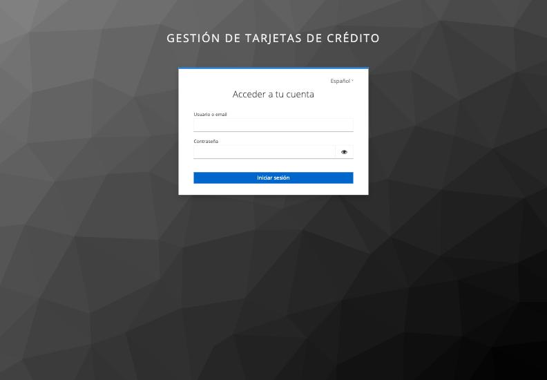

Si el usuario o la contraseña no son correctos, la pantalla lo indica y puede volver a intentarlo. Si olvidó su contraseña, solicítela al administrador del sistema.

### Cerrar sesión

1. Pulse su nombre en la esquina superior derecha.
2. Elija **Cerrar sesión**. El sistema vuelve a la pantalla de ingreso.

Cierre sesión siempre que deje el equipo. Por seguridad, si la sesión se mantiene sin uso mucho tiempo, el sistema puede pedirle que ingrese de nuevo.

---

## 3. Perfiles: qué puede hacer cada usuario

Cada usuario tiene un perfil, que se muestra debajo de su nombre en la barra superior. El sistema solo muestra los menús y botones que su perfil permite usar.

| Tarea | Administrador | Operador de atención | Cajero | Analista de crédito |
|---|:---:|:---:|:---:|:---:|
| Consultar clientes y cuentas | Sí | Sí | Sí | Sí |
| Crear y editar clientes | Sí | Sí | | |
| Eliminar clientes | Sí | | | |
| Consultar solicitudes | Sí | Sí | | Sí |
| Registrar solicitudes | Sí | Sí | | |
| Aprobar o rechazar solicitudes | Sí | | | Sí |
| Registrar consumos | Sí | Sí | | |
| Registrar pagos | Sí | | Sí | |
| Bloquear tarjetas | Sí | Sí | | |
| Desbloquear tarjetas | Sí | | | |
| Reponer y renovar tarjetas | Sí | Sí | | |
| Registrar recargos por mora | Sí | | | |
| Devolver intereses, exonerar mora y reversar comisiones | Sí | | | |
| Reversar consumos y pagos | Sí | | | |
| Cancelar cuentas | Sí | | | |
| Ver el número completo de cuenta y tarjeta | Sí | | | |

Así se separan las funciones: quien registra una solicitud (Operador) no la decide (Analista), y quien registra consumos (Operador) no registra pagos (Cajero).

Si intenta abrir una página que su perfil no permite, verá el mensaje **"No tienes permiso para ver esta página"** con el botón **Ir al inicio**. Si necesita ese acceso, solicítelo a un administrador.

---

## 4. Recorrido de la pantalla

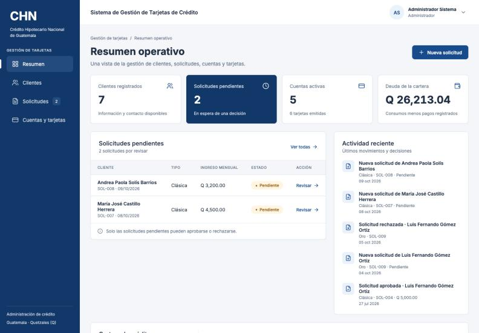

- **Barra lateral (izquierda):** menú principal con **Resumen**, **Clientes**, **Solicitudes** y **Cuentas y tarjetas**. Solo aparecen las opciones de su perfil. Junto a **Solicitudes** se muestra cuántas solicitudes están pendientes. En pantallas pequeñas la barra se abre con el botón de menú de la esquina superior izquierda.
- **Barra superior:** nombre del sistema y, a la derecha, su nombre y perfil. Al pulsar su nombre aparece **Cerrar sesión**.
- **Ruta de navegación:** sobre el título de cada página se indica dónde está (por ejemplo, *Cuentas y tarjetas / Detalle de cuenta*). Puede pulsar las partes subrayadas para volver.
- **Botón Regresar:** aparece en las páginas internas (detalle de cliente, formularios, detalle de cuenta, nueva solicitud y revisión). Lo lleva a la página anterior.
- **Menú "Más acciones":** en el detalle de una cuenta agrupa las operaciones menos frecuentes (reponer, renovar, bloquear, desbloquear, registrar cargo, exonerar mora y cancelar cuenta). Solo muestra las opciones que su perfil permite y que aplican a esa cuenta.
- **Mensajes:** al guardar algo correctamente aparece un aviso de confirmación (por ejemplo, *"Pago registrado correctamente"*). Los errores aparecen en rojo arriba del formulario o debajo del campo que hay que corregir.

---

## 5. Resumen operativo

Es la página de inicio. Muestra, según su perfil:

- **Clientes registrados**, **Solicitudes pendientes**, **Cuentas activas** (con cuántas tarjetas hay emitidas) y **Deuda de la cartera**.
- **Solicitudes pendientes:** las más recientes, con el enlace **Revisar** (si puede decidir) o **Ver detalle**. **Ver todas** abre la lista completa.
- **Actividad reciente:** últimas solicitudes registradas, aprobadas o rechazadas.
- **Cartera de crédito:** límite total, porcentaje del crédito utilizado, crédito disponible y número de **cuentas en mora**.

El botón **Nueva solicitud** (arriba a la derecha) lleva directamente al registro de una solicitud.

---

## 6. Clientes

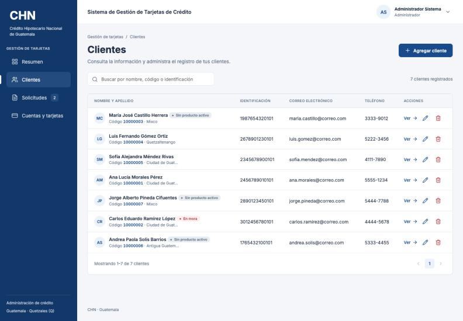

### 6.1 Buscar un cliente

1. En la barra lateral pulse **Clientes**.
2. Escriba en el buscador **Buscar por nombre, código o identificación**. La lista se filtra mientras escribe.
3. Pulse **Ver** para abrir el detalle del cliente.

En la lista, cada cliente muestra su código y su ciudad. Dos etiquetas ayudan a identificar casos especiales:

- **En mora:** el cliente tiene al menos una cuenta con pagos atrasados.
- **Sin producto activo:** el cliente no tiene ninguna cuenta activa (por ejemplo, porque canceló la única que tenía o porque aún no se le ha aprobado ninguna).

### 6.2 Crear un cliente

1. En **Clientes** pulse **Agregar cliente**.
2. Complete todos los campos: **Nombre**, **Apellido**, **Número de identificación**, **Fecha de nacimiento**, **Dirección**, **Correo electrónico** y **Teléfono**.
3. Pulse **Guardar cliente**. Verá el mensaje *"Cliente registrado correctamente"* y el sistema le asignará el código de cliente.

Para salir sin guardar pulse **Cancelar**.

El sistema revisa los datos antes de guardar y muestra el problema debajo de cada campo:

| Mensaje | Qué hacer |
|---|---|
| *El nombre es obligatorio* / *El apellido es obligatorio* | Complete el campo. |
| *Use entre 5 y 20 letras, números o guiones* | Revise el número de identificación. |
| *La fecha de nacimiento debe ser pasada* | Corrija la fecha. |
| *El cliente debe ser mayor de edad (18 años o más)* | Solo se registran clientes mayores de edad. |
| *El correo electrónico no tiene un formato válido* | Escriba un correo como `nombre@dominio.com`. |
| *El teléfono debe tener entre 8 y 20 caracteres (números, +, (), - y espacios)* | Corrija el teléfono. |
| *Ya existe un cliente con el número de identificación …* | La persona ya está registrada: búsquela en la lista en lugar de crearla de nuevo. |

### 6.3 Ver el detalle de un cliente

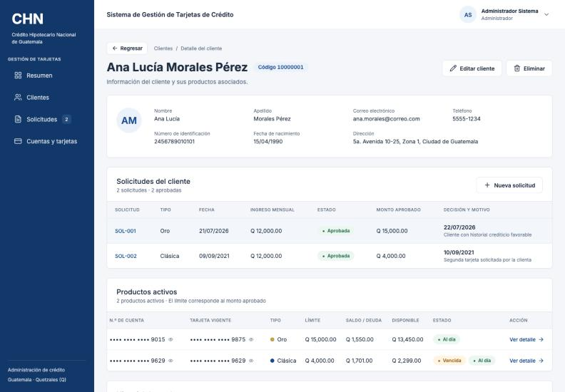

El detalle muestra:

- Los datos personales y de contacto, y el **código de cliente** junto al nombre.
- **Solicitudes del cliente:** cada solicitud con su tipo, fecha, ingreso, estado, monto aprobado y la decisión con su motivo. Desde aquí puede pulsar **Nueva solicitud** con el cliente ya seleccionado.
- **Productos activos:** las cuentas vigentes del cliente con su tarjeta, límite, deuda, disponible y estado. **Ver detalle** abre la cuenta.
- **Historial de productos:** las cuentas canceladas, con la fecha y el motivo de la cancelación.

### 6.4 Editar un cliente

1. En la lista pulse el icono del lápiz (**Editar cliente**) o, en el detalle, el botón **Editar cliente**.
2. Modifique los datos. El **Código de cliente** aparece como campo de solo lectura: lo asigna el sistema y no se puede cambiar.
3. Pulse **Guardar cliente**. Verá *"Cliente actualizado correctamente"*.

### 6.5 Eliminar un cliente

Solo se puede eliminar un cliente que **no tenga cuentas activas**.

1. En la lista pulse el icono de la papelera (**Eliminar cliente**) o, en el detalle, el botón **Eliminar**.
2. La ventana **Eliminar cliente** muestra cuántas solicitudes, cuentas y tarjetas tiene el cliente.
   - Si tiene cuentas activas, verá **"No se puede eliminar este cliente"** y el botón quedará deshabilitado. Primero hay que cancelar cada una de sus cuentas (sección 16).
   - Si no tiene cuentas activas, el aviso indica que también se eliminarán sus solicitudes, cuentas canceladas, tarjetas y movimientos.
3. Pulse **Eliminar cliente** para confirmar o **Cancelar** para salir.

**Esta acción no se puede deshacer.** Úsela solo para registros creados por error.

---

## 7. Solicitudes de tarjeta

### 7.1 Requisitos para obtener una tarjeta

El cliente debe cumplir todo lo siguiente:

1. Ser mayor de edad.
2. Tener al menos **1 año de estabilidad laboral** con su empleador actual.
3. Tener un **ingreso mensual** igual o mayor al mínimo del tipo de tarjeta (sección 1).
4. **No tener cuentas en mora.**
5. **No tener ya una cuenta activa del mismo tipo.** Si el cliente perdió o dañó su tarjeta, no se registra una solicitud nueva: se hace una **reposición** (sección 12). Si el cliente canceló antes una cuenta de ese tipo, sí puede volver a solicitarla.
6. No tener otra solicitud pendiente del mismo tipo.

### 7.2 Registrar una solicitud

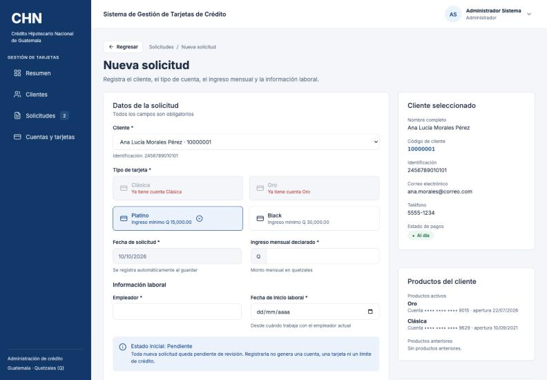

1. Pulse **Nueva solicitud** (en el Resumen, en Solicitudes o en el detalle del cliente).
2. En **Cliente** elija al cliente. A la derecha aparecen sus datos, su **Estado de pagos** y sus **Productos del cliente** (activos y anteriores).
3. Escriba el **Ingreso mensual declarado**.
4. Elija el **Tipo de tarjeta**. Los tipos que no se pueden elegir aparecen en gris con el motivo:
   - *Requiere ingreso de Q …*: el ingreso escrito no alcanza el mínimo de ese tipo.
   - *Ya tiene cuenta …*: el cliente ya tiene una cuenta activa de ese tipo.
5. En **Información laboral** escriba el **Empleador** y la **Fecha de inicio laboral**. Debajo del campo aparece la antigüedad calculada (*Antigüedad: …*).
6. Pulse **Crear solicitud**. Verá *"Solicitud registrada correctamente"*.

La **Fecha de solicitud** se registra automáticamente. Toda solicitud nueva queda en estado **Pendiente**: registrarla no abre ninguna cuenta ni emite tarjeta.

El botón **Crear solicitud** queda deshabilitado en estos casos:

| Aviso | Qué significa |
|---|---|
| **El cliente tiene cuentas en mora** | Debe ponerse al día en sus pagos antes de solicitar una nueva tarjeta. |
| *Se requiere al menos 1 año de estabilidad laboral* | La fecha de inicio laboral es de hace menos de 12 meses. |

### 7.3 Ver y filtrar solicitudes

1. En la barra lateral pulse **Solicitudes**.
2. Use las pestañas **Todas**, **Pendiente**, **Aprobada** y **Rechazada** (cada una muestra cuántas hay) y el buscador **Buscar cliente, código o solicitud**.
3. Pulse **Revisar** (solicitudes pendientes, si su perfil puede decidir) o **Ver detalle**.

Cada solicitud tiene un código como `SOL-007`.

### 7.4 Aprobar una solicitud

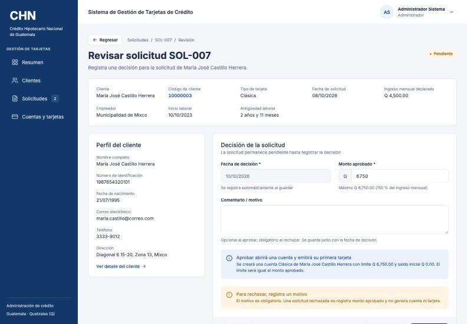

1. Abra la solicitud con **Revisar**.
2. Revise los datos: tipo, ingreso, **Empleador**, **Inicio laboral** y **Antigüedad laboral**, y el **Perfil del cliente**.
3. En **Monto aprobado** el sistema propone el máximo permitido: el **150 % del ingreso mensual** (por ejemplo, con un ingreso de Q 4,500.00 el máximo es Q 6,750.00). Puede aprobar un monto menor. Si escribe más, verá *"Supera el máximo de … por …"*.
4. Si lo desea, escriba un **Comentario / motivo** (es opcional al aprobar).
5. Pulse **Aprobar**. Verá *"Solicitud aprobada: cuenta abierta y tarjeta emitida"*.

Al aprobar, el sistema abre la **cuenta de crédito** con límite igual al monto aprobado y deuda Q 0.00, y emite su **primera tarjeta**. La solicitud muestra entonces el número de cuenta y de tarjeta y el enlace **Ver detalle de la cuenta**.

El botón **Aprobar** queda deshabilitado, con un aviso rojo, si:

- **No se puede aprobar: estabilidad laboral insuficiente** (menos de 1 año).
- **No se puede aprobar: el cliente ya tiene una cuenta de este tipo.**
- **No se puede aprobar: el cliente tiene cuentas en mora.**

En esos casos la solicitud solo se puede rechazar.

### 7.5 Rechazar una solicitud

1. Abra la solicitud con **Revisar**.
2. Escriba el motivo en **Comentario / motivo**. **Es obligatorio** al rechazar; sin él verá *"Indique el motivo del rechazo"*.
3. Pulse **Rechazar**. Verá *"Solicitud rechazada"*.

Una solicitud rechazada no genera cuenta ni tarjeta. Las decisiones quedan registradas con su fecha y no se pueden cambiar.

---

## 8. Cuentas y tarjetas

### 8.1 Lista de cuentas

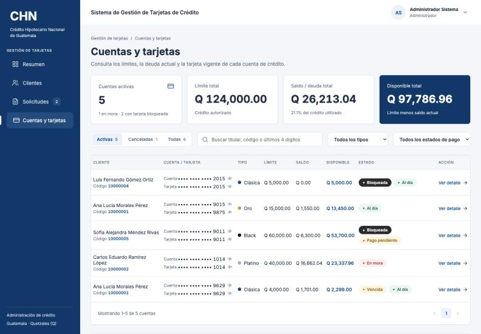

1. En la barra lateral pulse **Cuentas y tarjetas**.
2. Arriba verá los totales de la cartera: **Cuentas activas**, **Límite total**, **Saldo / deuda total** y **Disponible total**.
3. Use las pestañas **Activas** (se muestra al entrar), **Canceladas** y **Todas**.
4. Busque con **Buscar titular, código o últimos 4 dígitos** y filtre por tipo (**Todos los tipos**) o por estado (**Todos los estados de pago**: *Al día*, *Pago pendiente*, *En mora* o *Tarjeta bloqueada*).
5. Pulse **Ver detalle** para abrir una cuenta.

Etiquetas de estado:

| Etiqueta | Significado |
|---|---|
| **Al día** | La cuenta no tiene pagos atrasados. |
| **Pago pendiente** | Falta el pago mínimo del mes, pero todavía no vence (hasta el día 25). |
| **En mora** | No se cubrió el pago mínimo antes del día 25. |
| **Bloqueada** | La tarjeta vigente está bloqueada. |
| **Vencida** | La tarjeta vigente pasó su fecha de vencimiento. |
| **Cancelada** | La cuenta fue cancelada. |

### 8.2 Detalle de la cuenta

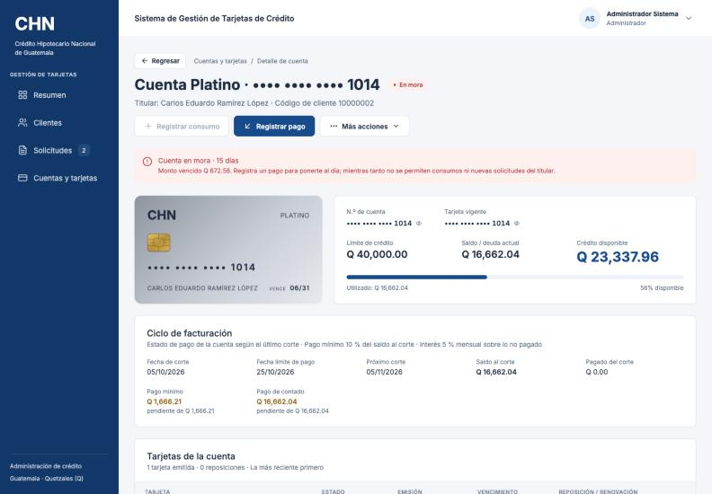

El detalle de la cuenta muestra:

- **Encabezado:** tipo y número de cuenta, titular y código de cliente, con los botones **Registrar consumo**, **Registrar pago** y **Más acciones** (según su perfil).
- **Avisos:** cuenta en mora (con el monto vencido y los días de atraso), tarjeta bloqueada, tarjeta vencida o cuenta cancelada.
- **Tarjeta:** dibujo de la tarjeta vigente con su color según el tipo (Clásica azul, Oro dorado, Platino plateado, Black negro), su número, titular y vencimiento. Si está bloqueada aparece en gris con la palabra *BLOQUEADA*.
- **N.º de cuenta** y **Tarjeta vigente:** pueden ser distintos si la tarjeta se repuso o renovó.
- **Límite de crédito**, **Saldo / deuda actual** y **Crédito disponible**, con una barra de uso. Si los intereses o recargos llevaron la deuda por encima del límite, aparece el aviso *Sobregiro por cargos*.
- **Ciclo de facturación:** se explica en la sección 10.
- **Tarjetas de la cuenta:** todas las tarjetas que ha tenido la cuenta, la más reciente primero, con su estado (*Activa*, *Bloqueada*, *Reemplazada* o *Cancelada*), emisión, vencimiento y, si se repuso o renovó, el motivo, la fecha y los requisitos presentados.
- **Historial de movimientos:** consumos, pagos y cargos, del más reciente al más antiguo.

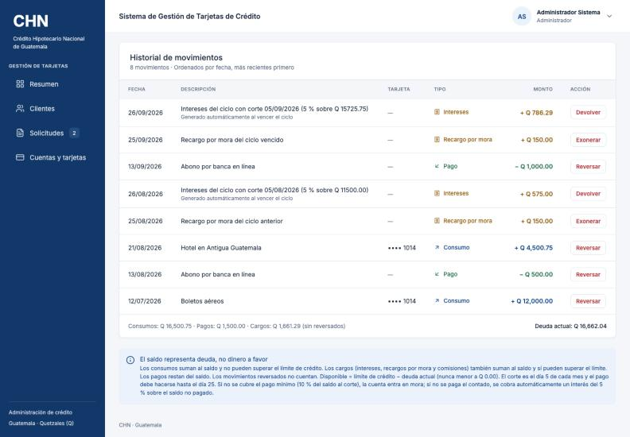

En el historial, cada movimiento indica su tipo (*Consumo*, *Pago*, *Intereses*, *Recargo por mora* o *Comisión por reposición*). Los intereses dicen *"Generado automáticamente al vencer el ciclo"*. Los movimientos reversados aparecen tachados, con su estado (*Reversado*, *Devuelto* o *Exonerado*) y el motivo, y ya no cuentan en la deuda. Al pie se muestran los totales y la **Deuda actual**.

### 8.3 Ver el número completo

Los números de cuenta y de tarjeta se muestran ocultos. Si su perfil lo permite (Administrador), junto a cada número aparece un **ojo** (**Mostrar número**):

1. Pulse el ojo: el número completo aparece en grupos de 4 dígitos.
2. Pulse de nuevo (**Ocultar número**) para ocultarlo. También se oculta al salir de la página.

Si no ve el ojo, su perfil no tiene acceso a los números completos.

---

## 9. Registrar consumos y pagos

### 9.1 Registrar un consumo

1. En el detalle de la cuenta pulse **Registrar consumo**.
2. La ventana muestra la cuenta, la tarjeta vigente, el **Límite de crédito**, la **Deuda actual** y el **Disponible**.
3. Escriba el **Monto del consumo** y la **Descripción** (por ejemplo, el comercio). La **Fecha y hora** es opcional: si la deja vacía se usa la actual; no puede ser futura.
4. Pulse **Registrar consumo**. Verá *"Consumo registrado correctamente"*.

El consumo se hace siempre con la tarjeta vigente y no puede superar el crédito disponible. El botón **Registrar consumo** aparece deshabilitado (al pasar el cursor se ve el motivo) cuando:

| Aviso | Qué hacer |
|---|---|
| *La tarjeta vigente está bloqueada: no se permiten consumos* | Desbloquear (si el motivo lo permite) o reponer la tarjeta. |
| *La tarjeta venció el …: renuévela para registrar consumos* | Renovar la tarjeta (sección 13). |
| *La cuenta está en mora: registra un pago para ponerte al día antes de realizar consumos* | Registrar un pago que cubra la mora. |
| **No se puede registrar este consumo** (la deuda excedería el límite) | Registrar un monto menor o igual al disponible. |

### 9.2 Registrar un pago

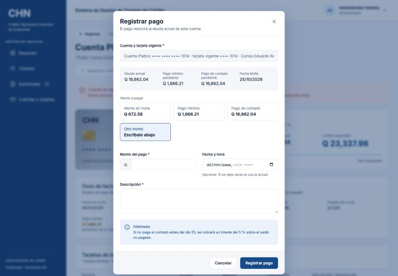

1. En el detalle de la cuenta pulse **Registrar pago**.
2. La ventana muestra la **Deuda actual**, el **Pago mínimo pendiente**, el **Pago de contado pendiente** y la **Fecha límite**.
3. En **Monto a pagar** elija una opción, que llena el monto automáticamente:
   - **Monto en mora** (solo si la cuenta está en mora): lo necesario para salir de la mora.
   - **Pago mínimo:** lo que falta del pago mínimo del mes.
   - **Pago de contado:** lo que falta para pagar todo el saldo del corte y no generar intereses.
   - **Otro monto:** escriba el monto en **Monto del pago**.
4. Escriba la **Descripción** (por ejemplo, *Pago en agencia*). La fecha es opcional.
5. Revise los avisos y pulse **Registrar pago**. Verá *"Pago registrado correctamente"*.

Avisos de la ventana:

- **Saldo después de registrar este pago:** cómo quedarán la deuda y el disponible. Si la cuenta está en mora indica si el pago la pone al día o cuánto falta.
- **El pago no cubre el pago mínimo** (amarillo): el pago es menor que el mínimo; si no se completa antes de la fecha límite, la cuenta entrará en mora. El pago se puede registrar igual.
- **Intereses:** si no se paga el contado antes del día 25, se cobrará un interés del 5 % sobre lo no pagado.

Los pagos se aceptan aunque la tarjeta esté bloqueada o vencida, o la cuenta esté en mora. No se puede pagar más que la deuda actual (*"Supera la deuda actual por …"*) ni pagar una cuenta sin deuda (*"La cuenta no tiene saldo pendiente de pago"*).

---

## 10. Pago mínimo, intereses y mora

Cada cuenta tiene un ciclo mensual:

- **Fecha de corte:** día **5** de cada mes. Lo que el cliente debe ese día es el **saldo al corte**.
- **Fecha límite de pago:** día **25** del mismo mes.
- **Pago mínimo:** el **10 %** del saldo al corte.
- **Pago de contado:** el saldo al corte completo.

Qué ocurre según lo que pague el cliente antes del día 25:

| Pago antes del día 25 | Resultado |
|---|---|
| El pago de contado completo | Queda **al día** y **no paga intereses**. |
| Al menos el pago mínimo, pero no el contado | Queda **al día**, pero el día 26 se le cobra un **interés del 5 %** sobre lo que no pagó. |
| Menos del pago mínimo (o nada) | Queda **en mora** desde el día 26 y además se le cobra el interés del 5 % sobre lo que no pagó. |

**Ejemplo.** El 5 de octubre el saldo al corte es **Q 2,000.00**. El pago mínimo es Q 200.00 y el de contado Q 2,000.00, con fecha límite el 25 de octubre.

- Si paga **Q 2,000.00** el 20 de octubre: queda al día y sin intereses.
- Si paga **Q 200.00** el 20 de octubre: queda al día. El 26 de octubre se cobra un interés de 5 % sobre los Q 1,800.00 no pagados: **Q 90.00**.
- Si paga **Q 150.00** el 20 de octubre: le faltaron Q 50.00 para el mínimo, así que desde el 26 de octubre está **en mora por Q 50.00**, y se cobra un interés de 5 % sobre Q 1,850.00: **Q 92.50**.

El panel **Ciclo de facturación** del detalle de la cuenta muestra la **Fecha de corte**, la **Fecha límite de pago**, el **Próximo corte**, el **Saldo al corte**, lo **Pagado del corte**, el **Pago mínimo** y el **Pago de contado** con lo que falta de cada uno.

Los intereses los calcula y registra el **sistema automáticamente**; nadie los registra a mano. Aparecen en el historial como *Intereses* con la descripción del ciclo.

Mientras una cuenta está **en mora**:

- No acepta consumos (sí pagos).
- El titular no puede solicitar ni recibir nuevas tarjetas.
- La cuenta no se puede cancelar.

Para salir de la mora basta con pagar lo que falta del pago mínimo vencido (opción **Monto en mora** en la ventana de pago).

---

## 11. Bloquear y desbloquear una tarjeta

### 11.1 Bloquear

1. En el detalle de la cuenta pulse **Más acciones** → **Bloquear tarjeta**.
2. Elija el **Motivo del bloqueo**: *Robo*, *Extravío*, *Sospecha de fraude* o *Solicitud del cliente*.
3. Si lo desea, escriba un **Comentario** (máximo 250 caracteres).
4. Pulse **Bloquear tarjeta**. Verá *"Tarjeta bloqueada correctamente"*.

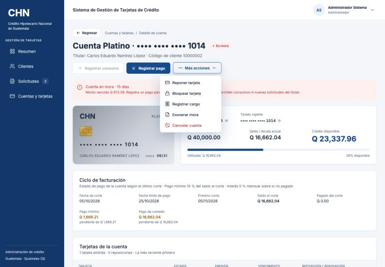

Una tarjeta bloqueada **no acepta consumos, pero sí pagos**.

**Importante:** si el motivo es *Robo*, *Extravío* o *Sospecha de fraude*, el bloqueo es **definitivo** (la ventana lo advierte con el aviso **Bloqueo definitivo**): la tarjeta no podrá desbloquearse y la única opción será reponerla. Solo el bloqueo por *Solicitud del cliente* es temporal.

### 11.2 Desbloquear

Solo para tarjetas bloqueadas por **Solicitud del cliente** y solo con perfil Administrador.

1. En el detalle de la cuenta pulse **Más acciones** → **Desbloquear tarjeta**.
2. Confirme con **Desbloquear tarjeta**. Verá *"Tarjeta desbloqueada correctamente"*.

Si la tarjeta está bloqueada por otro motivo, la opción no aparece y el aviso de la cuenta dice: *"Esta tarjeta no puede desbloquearse. La única opción es generar una reposición"*, con el botón **Generar reposición**.

---

## 12. Reponer una tarjeta

La reposición emite una **tarjeta nueva en la misma cuenta** cuando el plástico se roba, se pierde, se daña o hay sospecha de fraude. La deuda, el límite, el ciclo y el historial se conservan; cambia el número de la tarjeta. La mora no impide reponer.

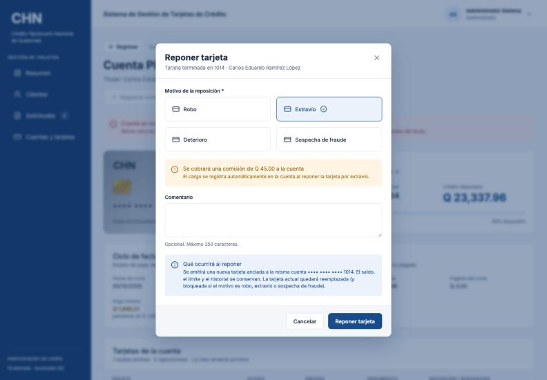

1. En el detalle de la cuenta pulse **Más acciones** → **Reponer tarjeta** (o **Generar reposición** en el aviso de bloqueo).
2. Elija el **Motivo de la reposición** y cumpla su requisito:

| Motivo | Requisito | Costo |
|---|---|---|
| Robo | Marcar la casilla **El cliente presentó la denuncia del robo** | Sin costo |
| Extravío | Ninguno | **Comisión de Q 45.00** que se carga a la cuenta |
| Deterioro | Marcar la casilla **El cliente presentó la tarjeta deteriorada** | Sin costo |
| Sospecha de fraude | Ninguno | Sin costo |

3. Si lo desea, escriba un **Comentario**.
4. Pulse **Reponer tarjeta**. Verá *"Tarjeta repuesta correctamente. La nueva tarjeta termina en …"*.

Mientras falte marcar la casilla del requisito, el botón **Reponer tarjeta** queda deshabilitado. Si el motivo es extravío, la ventana avisa **"Se cobrará una comisión de Q 45.00 a la cuenta"** y la comisión aparece en el historial como *Comisión por reposición*.

La tarjeta anterior queda como **Reemplazada** en *Tarjetas de la cuenta* (y bloqueada si el motivo fue robo, extravío o sospecha de fraude).

---

## 13. Renovar una tarjeta vencida

Cuando la tarjeta vigente pasa su fecha de vencimiento, la cuenta muestra la etiqueta **Vencida** y el aviso **Tarjeta vencida**: *"La tarjeta venció el … Renuévela para seguir registrando consumos"*. Una tarjeta vencida no acepta consumos (sí pagos).

1. Pulse **Renovar tarjeta** en el aviso o en **Más acciones**.
2. La ventana indica: *"Se emitirá una nueva tarjeta sin costo en la misma cuenta … El saldo, el límite y el historial se conservan."*
3. Pulse **Renovar tarjeta**. Verá *"Tarjeta renovada correctamente. La nueva tarjeta termina en …"*.

La renovación **no tiene costo**. La tarjeta nueva vence en 5 años y la anterior queda como *Reemplazada* con el motivo *Renovación por vencimiento*. Si la tarjeta vencida además está bloqueada, primero hay que desbloquearla o reponerla.

---

## 14. Reversar movimientos

Un reverso corrige un consumo o un pago registrado por error (por ejemplo, un cargo duplicado). Solo lo puede hacer un Administrador. **El movimiento no se borra:** queda tachado, con el motivo, la fecha y el usuario, y deja de contar en la deuda, el pago mínimo, la mora y los intereses.

1. En el **Historial de movimientos** pulse **Reversar** en la fila del consumo o del pago.
2. La ventana muestra el movimiento y el **Efecto en el saldo** (*"El saldo pasará de … a …"*).
3. Escriba el **Motivo** (obligatorio, entre 5 y 250 caracteres).
4. Pulse **Reversar consumo** o **Reversar pago**. Verá *"Consumo reversado correctamente"* o *"Pago reversado correctamente"*.

No se puede reversar si el resultado no es posible:

- *"No se puede reversar el consumo: el saldo quedaría en … Reverse primero el pago que lo cubrió"*: el consumo ya se pagó; primero hay que reversar ese pago.
- *"No se puede reversar el pago: el saldo de … superaría el límite de crédito de …"*.
- Un movimiento ya reversado no se puede reversar de nuevo.

---

## 15. Recargos por mora, devolución de intereses y exoneración de mora

Además de consumos y pagos, la cuenta puede tener **cargos**: intereses (automáticos), recargos por mora y comisiones por reposición. Los cargos suman a la deuda y, a diferencia de los consumos, pueden dejarla por encima del límite. Estas operaciones son solo para el perfil Administrador.

### 15.1 Registrar un recargo por mora

1. En el detalle de la cuenta pulse **Más acciones** → **Registrar cargo**.
2. En **Tipo de cargo** elija *Recargo por mora* (es el único que se registra a mano; los intereses y las comisiones los genera el sistema).
3. Escriba el **Monto** y la **Descripción**. La fecha es opcional.
4. Pulse **Registrar cargo**. Verá *"Cargo registrado correctamente"*.

Si el cargo deja la deuda por encima del límite, la ventana lo advierte con **"El cargo dejará la cuenta en sobregiro"**.

### 15.2 Devolver intereses

1. En el **Historial de movimientos**, en la fila de *Intereses*, pulse **Devolver**.
2. Escriba el motivo (entre 5 y 250 caracteres) y pulse **Devolver intereses**.
3. Verá *"Intereses devueltos correctamente"*. El cargo queda como **Devuelto** y la deuda baja. El sistema no vuelve a cobrar el interés de ese mes.

### 15.3 Exonerar recargos por mora

- **Un recargo:** en la fila del *Recargo por mora* pulse **Exonerar**, escriba el motivo y pulse **Exonerar recargo**. Verá *"Recargo por mora exonerado correctamente"*.
- **Todos los recargos de la cuenta:** pulse **Más acciones** → **Exonerar mora** (la opción aparece solo si hay recargos pendientes), escriba el **Motivo de la exoneración** y pulse **Exonerar mora**. Verá, por ejemplo, *"Se exoneraron 2 recargos por Q 300.00"*.

**La exoneración no paga la deuda:** quita los recargos, pero si el cliente no ha cubierto el pago mínimo vencido, la cuenta **sigue en mora** hasta que pague.

### 15.4 Reversar una comisión por reposición

En la fila de *Comisión por reposición* pulse **Reversar**, escriba el motivo y pulse **Reversar comisión**. Verá *"Comisión revertida correctamente"*.

---

## 16. Cancelar una cuenta

Solo el perfil Administrador puede cancelar cuentas. Requisitos:

- La cuenta debe estar **al día** en sus pagos.
- La deuda debe ser **Q 0.00**.

Se puede cancelar aunque la tarjeta esté bloqueada.

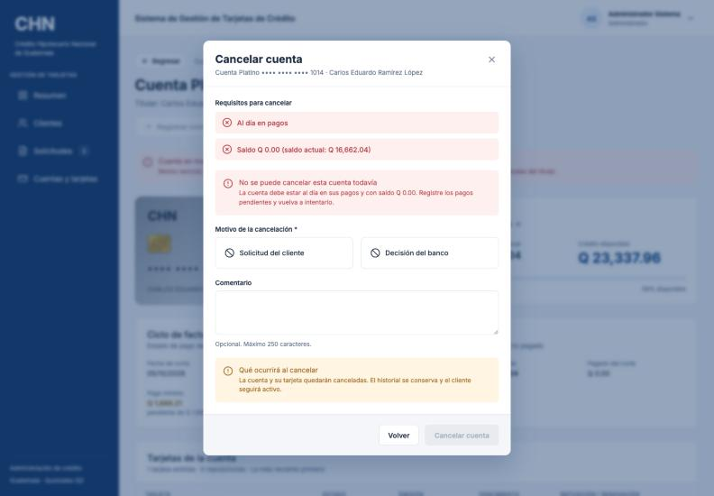

1. En el detalle de la cuenta pulse **Más acciones** → **Cancelar cuenta**.
2. Revise **Requisitos para cancelar**: cada requisito aparece con una marca verde si se cumple o una x roja si no. Si alguno no se cumple verá **"No se puede cancelar esta cuenta todavía"** y el botón quedará deshabilitado.
3. Elija el **Motivo de la cancelación**: *Solicitud del cliente* o *Decisión del banco*. Si lo desea, escriba un **Comentario**.
4. Pulse **Cancelar cuenta** (o **Volver** para salir sin cancelar). Verá *"Cuenta cancelada correctamente"*.

Al cancelar, la cuenta y su tarjeta quedan **Canceladas**. **No se borra nada:** el historial de tarjetas y movimientos sigue visible, la cuenta muestra el aviso **Cuenta cancelada** con el motivo, la fecha y el usuario, y ya no admite operaciones. El cliente sigue registrado; si no le quedan otras cuentas aparecerá como **Sin producto activo**, y puede volver a solicitar el mismo tipo de tarjeta (recibirá una cuenta con número nuevo).

---

## 17. Preguntas frecuentes y mensajes comunes

**No veo un menú o un botón que usa un compañero.**
Su perfil no tiene ese permiso (sección 3). Si lo necesita para su trabajo, solicítelo a un administrador.

**Veo "No tienes permiso para ver esta página".**
La página no corresponde a su perfil. Pulse **Ir al inicio**.

**El cliente perdió su tarjeta y quiere una nueva. ¿Registro una solicitud?**
No. Se hace una **reposición** (sección 12): la tarjeta nueva queda en la misma cuenta. Una solicitud del mismo tipo sería rechazada porque el cliente ya tiene esa cuenta.

**No puedo registrar un consumo.**
Revise el motivo al pasar el cursor sobre **Registrar consumo**: tarjeta bloqueada, tarjeta vencida, cuenta en mora o falta de crédito disponible (sección 9.1).

**El cliente pagó el mínimo. ¿Por qué tiene intereses?**
El pago mínimo evita la mora, pero no los intereses. Solo el pago de contado completo antes del día 25 evita el interés del 5 % (sección 10).

**Exoneré la mora y la cuenta sigue en mora.**
Es correcto: la exoneración quita los recargos, pero no paga la deuda. El cliente debe cubrir el monto en mora.

**No puedo desbloquear una tarjeta.**
Solo se desbloquean las tarjetas bloqueadas por *Solicitud del cliente*. Las bloqueadas por robo, extravío o sospecha de fraude se reponen.

**No puedo eliminar un cliente.**
Tiene cuentas activas. Primero hay que cancelarlas (requieren estar al día y con deuda Q 0.00).

**No puedo cancelar una cuenta.**
La cuenta no está al día o tiene deuda. Registre los pagos pendientes y vuelva a intentarlo.

**¿Por qué el número de la tarjeta es distinto del número de cuenta?**
La tarjeta se repuso o se renovó. La cuenta conserva su número original y la tarjeta nueva tiene otro.

Otros mensajes que puede recibir:

| Mensaje | Qué significa / qué hacer |
|---|---|
| *El cliente ya tiene una solicitud pendiente de tarjeta …* | Ya hay una solicitud pendiente del mismo tipo; revise la existente. |
| *El ingreso de … no alcanza el mínimo de … para la tarjeta …* | Elija un tipo de tarjeta acorde al ingreso. |
| *El monto aprobado supera el máximo permitido* | Apruebe como máximo el 150 % del ingreso mensual. |
| *La cuenta no tiene saldo pendiente de pago* | La deuda es Q 0.00; no hay nada que pagar. |
| *Para reponer por robo el cliente debe presentar la denuncia del robo* | Solicite la denuncia y marque la casilla correspondiente. |
| *Para reponer por deterioro el cliente debe presentar la tarjeta deteriorada* | Reciba la tarjeta dañada y marque la casilla correspondiente. |
| *La tarjeta vence el …; solo puede renovarse cuando haya vencido* | La tarjeta todavía es válida; no necesita renovación. |
| *La cuenta está cancelada* | Una cuenta cancelada no admite operaciones. |
| *No tiene permisos para realizar esta operación* | Su perfil no permite esa acción. |
| La sesión vuelve a la pantalla de ingreso | La sesión terminó; ingrese de nuevo con su usuario. |
