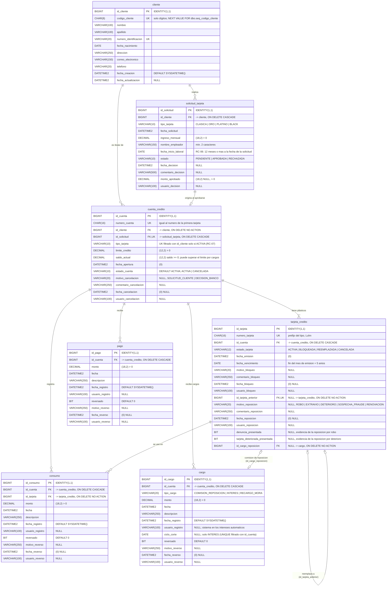

# Diagrama Entidad-Relación — GestionTarjetasCredito

Base de datos SQL Server `GestionTarjetasCredito` (collation `Modern_Spanish_CI_AS`, esquema `dbo`).
Scripts: `database/02_crear_esquema.sql` (estructura) y `database/03_datos_semilla.sql` (datos demo).
Reglas de negocio: [REGLAS_CREDITO.md](REGLAS_CREDITO.md), Parte 2 (secciones 9 a 15), Parte 3 (sección 16, código de cliente), Parte 4 (secciones 21 a 27: cargos, renovación y cancelación) y Parte 5 (secciones 28 a 32: pago mínimo e interés automático).

> El crédito (límite, saldo, ciclo, mora y movimientos) vive en **`cuenta_credito`**. La **`tarjeta_credito`** es solo el plástico anclado a una cuenta; una reposición o renovación crea un plástico nuevo en la misma cuenta y deja el anterior como `REEMPLAZADA`. Los **cargos** (comisión, intereses y recargos por mora) suman al saldo y pueden sobregirar el límite; una cuenta **cancelada** conserva todo su historial.



## Secuencia del código de cliente

`dbo.seq_codigo_cliente` (`BIGINT`, `START WITH 10000001 INCREMENT BY 1`) no es una tabla y por eso no aparece en el diagrama. El backend toma el siguiente valor con `SELECT NEXT VALUE FOR dbo.seq_codigo_cliente` antes de insertar un cliente y lo guarda en `cliente.codigo_cliente`; el código no se edita después. La semilla reinicia la secuencia en 10000001, asigna 10000001 a 10000007 a sus siete clientes (Jorge es el 10000007) y la secuencia continúa en 10000008. El usuario de la aplicación solo tiene `db_datareader` y `db_datawriter`, por lo que el esquema le concede `UPDATE` sobre la secuencia (requisito de `NEXT VALUE FOR`).

## Relaciones y cardinalidades

| Relación | Cardinalidad | Clave foránea | Acción al eliminar |
|---|---|---|---|
| cliente → solicitud_tarjeta | 1 a N | `fk_solicitud_tarjeta_cliente` | CASCADE |
| cliente → cuenta_credito | 1 a N (máximo una **activa** por tipo: `ux_cuenta_credito_cliente_tipo_activa`) | `fk_cuenta_credito_cliente` | NO ACTION |
| solicitud_tarjeta → cuenta_credito | 1 a 0..1 (UNIQUE en `id_solicitud`) | `fk_cuenta_credito_solicitud` | CASCADE |
| cuenta_credito → tarjeta_credito | 1 a N (exactamente una vigente) | `fk_tarjeta_credito_cuenta` | CASCADE |
| tarjeta_credito → tarjeta_credito | 0..1 a 0..1 (`id_tarjeta_anterior`, UNIQUE filtrado) | `fk_tarjeta_credito_anterior` | NO ACTION |
| cuenta_credito → consumo | 1 a N | `fk_consumo_cuenta_credito` | CASCADE |
| tarjeta_credito → consumo | 1 a N (con qué tarjeta se hizo) | `fk_consumo_tarjeta_credito` | NO ACTION |
| cuenta_credito → pago | 1 a N | `fk_pago_cuenta_credito` | CASCADE |
| cuenta_credito → cargo | 1 a N | `fk_cargo_cuenta_credito` | CASCADE |
| tarjeta_credito → cargo | N a 0..1 (comisión de la reposición por extravío) | `fk_tarjeta_credito_cargo_reposicion` | NO ACTION |

- Un **cliente** tiene varias solicitudes y, como máximo, una **cuenta activa** por tipo de tarjeta. Una categoría nueva significa siempre una cuenta y una tarjeta nuevas; una cuenta cancelada no cuenta, por lo que el cliente puede pedir de nuevo ese tipo y recibe un número de cuenta nuevo.
- Cada **solicitud** aprobada origina exactamente una **cuenta** y su primera tarjeta. El número de cuenta (16 dígitos) es el de esa primera tarjeta y no cambia con las reposiciones.
- Cada **cuenta** tiene exactamente **una tarjeta vigente** (`ACTIVA` o `BLOQUEADA`) y, en su historial, las `REEMPLAZADA`. Lo garantiza el índice único filtrado `ux_tarjeta_credito_vigente_por_cuenta` (`UNIQUE (id_cuenta) WHERE estado_tarjeta <> 'REEMPLAZADA'`); en una cuenta cancelada la vigente queda `CANCELADA`.
- Una **reposición** deja la tarjeta anterior `REEMPLAZADA` (conserva su bloqueo como historial) y crea una nueva `ACTIVA` en la misma cuenta con `id_tarjeta_anterior`. `ux_tarjeta_credito_anterior` impide reemplazar dos veces la misma tarjeta.
- Una **renovación** por vencimiento deja la vieja `REEMPLAZADA` con `motivo_reposicion = RENOVACION` y emite una tarjeta nueva sin costo. Una reposición por robo o deterioro guarda su evidencia (`denuncia_presentada`, `tarjeta_deteriorada_presentada`); la de extravío enlaza el cargo de la comisión en `id_cargo_reposicion`.
- Los **consumos**, **pagos** y **cargos** pertenecen a la cuenta; el consumo además guarda la tarjeta usada. Consumos y cargos suman al saldo y los pagos lo reducen. El saldo nunca es negativo (`ck_cuenta_credito_saldo_actual`), pero **puede superar el límite** por cargos (sobregiro): el límite de los consumos se valida en el servicio y el crédito disponible es `max(0, límite - saldo)`.
- Los **intereses** los genera el sistema al vencer cada ciclo (`ciclo_corte`, usuario `sistema`). El índice único filtrado `ux_cargo_interes_por_ciclo` (`UNIQUE (id_cuenta, ciclo_corte) WHERE tipo_cargo = 'INTERES'`) permite un solo interés por ciclo, aunque esté reversado, de modo que una devolución no lo vuelve a generar.
- Una cuenta **cancelada** (`estado_cuenta = 'CANCELADA'`) no se borra: conserva tarjetas, movimientos y cargos con su motivo, fecha y usuario de cancelación (`ck_cuenta_credito_coherencia_cancelacion`).
- Un movimiento **reversado** (`reversado = 1`) no se borra: conserva motivo, fecha y usuario, y deja de contar en el saldo, el saldo al corte, la mora y los totales (`ck_consumo_coherencia_reverso`, `ck_pago_coherencia_reverso`, `ck_cargo_coherencia_reverso`).

## Reglas de integridad principales

- `uq_cliente_codigo_cliente` (con `ck_cliente_codigo_cliente`, solo dígitos), `uq_cliente_numero_identificacion`, `uq_cuenta_credito_numero_cuenta` y `uq_tarjeta_credito_numero_tarjeta`: números únicos; los números de cuenta y de tarjeta son `CHAR(16)` con solo dígitos y el código de cliente es `CHAR(8)`.
- `ux_cuenta_credito_cliente_tipo_activa`: respaldo en base de datos de la regla RC-07 (solo cuentas activas).
- `ck_cuenta_credito_estado_cuenta`, `ck_cuenta_credito_motivo_cancelacion` y `ck_cuenta_credito_coherencia_cancelacion`: ACTIVA sin datos de cancelación; CANCELADA con motivo y fecha.
- `ck_cargo_tipo_cargo`, `ck_cargo_monto` y `ck_cargo_ciclo_corte`: tres tipos de cargo, monto mayor que cero y `ciclo_corte` solo en los intereses.
- `ck_solicitud_tarjeta_coherencia_decision`: PENDIENTE no tiene decisión; APROBADA tiene fecha y monto aprobado; RECHAZADA tiene fecha y comentario, sin monto.
- `ck_tarjeta_credito_coherencia_bloqueo`: ACTIVA sin motivo de bloqueo; BLOQUEADA con motivo y fecha; REEMPLAZADA y CANCELADA conservan el bloqueo previo como historial.
- `ck_tarjeta_credito_coherencia_reposicion`: solo una tarjeta REEMPLAZADA tiene motivo y fecha de reposición.
- Montos (`ingreso_mensual`, `monto_aprobado`, `limite_credito`, `monto` de consumo, pago y cargo) siempre mayores que cero.

## Estrategia de cascada

SQL Server no permite **varios caminos de cascada** hacia una misma tabla. Si `cuenta_credito` tuviera `ON DELETE CASCADE` tanto hacia `cliente` como hacia `solicitud_tarjeta` (que ya cae en cascada desde `cliente`), habría dos caminos y el `CREATE TABLE` fallaría. Por eso las dos claves foráneas que cerrarían un segundo camino son `NO ACTION`:

```
cliente ──CASCADE──> solicitud_tarjeta ──CASCADE──> cuenta_credito ──CASCADE──> tarjeta_credito
   │                                                      ▲    │
   └─────────────────── NO ACTION ───────────────────────┘    ├──CASCADE──> consumo ──NO ACTION──> tarjeta_credito
                                                              ├──CASCADE──> pago
                                                              └──CASCADE──> cargo <──NO ACTION── tarjeta_credito.id_cargo_reposicion
tarjeta_credito.id_tarjeta_anterior ──NO ACTION──> tarjeta_credito
```

- Existe **un solo camino** de cascada desde `cliente`: cliente → solicitud_tarjeta → cuenta_credito → tarjeta_credito / consumo / pago / cargo.
- `cuenta_credito.id_cliente` se conserva (NO ACTION) para consultar las cuentas de un cliente y garantizar la integridad.
- `consumo.id_tarjeta` (NO ACTION) abriría un segundo camino cuenta → consumo (vía tarjeta); `tarjeta_credito.id_tarjeta_anterior` es una FK a la misma tabla, que SQL Server solo admite como NO ACTION.
- `tarjeta_credito.id_cargo_reposicion` (NO ACTION) enlaza la tarjeta reemplazada por extravío con su comisión; no abre otro camino de cascada.
- Al borrar una cuenta, SQL Server evalúa estas FK `NO ACTION` al final de la sentencia, cuando la cascada ya eliminó todos los consumos y tarjetas implicados, por lo que no impiden el borrado. Se verificó contra la base de datos real eliminando clientes con varias cuentas, reposiciones con comisión, cuentas canceladas, cargos y movimientos reversados.
- Aun así, el backend elimina un cliente en una sola transacción y en orden explícito, sin depender del orden interno de SQL Server: primero las cuentas del cliente (la base de datos borra en cascada tarjetas, consumos, pagos y cargos) y después el cliente (la base de datos borra en cascada sus solicitudes).
